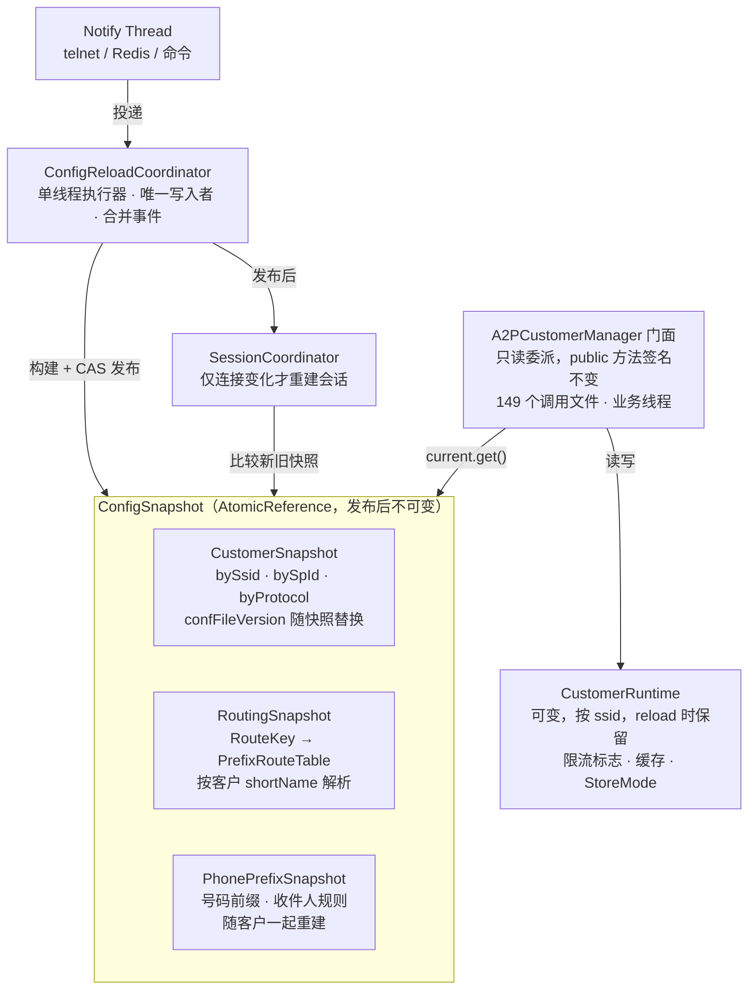
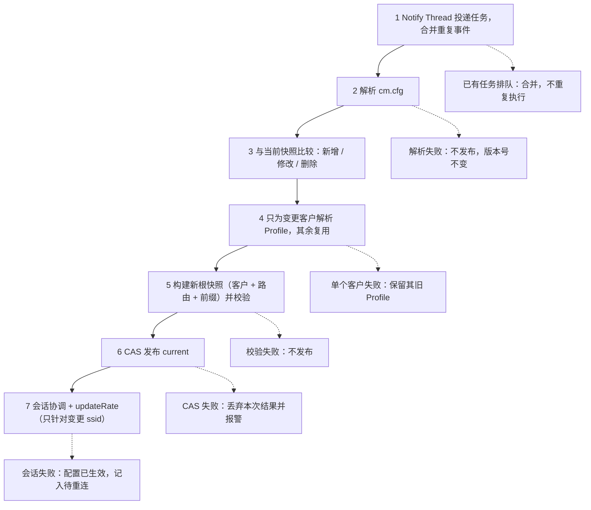

# A2P 客户配置模块重构设计

2026-10-26

## 背景与目标

本设计把客户配置改为「不可变快照 + 单一写入者」：reload 只重新解析变更的客户，失败时线上快照不动，旧客户递送不受影响。

**触发事件**：2026-10-22 12:45:32，线上两个 Notify Thread 并发执行 cm.cfg reload（线上版本 `OnEvent` 无锁）。两个线程共享成员变量 `confBlockMap2Reload` / `confBlockMap2Remove`，同时增删 `corePriority_ssid_list`，导致：

- `initCorePrioritySSIDList` 打日志时 log4j 遍历列表抛 `ConcurrentModificationException`，`initCustomerInfo` 中途退出，后续 `initProtocolSSIDMap`、`initRecipientLen`、`initSsidtoPhonePrefix` 等未执行。
- `CorePrioritrySender` 遍历同一列表抛 CME。
- HKCMIJXHQITTC 的 shortName 映射被另一线程清除；md5 已更新，再次 reload 无法修复。

**硬性要求**

1. reload 只影响有变更的客户，其他客户的数据与连接不被触碰。
2. reload 任何环节失败，线上仍按旧配置递送，并可在下次 reload 自动重试。

**约束**：目标 JDK 17（2026-10-26 确定；事故时线上运行的是 1.7.0_201 的旧包），可以使用 lambda、record、`Map` 默认方法；`A2PCustomerManager` 有 149 个调用文件，对外接口需保持兼容。

## 现状诊断

根本问题是同一份客户数据分散在 30 多个可变全局集合里，reload 靠「先逐个 clear、再逐个 init」原地修改，且有多个写入者。

**结构**

| 类 | 规模 | 主要问题 |
| --- | --- | --- |
| `A2PCustomerInfo` | 221 字段 / 427 方法；`assignValue` 1120 行 | 十余类配置混在一起；配置与运行时状态（`applyInThrottleFlag`、Guava 缓存）混在一起；解析时直接写 `RetryPolicyManager` 全局 map |
| 4 个连接类型子类 | Single / Multi / SingleNode / MultiNode | 外部 186 处向下转型，多数只为 `isChlInit` / `isInit` / `getChlAcctName` |
| `A2PCustomerManager` | 9400 行 / 169 字段 / 336 方法 | 7 类职责：路由约 2700 行、客户索引约 1400 行、模板替换约 1270 行、黑白名单与 Redis 约 1000 行，及号码前缀、连接、杂项 |
| 路由数据 | 30 多对 map、字符串拼接 key | 主/备 × 一级/二级 × 客户/发送方/内容/OP/号码，30 多个几乎相同的 getter |

**并发问题**（reload 线程与业务线程、reload 线程之间）

| 位置 | 问题 | 影响 |
| --- | --- | --- |
| `A2PCustomerManager.OnEvent`（线上版本） | 每个事件独立 Notify Thread，无锁；中间状态放在成员变量 | 两个 reload 互相破坏，客户半初始化或丢失 |
| `reloadCustomerInfo` | 先 clear 后 init | 窗口期 `getCustomerBySSID` 返回 null |
| `compareConfBlocks` | 比较阶段就更新 md5 与 `confBlockMap` | 失败后不再重试 |
| `AbstractConnectionFactory.java:352/370` | 连接工厂替换/删除 `ssid_cust_map` 条目 | 第二个写入者；客户对象类型被换掉 |
| `getSsidByProtocol`（71 处调用） | 返回共享 `ArrayList` | CME 或 `IndexOutOfBounds` |
| `isShortcode`、`getCurrentA2Ps` | 遍历普通 `HashSet` | CME；拼出的 SQL 漏掉当前 A2P |
| `ContentScanMilter.java:39` | 缓存 map 引用，列表被原地 add | CME |
| `A2PCustomerManager.java:3072` | 原地 clear 旧 `RetryPolicyInfo` | reload 期间重试策略为空 |
| `RedisControlSubscriber.java:89` | 认为异步 reload 已完成 | 限流按旧值更新 |

## 总体架构

配置数据只有一个写入者：`ConfigReloadCoordinator` 的单线程执行器。它构建不可变的根快照并用 CAS 发布；业务线程通过门面只读快照，可变的运行时状态单独放在 `CustomerRuntime`。



Notify Thread 只投递任务就返回；快照发布后再由 SessionCoordinator 比较新旧快照处理连接。Manager 的其他职责按同样方式拆为 `RoutingTable`、`ContentPolicyService`、`ListCheckService`、`ConnectionDirectory`，各自的数据都放进根快照。

## CustomerProfile 与 CustomerRuntime

一个客户拆成两部分：不可变的配置 `CustomerProfile`（reload 时整个替换）和可变的运行时状态 `CustomerRuntime`（reload 时保留）。外部实际只调用了 4 种 setter，配置部分可以直接做成不可变。

```java
public final class CustomerProfile {
	private final Identity identity;           // ssid, shortName, customerId, iosmsSsid, service, role, spId, serverId
	private final ConnectionConfig connection; // 取代 4 个子类
	private final ThrottleConfig throttle;
	private final NumberPolicy number;         // 前缀处理、号码长度、shortcode、租用地址
	private final DrPolicy dr;                 // DR 模式、假 DR、状态映射、比例
	private final ContentPolicy content;       // 字符集、7bit、UDH、拆分、binary
	private final AntiSpamPolicy antiSpam;     // 含 blackhole
	private final RetryPolicyInfo retry;       // 从 RetryPolicyManager 收回
	private final A2PCustomerConfig source;    // 原始配置，用于判断变更
}

public final class ConnectionConfig {
	private final Protocol protocol;           // SMPP / SSLSMPP / PEERING2 / HTTP ...
	private final boolean initOnStartup;       // 统一 isChlInit / isInit
	private final Credentials credentials;     // chlAcctName / password / sysId
	private final SmppParams smpp;             // 非 SMPP 为 null
	private final HttpParams http;
	private final Topology topology;           // Single / MultiConnection / MultiNode
}
```

- **解析**：1120 行的 `assignValue` 按小节拆成 `IdentityParser`、`SmppParamsParser`、`DrPolicyParser` 等，每个约 100 行。全部是纯函数：输入 `A2PCustomerConfig` 和只读的 shortName 解析器，输出不可变对象；出错抛带配置项名的异常，不再吞掉。
- **消除转型**：`isChlInit` / `isInit` / `getChlAcctName` 上提到 `ConnectionConfig`，186 处向下转型基本可去掉。
- **运行时状态**：`CustomerRuntime` 按 ssid 存放 `applyInThrottleFlag`、收件人缓存、`ConnectionManager` 引用，以及 Manager 中的 `ssidsInStoreMode` / `ssidsInRopBusyMode` / `ssidsInRopFailedMode` / `ssidsInDRStoreMode`。配置变更不再让限流状态和缓存丢失。
- **兼容**：过渡期 `A2PCustomerInfo` 保留为外壳，getter 委派到 Profile 的子对象。

## ConfigSnapshot 与各组件快照

所有索引放进一个不可变的根快照 `ConfigSnapshot`，由 `AtomicReference` 持有。读线程一次 `get()` 拿到一组彼此一致的客户、路由、号码前缀数据；快照发布后不再修改。

```java
final class ConfigSnapshot {
	final CustomerSnapshot customers;
	final RoutingSnapshot routing;       // 依赖 customers 的 shortName -> ssid
	final PhonePrefixSnapshot prefix;
	final long generation;               // 每次发布 +1，用于日志与排查
}

final class CustomerSnapshot {
	final Map<Integer, CustomerProfile> bySsid;
	final Map<String, CustomerProfile> byShortName, bySpId, byServerId, byShortcode;
	final Map<Integer, Integer> ssidByCustId, ssidByIosmsSsid;
	final Map<String, Integer> ssidByMncMcc;
	final Map<String, List<Integer>> ssidsByProtocol;   // 不可变 List
	final List<Integer> corePrioritySsids, queryMsgSsids;
	final Set<Integer> currentA2Ps; final int currentA2P;
	final Map<String, List<String>> requiredCharsets;   // "o_r" -> charsets，跨客户派生
	final Map<Integer, Integer> connectedRelay;
	final Map<String, Boolean> policy;                   // routingInfo 中的 ALLOW
	final String confFileVersion;                        // 与快照一起替换
}

final class RoutingSnapshot {
	final Map<RouteKey, PrefixRouteTable> tables;
	int resolve(RouteKey key, GmmsMessage msg, Set<Integer> exclude);
}

record RouteKey(
	RouteKind kind,     // CUSTOMER, SENDER, CONTENT_KEYWORD, OP, OP_SENDER, OP_CONTENT, NUMBER, DEFAULT
	Tier tier,          // PRIMARY, SECONDARY
	int backupLevel,    // 0 = 主路由，1..9 = 备份
	int ossid) {}
```

- **删掉约 30 个按单个属性存放的集合**（`rSsidSupport7Bit`、`deliveryreportMode`、`rSsidNotSupportUDH` 等）。`isSupport7Bit(ssid)` 改为读 `bySsid.get(ssid).content()`。只有「按值反查 ssid」的才单独建索引。
- **不可变集合**：构建用 `HashMap` / `ArrayList`，发布前包一层 `Collections.unmodifiableXxx`。发布后没有写入，不需要 `ConcurrentHashMap`，也不会再有 CME。
- **增量构建**：只有 `source.compareTo` 不同的客户重新解析 Profile；未变的直接复用旧对象。索引整体重建，只是遍历内存对象做 put，客户数在几千级别时为毫秒级。
- **路由收敛**：30 多对 map 合并为 `Map<RouteKey, PrefixRouteTable>`，现有 30 多个 `getXxxRoutingRelay` 保留为一行委派。客户快照变更后顺带重建路由快照，新增客户不再需要手动 reload 路由。
- **一致读**：普通查询每次读最新快照；对一致性敏感的调用方先 `snapshot()` 拿到引用，整条消息用同一份。

## Reload 时序

所有 reload 在同一个线程里按顺序执行，只有第 6 步的一次 CAS 会改变线上数据；前 5 步只操作局部对象，失败即放弃。



本次事故中的两条几乎同时的 RELOAD_CUSTOMER，在这个流程里会被合并或顺序执行，不会互相覆盖。

**执行器与合并事件**

```java
private final ExecutorService reloadExecutor = Executors.newSingleThreadExecutor();
private final AtomicBoolean customerDirty = new AtomicBoolean(false);

public int onEvent(Event event) {            // Notify Thread 只投递，不做 reload
	if (event.getEventType() == Event.TYPE_CUSTOMER_RELOAD) {
		if (customerDirty.compareAndSet(false, true)) {
			reloadExecutor.submit(new Runnable() {
				public void run() {
					customerDirty.set(false);    // 先清标志：执行期间新来的事件会再排一次
					reloadCustomers();
				}
			});
		}                                      // 已有任务排队：合并
	}
	return 0;
}
```

**构建与发布**

```java
private final AtomicReference<ConfigSnapshot> current = new AtomicReference<ConfigSnapshot>();

private void reloadCustomers() {
	ConfigSnapshot base = current.get();
	ReloadResult r = builder.build(base, confFile);   // 第 2-5 步，只操作局部对象
	if (r.next == null) { log.error(...); return; }   // 解析或校验失败
	if (!current.compareAndSet(base, r.next)) {        // 第 6 步
		log.error("snapshot changed during reload, discarded");
		return;
	}
	sessionCoordinator.apply(base, r.next, r.changedSsids);  // 第 7 步
}
```

- **为什么不用 `synchronized`**：Notify Thread 投递后立即返回，不会阻塞在锁上；重复事件被合并，不会排队执行 N 次。
- **CAS 的作用**：正常情况下不会失败，是防止以后有人绕过执行器直接写的第二道防线。
- **其他 reload 事件**（路由、号码前缀、黑白名单）提交到同一个执行器，各自有 dirty 标志，保证根快照只有一个写入者。

## 失败处理

任何失败都不会让线上快照处于半更新状态；配置层面的失败一律保留旧配置，并在下次 reload 时自动重试。

| 失败点 | 线上状态 | 版本号 | 后续 |
| --- | --- | --- | --- |
| cm.cfg 解析失败 | 不变 | 不更新 | error 日志；修正文件后重新 reload |
| 单个客户 Profile 解析失败 | 该客户继续用旧 Profile，其余变更正常发布 | 不更新 | error 日志带 shortName 与配置项名；下次自动重试 |
| 校验失败（SSID 重复、引用不存在的 shortName） | 冲突的客户按解析失败处理 | 不更新 | 同上 |
| 路由快照重建失败 | 整个根快照不发布（客户与路由保持一致） | 不更新 | error 日志 |
| CAS 发布失败 | 不变，丢弃本次结果 | 不更新 | error 日志；说明有人绕过执行器写入，需排查 |
| 会话重建失败 | 新配置已生效，只影响该客户连接 | 已更新 | 记入待重连列表，由执行器延时重试 |

「版本号不更新」的实现方式：快照记录真实的 `confFileVersion`（对外 `getConfFileVersion()` 始终返回 md5），另有 `complete` 标记；有客户失败时 `complete = false`，下次 reload 即使 md5 相同也会重新比较，只重试失败的客户。

## 外部调用方改造

快照的保证只在「只有执行器写、调用方不长期持有内部集合」时成立，以下调用方必须一起改。

| 调用方 | 现状 | 改造 |
| --- | --- | --- |
| `AbstractConnectionFactory`（`initSingleConnectionInfo` / `clearSingleConnectionInfo`） | 把转换出的 `SingleNodeCustomerInfo` 写回 `ssid_cust_map`，或直接删除 | 已实现（第 2 步）：`addCustomerInfoBySsid` / `clearCustomerInfoBySsid` 改为写 Manager 内的覆盖层 `connectionCustomers`，不再触碰快照；`getCustomerBySSID` 先查覆盖层再查快照。工厂代码未改，后续可再把覆盖层移入工厂 |
| 会话工厂（MultiSmppClient / Peering2 / CommonHttp 等） | 可能长期持有 CustomerInfo 对象 | 使用时按 ssid 从快照取 Profile；只有连接配置变化才重建会话 |
| `getSsidByProtocol`（71 处）、`getSsidByQueryMsg`、`getCorePriority_ssid_list` | 返回共享 `ArrayList` | 返回快照中的不可变列表；签名仍为 `ArrayList` 的过渡期返回 `new ArrayList<Integer>(list)` |
| `ContentScanMilter` | 构造时缓存 map 引用 | 每次处理时从快照读 |
| `MessageAddressInterpreter`（`isShortcode`、`getAllShortcode`） | 遍历 Manager 内部集合 | 读快照不可变集合 |
| `MessageStoreManager`（`getCurrentA2Ps` 拼 SQL） | `HashSet.toString` | 快照发布时预先生成字符串 |
| `RetryPolicyManager` | reload 时旧策略被原地 clear | 从 `CustomerProfile.retry` 读，不再有全局 map |
| `RedisControlSubscriber.java:89` | 事件返回后立即 `updateRate` | 删除；由执行器在快照发布后对变更的 ssid 调用 |
| `CorePrioritrySender` | 遍历共享列表；`priorityList` 是实例字段 | 读快照列表；`priorityList` 改为局部变量 |

## 迁移步骤与验证

分 8 步进行，每步独立上线；第 0–2 步完成后，本次事故的两类问题（并发 reload、半初始化）即根除。

0. **短期止血（已在工作区）**：`OnEvent` 加 `reloadLock`；`corePriority_ssid_list` 改 `CopyOnWriteArrayList`；单个客户异常隔离。另补：3782 行日志只打印当前 ssid；`getSsidByProtocol` 返回副本；普通 `HashSet` 换成 `Collections.newSetFromMap(new ConcurrentHashMap)`。
1. **对比测试基线**：用生产 cm.cfg、routingInfo.cfg 和一批样例消息，导出 Manager 所有 public 查询的返回值为基准文件。仓库目前没有测试，这一步是后续每步的验收依据。
2. **单线程执行器 + `CustomerSnapshot`（已完成，2026-10-26）**：执行器与 `AtomicReference<CustomerSnapshot>` 暂时放在 `A2PCustomerManager` 内，`ConfigReloadCoordinator` 留到第 6 步拆分时再独立；Manager 查询方法读快照；删除全部 `clear*` 方法；连接工厂改写覆盖层。`assignValue` 不再写 `RetryPolicyManager`，改为挂在客户对象上，发布后由 Manager 放入。经核实 `assignValue` 不解析其他客户的 shortName，未变客户直接复用已解析对象。
3. **拆出 `CustomerRuntime`**。
4. **拆 `assignValue`**：按小节做 Parser；RetryPolicy 收回 Profile。
5. **`ConnectionConfig` 取代 4 个子类**，消除 186 处转型。
6. **抽出 `RoutingTable`**，然后依次抽出 `ContentPolicyService`、`ListCheckService`、`ConnectionDirectory`。
7. **门面瘦身**，新代码直接依赖组件，逐步迁移 149 个调用文件。

**每步验收**

- [ ] 对比测试与基准文件一致
- [ ] 压测中连续发 10 次 RELOAD_CUSTOMER（含两条几乎同时发出），无 CME、无 `getCustomerBySSID` 返回 null、消息无失败
- [ ] 故意写错一个客户的配置后 reload：该客户继续按旧配置递送，其他客户变更生效，修正后再 reload 能自动补上
- [ ] 只改一个客户的 DR 模式：其 SMPP 会话不断开

## 风险与待确认事项

| 风险 | 应对 |
| --- | --- |
| `assignValue` 中可能还有未发现的全局副作用（已确认 RetryPolicy 一处） | 拆 Parser 时逐段检查对 Manager 以外单例的写入 |
| 会话工厂长期持有 CustomerInfo，「只有连接变化才重建会话」不成立 | 先改为按 ssid 查询；未完成前所有变更都重建会话（与现状一致） |
| 一条消息处理中多次调用跨越一次快照替换 | 窗口很小、一般可接受；敏感路径用 `snapshot()` |
| 快照替换期间新旧两份同时在内存 | 未变的 Profile 共享，增量只有索引 map |
| 仓库无测试、本机无 JDK | 第 1 步对比测试先行；编译与压测在测试环境完成 |

**待确认**

- 10-22 12:45:32 两条 RELOAD_CUSTOMER 的来源（telnet、Redis 控制消息还是脚本重发）。
- 事故后受影响客户（HKCMIJXHQITTC 及打印过 `initCustomerInfo error` 的客户）是否已通过重启恢复。
- BraxisVNLocalOthersV、SparkTeleMXMKT5V 的 MCCMNC 配置 `41918` 只有 5 位，代码要求 6 位，需配置同事确认。
- 生产环境客户数量级（用于确认整体重建索引的耗时）。
