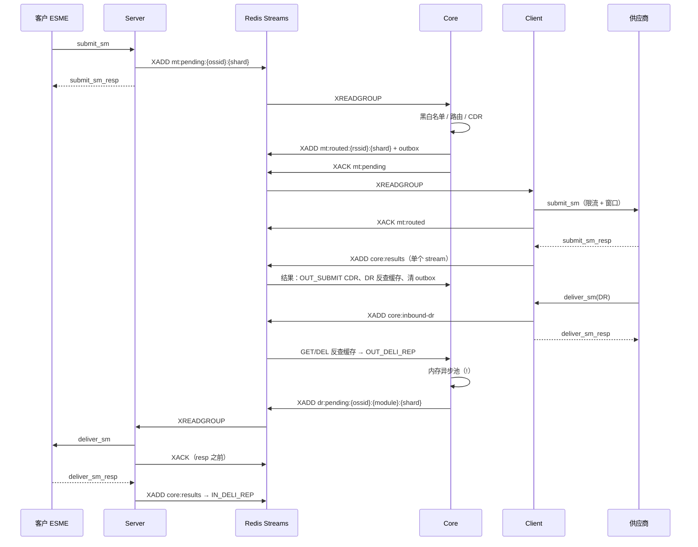

# A2P 消息链路整体分析与改进

> 汇总 [SMPP Server](SMPP-Server架构分析与改进.md)、[Core](Core模块架构分析与改进.md)、[Client](Client模块架构分析与改进.md) 三份分析，从端到端的角度看整条链路的问题，并给出统一的改进路线。

## 1. 端到端链路



链路由 6 个 stream 消费者串起来，每一跳都是"读 → 处理 → 写下一跳 → 确认"。每一跳都是至少一次投递（at-least-once），但没有任何一跳做了幂等。

## 2. 跨模块的共性问题

| 主题 | 现象 | 涉及 | 影响 |
|---|---|---|---|
| **① 没写下一跳就先 ack** | 确认之后的动作只放在内存里：Core 的 DR 转发异步池、DB 兜底、默认长短信合并；Server 内存模式下的 DR pending | Core R1/R4、Server D4 | 崩溃会静默丢消息，不会重投 |
| **② 重投不幂等** | 6 个消费者都"批量读 + 逐条处理 + auto-claim 按空闲时间领取"，并发重复和失败重投都会把副作用再执行一遍 | Core R3、Client D1-D3 | 客户重复收到 DR / 假 DR、供应商重复下发、CDR 重复、计数错误 |
| **③ 消费框架复制 6 份** | dispatcher 单线程 + CallerRuns、一个 stream 一直占着 worker 直到读空、`KEYS` 列 stream、重投没有次数上限 | 全部 | 某个 stream 慢会拖住其他 stream；Redis 被 `KEYS` 阻塞；毒消息无限重投 |
| **④ 分片配置不一致** | DR stream 名带分片号但 Server 只负责 0 号分片（已修）；结果流没有分片；各模块的 `TotalShards` 需要人工保持一致，没有校验 | Server（已修）、Core S1 | DR 不下发；结果流单线程，导致 DR 反查查不到 |
| **⑤ 限流** | Server 入向是单节点检查；Client 出向是单节点、阻塞式、HTTP 没有限流 | Server、Client T1-T3 | 多节点时实际速率超过配置；慢通道卡住 worker |
| **⑥ 线程模型** | Server 每个连接 4 到 8 个线程；Client 每个供应商连接同样如此；Core DR 转发池只有 1 到 5 个线程 | Server T1、Core S2 | 容量上限低；GC 压力大 |
| **⑦ 日志** | 线上开着 TRACE；每条消息有多条 INFO 并打印消息全文 | 全部 | 日志 IO 成为瓶颈 |

**每条消息的 Redis 往返估算**（MT 加 DR 走完全程，不含可选的计费和计数）：Server 2、Core MT 4 到 5、Client 外发 2 到 3、结果 1 + Core 3 到 4、DR 回程 Client 1 + Core 4 + Server 4，合计**约 20 到 25 次**。合并 Lua 和使用 pipeline 后可以降到 12 次左右。

## 3. 统一的设计原则

1. **先持久化下一跳，再 ack**。下一跳只能是 Redis stream 或有 TTL 的 outbox key，不能是内存池。
2. **每一跳都做幂等**：键为 `{阶段}:{msgId}`。"写下一跳"和"设置已完成标记"放在同一段 Lua 里原子执行；副作用（CDR、计数、假 DR）在执行前先检查标记。
3. **一个消费框架**：`StreamConsumerTemplate` 统一负责门铃、限时批次（批量不超过"空闲阈值 × 处理速率"）、非阻塞让出、`XCLAIM` 指定 ID 重试、投递次数上限、DLQ、`SCAN`、指标。业务只实现 `process(msg) → ACK | RETRY_LATER(delay) | DLQ`。
4. **按 ssid 分片的命名统一**：所有 stream 都用 `{类型}:{ssid}:{shard}`（Server 的 DR 再加上模块名）；分片归属由同一份配置推导，启动时校验覆盖范围。
5. **限流非阻塞且全局一致**：Redis 令牌桶加本地预取；拿不到令牌就延迟重排，不占 worker。

## 4. 统一路线图

| 阶段 | 周期 | 内容 | 来源 |
|---|---|---|---|
| **A1 止损** | 第 1 周 | Core：DR 转发改同步、反查缓存处理成功后再删；Server：计费原子扣减 + 失败退款、accept 循环加固；Client：windowRetry 只重投指定 ID、批量大小与速率挂钩；线上日志降为 INFO | Core A1/A2、Server A1/A3、Client A1/A2 |
| **A2 幂等** | 第 2 周 | Core MT 和 Client 外发加幂等标记（并进外发 Lua）；重投次数上限 + DLQ；收件人计数改原子操作 | Core A3-A5、Client A3 |
| **B1 消费框架** | 第 3 到 4 周 | 抽出 `StreamConsumerTemplate`，6 个消费者迁移过去（一次迁一个，可以灰度）；`SCAN` 替换 `KEYS`；非阻塞限流 | Core B3/B4、Client A4/B4 |
| **B2 吞吐** | 第 5 到 6 周 | 结果流分片；outbox 并进外发 Lua；多节点共享限流额度；Server 共享收包池修复和线程收敛 | Core B1/B2、Client A5、Server 阶段 B |
| **C 结构** | 视需要 | 拆分 `InternalCoreEngineSession` 和 `MultiSmppSession`；删掉旧的异步路径；Netty 化 IO；HTTP 改异步客户端 | 各文档阶段 C |

每个阶段上线前，先用三份文档第 5 节的验证场景做故障注入（kill -9、确认失败、Redis 抖动、慢客户、慢供应商）。重点看三个指标：
- **端到端对账**：IN_SUBMIT = OUT_SUBMIT + 拒绝；OUT_DELI_REP = IN_DELI_REP + 失败。
- **重复率**：`ack_returned_zero` 的计数。
- **各跳的 PEL 长度**。

## 5. 专题：Server 故障时 DR 能否改从其他 Server 下发

### 5.1 现有机制

Core 在写出 DR 的那一刻决定目标 Server 模块（`SmppServerDrRouteResolver.resolveTargetModule`），依据是 Redis 里的会话登记表（`SmppServerSessionRegistry`，默认开启）。选择顺序：

1. 消息原来进入的模块（`innerTransaction.module`）上，这个客户还有活跃会话 → 发给原模块。
2. 否则从登记表里选另一个有活跃会话的模块（`selectActiveModule`）。
3. 否则按客户分配（`SmppServerAssignmentResolver`）或配置，在在线模块里选一个。

选定后写入 `stream:dr:pending:{ossid}:{模块名}:{shard}`，只有这个模块会消费它。

前提：客户在其他 Server 上也有可以收 DR 的 bind（receiver 或 transceiver）。

### 5.2 各种情况

| 情况 | 结果 | 原因 |
|---|---|---|
| Server1 正常停机 | ✅ 新的 DR 立即改发 Server2 | 停机时会注销会话（`unregisterServerBindSession`），第 2 步就能选到 Server2 |
| Server1 崩溃（kill -9、OOM、宕机） | ❌ 最长约 11 分钟内，新的 DR 仍然发往 Server1 | 判断会话是否活跃只看登记表的 detail key 是否存在，TTL 是 `MaxSilentTime + 60` = 660 秒；崩溃时来不及注销 |
| 停机前已经写进 Server1 stream 的 DR | ❌ 等 Server1 恢复后判失败（11005） | 其他模块不消费 Server1 名下的 stream；Server1 恢复后如果找不到这个客户的会话，原模块直接 `failToCoreAndAck`，不会转给 Server2 |
| Server1 已发出、正在等 resp 的 DR | ❌ 内存模式下丢失；Redis 模式下只有 Server1 恢复后才会处理 | 待确认窗口按"模块 + 节点"归属 |

### 5.3 改进

| 项 | 改动 |
|---|---|
| F1 | 登记表 TTL 缩短到刷新间隔的 3 倍（约 90 秒，配置 `SmppServerSessionRegistryTtlSeconds`）；`hasActiveSessionInModule` 同时检查模块心跳 `module:status:server:{module}:{node}` 是否为 ONLINE |
| F2 | Server 消费 DR 时，本模块找不到会话就重新查登记表（排除自己），把 DR 写进有会话的模块的 stream 再确认消费，最多转发 1 到 2 次；只有找不到任何可用模块时才回 11005 |
| F3 | 接管孤儿 stream：定期检查离线超过 N 分钟的 Server 模块，把它名下 `stream:dr:pending:*:{该模块}:*` 里的 DR 按登记表重新分发 |
| F4 | 待确认 DR 窗口默认使用 Redis 模式，并允许任意在线模块接管恢复 |

## 6. 专题：长短信分段与分片

### 6.1 分段如何落到同一个 Core

Server 写 MT 时用 `StreamQueueManager.calculateShardId` 计算分片号：

```
hashKey = ossid_发送号码_接收号码[_sarMsgRefNum]
shard   = |hash| % TotalShards
→ stream:mt:pending:{ossid}:{shard}
```

各个 Core 按分片配置负责不同的分片。同一个客户、同样的发送号码和接收号码，不管从哪个 Server、哪个连接进来，都会进同一个 stream，被同一个 Core 消费。长短信的各段这三个值相同，所以会落到同一个 Core。这是按号码分片带来的结果，并不是专门为长短信设计的。

| 格式 | Server 解析 | 分片依据 | Core 处理 |
|---|---|---|---|
| UDH（esm_class 0x40，最常见） | 只把 UDH 字节存进 `msg.udh`，不解析参考号 | ossid + 发送号码 + 接收号码 | 不识别为长短信，每段带着 UDH 独立路由、独立外发，由手机自行拼接 |
| TLV（sar_msg_ref_num 等） | 解析出参考号、总段数、当前段号 | 再加上参考号 | 识别为长短信，在 Core 重组后外发：默认 `legacy` 模式在 Core 内存里合并，`redis` 模式在 Redis Hash 里合并 |

### 6.2 风险

1. **legacy 模式依赖"同一个 Core 而且不重启"**：分片归属一旦变化（扩容、调整分片配置、故障后由别的节点接管），或者 Core 在收齐分段之前重启，内存里已经收到的分段就会丢失。建议默认使用 `CsmReassembleMode=redis`。
2. **UDH 格式各段独立路由**：现在的路由是确定性的，没有随机选通道，正常情况下各段走同一个通道；但如果分段之间刚好发生主备切换或改道，同一条长短信的各段可能从不同供应商发出，手机拼不起来。
3. **`calculateShardId` 用的是 `Math.abs(hashCode) % n`**：hashCode 为 `Integer.MIN_VALUE` 时，`TotalShards` 不是 2 的幂就会得到负数分片号（比如 n=10 时为 -8），写进一个没有任何节点消费的 stream。n 是 2 的幂时余数为 0，不受影响。应该和其他几个分片函数一样改用 `& Integer.MAX_VALUE`。

## 7. 专题：分片配置规范

### 7.1 各配置的作用

| 配置 | Server | Core | Client |
|---|---|---|---|
| `TotalShards` | 计算 MT 的分片号（`stream:mt:pending`） | 计算出向 MT（`stream:mt:routed`）和 DR（`stream:dr:pending`）的分片号 | 计算 HTTP、MQM 等流的分片号 |
| 负责哪些分片 | `MyShards`：只影响 DR 消费；`ServerDrStreamShardFilter=false`（默认）时不起作用 | 依次读取：Redis `system:core:shards:{module}` → `CoreShard.{module}` → `CoreShard.{NodeID}` → `MyShards` | 依次读取：`ClientShard.*` → `MyShards` |

对于 `TotalShards=16`：分片号一定在 0 到 15 之间，不会出现 16；`Integer.MIN_VALUE % 16 = 0`，也不会出现负数。

### 7.2 规范

1. **所有模块的 `TotalShards` 必须一致**（比如都是 16），否则上游写入的分片和下游负责的分片对不上。Server 不配时默认是 1，会导致所有 MT 都进 0 号分片，只有一个 Core 在处理。
2. **同类节点之间不重叠地分配分片**。两个 Core 时：`CoreShard.CoreEngine1=0-7`、`CoreShard.CoreEngine2=8-15`；Client 同理用 `ClientShard.*`。如果每个节点都负责 0 到 15，消息不会重复（消费组会分摊），但同一组号码不再保证由同一个节点处理，长短信用 legacy 模式重组时各段可能分散到不同 Core 的内存里，永远拼不齐。
3. **同类节点合起来要覆盖全部分片**：所有 Core 负责的分片合起来必须是 0 到 `TotalShards-1`，Client 同理。否则没被覆盖的分片会一直积压（和 Server DR 分片问题是同一类）。
4. **调整 `TotalShards` 前先清空积压**：比如从 16 改成 8，已经在 8 到 15 号分片里的消息就没人负责了，除非还有节点继续消费它们。
5. **启动时校验**（建议实现）：每个模块启动时把自己的 `TotalShards` 和负责的分片写入 Redis（比如 `system:shards:{role}:{module}`），并和同类节点的配置比对。`TotalShards` 不一致、分片有重叠或有遗漏时打 ERROR 日志并上报指标。

### 7.3 线上检查

```bash
# MT 实际落在哪些分片（应该看到 0 到 15 都有；只有 0 说明 Server 的 TotalShards 实际是 1）
redis-cli --scan --pattern 'stream:mt:pending:*' | awk -F: '{print $NF}' | sort -n | uniq -c

# 出向 MT 与 DR 的分片分布
redis-cli --scan --pattern 'stream:mt:routed:*'  | awk -F: '{print $NF}' | sort -n | uniq -c
redis-cli --scan --pattern 'stream:dr:pending:*' | awk -F: '{print $(NF-1)":"$NF}' | sort | uniq -c

# 各个 Core 实际负责的分片
grep "Core shard assignment loaded" CoreEngine*.log | tail
```
