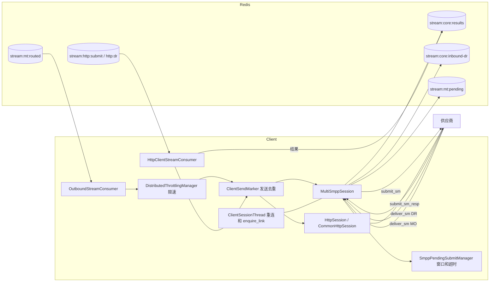

# Client 模块功能与测试用例清单

> 范围：Client（`MultiSmppClient`、`CommonHttpClient`）当前 `main` 的代码。“回归现状”依据 `regression/` 现有用例。第一批（连接生命周期和窗口）已实现，结果见第 8 节；**标“待补”的还没有写，也没有执行**。

## 1. 总览

Client 从 Redis 读取 Core 路由后的 MT，通过 SMPP 或 HTTP 发给供应商，再把 submit_resp、供应商 DR 和 MO 写回 Redis。

- **已支持功能：** 22 组，其中回归已覆盖 11 组，部分覆盖 5 组，没有覆盖 6 组。
- **测试用例：** 100 条，其中已覆盖 40 条，部分覆盖 6 条，待补 54 条。
- **主要缺口：** 可靠性优化（发送去重、限速、慢通道隔离、pending）测得比较全，但**submit_sm 字段、失败码映射、DR 解析、真实 HTTP 收发**基本没有回归用例，也没有真实 `kill -9` 的多进程用例。

### 架构

### 一条 SMPP MT 的处理顺序

`OutboundStreamConsumer.handleMessageSending`：

1. 按 rssid 选会话。没有会话或未连接：抢标记后回失败结果（COMMUNICATION_ERROR）并确认。
2. 查发送窗口。窗口满：本批延后（`ClientOutboundWindowFullRetryMs`）。
3. 取限速令牌。取不到：本批延后，不阻塞 worker。
4. 抢发送标记（`ClientSendMarker.claim`）。可能有另一份副本时，再查一次 stream 记录。
5. 登记 pending（这里窗口满也会延后），发出 submit_sm，确认消费。此时还没收到 submit_sm_resp。
6. 收到 resp 或超时后，把结果写入 `stream:core:results`。

## 2. 已支持的功能

现状说明：已覆盖 = 回归有用例验证行为；部分 = 只验证了其中一段；待补 = 回归没有用例，功能在代码和配置中存在，但本文档没有实测。

### 消费与发送

| 功能 | 主要配置 | 回归现状 |
|---|---|---|
| 消费 `stream:mt:routed`，门铃调度，慢通道隔离 | `RedisStreamConsumer.ClientOutboundSubmit.*`、`ClientStreamTaskMax*` | 已覆盖 |
| 按分片消费，跨模块校验分片 | `ClientShard.*`、`RELOAD_CLIENT_SHARDS` | 部分 |
| 发送去重，重投和确认竞争不重复发送 | `ClientSendIdempotency`、`ClientSendLeaseMs` | 已覆盖 |
| 通道限速（非阻塞） | `SMSOptionOutgoingThrottlingNum` | 已覆盖 |
| 发送窗口满时延后 | `WindowSize`、`ClientOutboundWindowFullRetryMs` | 已覆盖 |
| 自动重投 | `RedisStreamAutoClaim*` | 已覆盖 |

### SMPP 连接

| 功能 | 主要配置 | 回归现状 |
|---|---|---|
| bind、断线重连 | `BindMode`、`ReconnectInterval` | 已覆盖 |
| enquire_link 保活、静默断开 | `EnquireLink`、`EnquireLinkTime`、`EnquireLinkFailureNum`、`ConnectionSilentTime` | 已覆盖 |
| 多连接、多会话、连接选择策略 | `ConnectionType`、`OutgoingConnection`、`SessionNumber`、`SubmitPolicy_Conn` | 部分 |
| SMPP 3.3、TLS | `SMSOptionSMPPVersion`、`Protocol=SSLSMPP` | 待补 |

### 收发内容

| 功能 | 主要配置 | 回归现状 |
|---|---|---|
| 组装 submit_sm：编码、拼接方式、有效期、自定义参数 | `SMSOptionSupportOutgoingGSM7bit`、`ChlUdhConcatenated`、`SMSOptionTransferValidityPeriod` | 部分 |
| submit_sm_resp 转结果，失败码映射，outMsgId 转换 | `SMSOptionSubmitNotPaidMapping`、`ChlSMPPMsgIDParse`、`SMSOptionSMPPIsPadZero4SR` | 部分 |
| 等待响应超时，结果写入失败重试 | `BufferTimeout`、`SMPPSubmitPendingMode`、`SMPPSubmitPendingResultMaxRetry` | 部分 |
| 接收供应商 DR：先写 Redis 再回 resp | `stream:core:inbound-dr:*` | 已覆盖 |
| DR 解析和状态映射 | `SMSOptionDRStatusIsOptionPara`、`SMSOptionDRStatusMapping`、`SMSOptionDRNotPaidCode` | 待补 |
| 接收 MO | `stream:mt:pending:*` | 待补 |

### HTTP 通道

| 功能 | 主要配置 | 回归现状 |
|---|---|---|
| HTTP 外发，按通道超时和限速 | `SMSOptionHttpConnectTimeout`、`SMSOptionHttpReadTimeout`、`SMSOptionOutgoingThrottlingNum` | 已覆盖 |
| 按模板拼接请求、解析响应 | `ChlURL`、`protocol/commonhttp/*` | 待补 |
| 推送 DR 给 HTTP 客户 | `stream:http:dr:*` | 待补 |
| 主动查询 DR 和 MO | `SMSQueryDRHttpModule`、`QueryHttpMessageThread` | 待补 |

### 运维

| 功能 | 主要配置 | 回归现状 |
|---|---|---|
| 改通道配置只影响改动的通道 | `RELOAD_CUSTOMER` | 已覆盖 |
| 全链路日志 | — | 已覆盖 |

## 3. 不支持、已决定不做或有限制的功能

### 3.1 已决定不做

| 功能 | 现状 | 依据 |
|---|---|---|
| 会话断开时的宽限期 | 会话不可用就立即回失败（COMMUNICATION_ERROR），连接抖动时会有一批失败，由 Core 重试或改道 | `Client第2批优化设计`，S1 暂不改 |
| HTTP 连接池、异步客户端 | 仍是同步 `HttpURLConnection`，只做了按通道超时和限速 | `Client第2批优化设计` |
| 多节点共享限速额度 | 见 3.2 | 没有实现 |

### 3.2 有限制的行为

| 功能 | 限制 | 依据 |
|---|---|---|
| 通道限速 | 按单个 Client 节点生效，总速率等于配置值乘节点数 | 配置说明 5.3 |
| 不重复发送 | 只保证同一次外发不重复。resp 超时后如果 Core 重试，供应商可能收到两条，这是 SMPP 协议的限制，建议不把超时类错误码配进重试 | `Client第1批优化设计` |
| 发送中进程挂掉 | 不重发，可能少发一条，由 Core outbox 判超时（2700） | `ClientSendMarker` |
| SMPP 连接超时 | 固定 500 毫秒，不能配置，网络延迟高的供应商可能连不上 | `MultiSmppSession.java:260` |
| HTTP 同步阻塞 | 慢供应商占住 worker，用超时和小批量缓解 | `HttpSession` |
| HTTP 推送 DR | 没有发送去重，可能重复 | `HttpClientStreamConsumer` |

### 3.3 Client 不负责的

路由、改道、重试策略和重试次数、CDR、DR 匹配原消息，都由 Core 负责。

## 4. 测试用例

级别：P0 = 影响消息不丢、不重复发送或主链路；P1 = 影响业务功能；P2 = 少用的功能或优化。

### 一、消费与调度

| ID | 级别 | 配置 / 前置 | 场景 | 预期 | 现状 | 现有用例 |
|---|---|---|---|---|---|---|
| CS-01 | P0 | 正常 MT | 从 `stream:mt:routed` 读到 MT | 发给供应商，确认消费，标记删除 | 已覆盖 | ClientBatch1IT |
| CS-02 | P0 | `ClientShard.*` | 两个 Client 各负责一部分分片 | 只消费自己的分片。现有用例只验证了分片配置的校验，没有验证实际消费范围 | 部分 | ShardGroupIT |
| CS-03 | P1 | `RELOAD_CLIENT_SHARDS` | 运行中改分片 | 新分片开始消费，移走的分片不再读 | 待补 |  |
| CS-04 | P0 | 多个慢通道积压 | worker 只有 4 个 | 快通道不受影响 | 已覆盖 | ClientBatch1IT |
| CS-05 | P1 | `WorkerMaxPoolSize` | worker 全忙 | 核心数等于最大数，满了拒绝任务并把 stream 交回门铃，不由 dispatcher 执行 | 已覆盖 | ClientBatch1IT |
| CS-06 | P1 | `ClientStreamTaskMaxBatches`、`ClientStreamTaskMaxMs` | 大积压通道 | 任务到量后让出 worker，其他通道能轮到 | 待补 |  |
| CS-07 | P0 | worker 读走后挂掉 | 记录还在待确认列表 | 重投后发送并确认 | 已覆盖 | ClientBatch1IT |
| CS-08 | P1 | `RedisStreamMaxDeliveries` | 消息反复投递失败 | 进死信队列，不无限重试。现有用例只验证了推迟不计投递次数 | 部分 | ClientBatch1IT |
| CS-09 | P2 | 门铃丢失 | Client 启动时 stream 有积压 | 启动时重新敲门铃，积压被消费 | 待补 |  |

### 二、发送去重

| ID | 级别 | 配置 / 前置 | 场景 | 预期 | 现状 | 现有用例 |
|---|---|---|---|---|---|---|
| ID-01 | P0 | 已发出但确认丢失 | 重投 | 不再发送，只确认 | 已覆盖 | ClientBatch1IT |
| ID-02 | P0 | 另一线程正在发送 | 重投 | `BUSY`，不发送，留在待确认 | 已覆盖 | ClientBatch1IT |
| ID-03 | P0 | 发送者中途停止，租约过期 | 重投 | 不重发，只确认，由 Core outbox 判超时（2700） | 已覆盖 | ClientBatch1IT |
| ID-04 | P0 | 会话断开 | 新消息 | 回失败结果，确认消费，删除标记 | 已覆盖 | ClientBatch1IT |
| ID-05 | P0 | 会话断开，但这条之前已发出 | 重投 | 不回失败结果，只确认 | 已覆盖 | ClientBatch1IT |
| ID-06 | P1 | `ClientSendIdempotency=false` | 发送 | 不写标记 | 已覆盖 | ClientBatch1IT |
| ID-07 | P0 | 重投和确认竞争（两个方向） | 两份副本 | 供应商只收到一次，没有标记残留，不写多余失败结果 | 已覆盖 | ClientBatch1IT |
| ID-08 | P1 | 长短信各段、Core 重试 | 同一 msgId，不同段号或重试次数 | 标记 key 不同，每一段、每次重试都能发送 | 待补 |  |
| ID-09 | P0 | 标记所在 Redis 出错 | 发送前 | 不发送，消息留在待确认，恢复后由重投处理 | 待补 |  |

### 三、限速与窗口

| ID | 级别 | 配置 / 前置 | 场景 | 预期 | 现状 | 现有用例 |
|---|---|---|---|---|---|---|
| TW-01 | P0 | `SMSOptionOutgoingThrottlingNum=2` | 积压发送 | 速率符合配置，每条只发一次 | 已覆盖 | ClientBatch1IT |
| TW-02 | P0 | 限速通道 | 取不到令牌 | 不阻塞 worker，本批延后 | 已覆盖 | ClientBatch1IT |
| TW-03 | P1 | 消息被推迟 | 多次推迟 | 不计投递次数，不进死信队列，不被重投重复发送 | 已覆盖 | ClientBatch1IT |
| TW-04 | P0 | `WindowSize=2`，供应商不回 resp | 窗口满 | 只发 2 条，其余不回失败、不丢；resp 到达后继续发送；每条只发一次、都有成功结果，stream 清空，没有标记残留 | 已覆盖 | ClientConnectionIT |
| TW-05 | P1 | `ClientOutboundWindowFullRetryMs` | 窗口满 | 按配置间隔重试，取值限制在 10 到 60000 | 待补 |  |
| TW-06 | P1 | 限速通道 | 读取批量 | 每批不超过 1 秒的 TPS | 待补 |  |
| TW-07 | P1 | 修改 TPS 后 `RELOAD_CUSTOMER` | 运行中 | 新速率生效 | 待补 |  |
| TW-08 | P2 | 两个 Client 节点 | 同一通道 | 按节点限速，总速率等于配置值乘节点数（已知限制） | 待补 |  |

### 四、SMPP 连接

| ID | 级别 | 配置 / 前置 | 场景 | 预期 | 现状 | 现有用例 |
|---|---|---|---|---|---|---|
| CN-01 | P0 | 收发模式（`BindMode` 默认） | 启动 | bind 成功后状态为 CONNECT | 已覆盖 | LogChainClientIT、RenameReloadIT |
| CN-02 | P1 | `BindMode=T`、`R` | 发送和接收 | **T 在加载时拆成一条发送连接和一条接收连接（`_R`），一共两次 bind**；用发送连接外发。R 只有 bind_receiver，不外发，回失败结果 2500 | 已覆盖 | ClientConnectionIT |
| CN-03 | P0 | 供应商拒绝 bind | 启动 | 按 `ReconnectInterval` 持续重试；期间消息回失败结果 2500，不发送；对方恢复后 bind 成功并能外发 | 已覆盖 | ClientConnectionIT |
| CN-04 | P0 | 端口不通 | 启动 | 持续重试；期间消息回 2500；端口恢复后连接并能外发。连接超时固定 500 毫秒（见 3.2） | 已覆盖 | ClientConnectionIT |
| CN-05 | P0 | 供应商主动断开，有等待响应的消息 | 运行中 | 等待中的消息各回一个失败结果（**2700**，可能已发出），Client 不自动重发；按 `ReconnectInterval` 重连后能外发。重连时间不受保活睡眠影响（见第 8.2 节） | 已覆盖 | ClientConnectionIT |
| CN-06 | P1 | `EnquireLink=true`、`EnquireLinkTime` | 空闲 | 按间隔发 enquire_link；有应答时连接保持 | 已覆盖 | ClientConnectionIT |
| CN-07 | P1 | `EnquireLinkFailureNum=3` | 供应商不回 | 第 3 个未回后断开（实测正好 3 个），然后重连 | 已覆盖 | ClientConnectionIT |
| CN-08 | P1 | 供应商发 enquire_link | 运行中 | 回应答 | 已覆盖 | ClientConnectionIT |
| CN-09 | P2 | `ConnectionSilentTime`、`EnquireLink=false` | 长时间无活动 | 断开并重连 | 已覆盖 | ClientConnectionIT |
| CN-10 | P1 | `SessionNumber=2` | 多会话 | 两次 bind，20 条消息平均分到两个会话 | 已覆盖 | ClientConnectionIT |
| CN-11 | P1 | `SubmitPolicy_Conn`（`Policy` 属性和主连接） | 多连接 | Primary、LoadBalance、Random 等策略选到正确连接 | 待补 |  |
| CN-12 | P2 | `ConnectionType=MN` | 多节点 | 按节点建立连接并选择 | 待补 |  |
| CN-13 | P2 | `SMSOptionSMPPVersion=V33` | SMPP 3.3 供应商 | bind、发送、DR 都正常 | 待补 |  |
| CN-14 | P2 | `Protocol=SSLSMPP` | TLS 供应商 | `SslSmppClient` 能连接和发送 | 待补 |  |
| CN-15 | P0 | 修改通道配置后 `RELOAD_CUSTOMER` | 运行中 | 只有改动的通道重连，其他通道不受影响 | 已覆盖 | RenameReloadIT |

### 五、submit_sm 编码

| ID | 级别 | 配置 / 前置 | 场景 | 预期 | 现状 | 现有用例 |
|---|---|---|---|---|---|---|
| PD-01 | P0 | 普通 MT | 发送 | 发送方、接收方、内容、service_type 与消息一致。现有用例只验证了发出，没有校验字段 | 部分 | LogChainClientIT |
| PD-02 | P1 | `SMSOptionSupportOutgoingGSM7bit`、编码 | ASCII、UCS2、7bit | data_coding 和内容字节正确 | 待补 |  |
| PD-03 | P1 | `ChlUdhConcatenated` | 长短信分段 | UDH 或 SAR 可选参数二选一，段号正确 | 待补 |  |
| PD-04 | P1 | `SMSOptionTransferValidityPeriod`、`SMSOptionIsRelateValidityPeriod` | 有效期 | 按配置传绝对或相对时间，或不传 | 待补 |  |
| PD-05 | P1 | 消息是否要 DR | 发送 | registered_delivery 正确 | 待补 |  |
| PD-06 | P2 | ton、npi 配置 | 发送 | 地址类型正确 | 待补 |  |
| PD-07 | P2 | `SMSOptionHttpCustomParameter` 等 | 发送 | 自定义可选参数写入 | 待补 |  |
| PD-08 | P2 | `getTransparency` 大于 0 | 发送 | 带上 MNC、MCC | 待补 |  |
| PD-09 | P1 | 消息无法构造 PDU | 发送 | 回失败结果，确认消费，不卡住通道 | 待补 |  |

### 六、submit_sm_resp 和超时

| ID | 级别 | 配置 / 前置 | 场景 | 预期 | 现状 | 现有用例 |
|---|---|---|---|---|---|---|
| RS-01 | P0 | resp 为 ROK | 收到 | 写结果到 `stream:core:results`，带 outMsgId，删除 pending | 已覆盖 | LogChainClientIT |
| RS-02 | P0 | resp 为失败码 | 收到 | 按 `SMPPRespStatus` 转成内部状态，写失败结果 | 待补 |  |
| RS-03 | P1 | `SMSOptionSubmitNotPaidMapping` | 匹配的失败码 | 转成映射后的状态 | 待补 |  |
| RS-04 | P1 | `ChlSMPPMsgIDParse`、`SMSOptionSMPPIsPadZero4SR` | outMsgId | 十六进制转十进制、补零正确，供应商 DR 能匹配上 | 待补 |  |
| RS-05 | P0 | `BufferTimeout`，供应商不回 | 超时 | WARN `[RESP-TIMEOUT]`，写失败结果（SUBMIT_RESP_ERROR） | 已覆盖 | LogChainClientIT |
| RS-06 | P1 | 超时后 resp 才到 | 迟到 | 不重复写结果，打一条找不到原消息的日志 | 待补 |  |
| RS-07 | P0 | 结果写入失败（背压或 Redis 错误） | 收到 resp | 标记待重试，按 `SMPPSubmitPendingResultMaxRetry` 重试，超过后放弃并释放窗口 | 待补 |  |
| RS-08 | P1 | `SMPPSubmitPendingMode` | memory、redis、hybrid | memory 不访问 Redis；redis 写入并删除；模式切换和遗留 key 都正确 | 已覆盖 | ClientPendingIT |
| RS-09 | P1 | 响应和超时竞争 | 同时发生 | 只写一个结果（`tryClaimProduce`） | 待补 |  |

### 七、供应商 DR 和 MO

| ID | 级别 | 配置 / 前置 | 场景 | 预期 | 现状 | 现有用例 |
|---|---|---|---|---|---|---|
| VD-01 | P0 | deliver_sm 是 DR | 收到 | 写 `stream:core:inbound-dr`，再回 deliver_sm_resp ROK | 已覆盖 | LogChainClientIT |
| VD-02 | P0 | 写 Redis 失败 | 收到 DR | 回 ESME_RX_T_APPN，让供应商重发，不丢 | 待补 |  |
| VD-03 | P1 | DR 内容解析失败 | 收到 | 回 ESME_RX_T_APPN，不抛异常 | 待补 |  |
| VD-04 | P1 | `SMSOptionDRStatusIsOptionPara`、`SMSOptionSMPPNeedReceiptedMessageId` | 状态在可选参数里 | msgId 和状态解析正确 | 待补 |  |
| VD-05 | P1 | 短信文本格式回执 | `id:... stat:DELIVRD` | msgId 和状态解析正确 | 待补 |  |
| VD-06 | P1 | `SMSOptionDRStatusMapping`（Core 清单 DR-13） | 匹配状态 | 转成映射后的状态 | 待补 |  |
| VD-07 | P2 | `SMSOptionIsNotSupportUnknowDRStatus`（Core 清单 DR-14） | UNKNOWN | 按配置转换 | 待补 |  |
| VD-08 | P1 | `SMSOptionDRNotPaidCode`（Core 清单 DR-17） | 欠费码 | 按欠费处理 | 待补 |  |
| VD-09 | P2 | `SMSOptionSmppMapErrCod4DR`、`DrSwapAddr` | DR | 错误码映射、地址交换正确 | 待补 |  |
| VD-10 | P1 | deliver_sm 是 MO | 收到 | 写 `stream:mt:pending`，再回 ROK；写失败回 ESME_RX_T_APPN | 待补 |  |
| VD-11 | P2 | `SMSOptionRemoveUdh` | 带 UDH 的 deliver_sm | UDH 被去掉 | 待补 |  |

### 八、HTTP 通道

| ID | 级别 | 配置 / 前置 | 场景 | 预期 | 现状 | 现有用例 |
|---|---|---|---|---|---|---|
| HT-01 | P1 | `SMSOptionHttpReadTimeout`、`SMSOptionHttpConnectTimeout` | 供应商响应慢 | 按通道超时；没配用模块默认值 | 已覆盖 | ClientBatch2IT |
| HT-02 | P1 | 修改超时后 `RELOAD_CUSTOMER` | 运行中 | 下一个请求用新超时 | 已覆盖 | ClientBatch2IT |
| HT-03 | P0 | `SMSOptionOutgoingThrottlingNum` | HTTP 积压 | 速率符合配置，每条只处理一次，不阻塞 worker | 已覆盖 | ClientBatch2IT |
| HT-04 | P0 | 慢 HTTP 通道积压 | 多通道 | 不限速的通道不受影响 | 已覆盖 | ClientBatch2IT |
| HT-05 | P0 | 重投和确认竞争 | 两份副本 | `session.submit` 只调用一次。测试通道没配模板，没有真实发出请求 | 部分 | ClientBatch2IT |
| HT-06 | P0 | 没有 HTTP 会话 | 消息到达 | 回失败结果，确认消费。现有用例走到了这条路径，但没有专门断言 | 部分 | ClientBatch2IT |
| HT-07 | P0 | 配置了模板的 HTTP 通道 | 发送成功 | 真实 POST，参数正确；解析响应得到 outMsgId，写成功结果 | 待补 |  |
| HT-08 | P0 | 供应商回错误内容或 HTTP 错误码 | 发送 | 转成对应失败状态，写失败结果 | 待补 |  |
| HT-09 | P0 | `stream:http:dr` | DR 推送给 HTTP 客户 | 发出请求，写 DR_resp 结果 | 待补 |  |
| HT-10 | P1 | DR 推送失败 | 连接失败或错误码 | 写失败结果，走 DR 重试策略 | 待补 |  |
| HT-11 | P2 | `SMSQueryDRHttpModule`、`QueryHttpMessageThread` | 主动查询 DR | 查询结果写回 Core | 待补 |  |
| HT-12 | P2 | 供应商专用处理类（`protocol/commonhttp`，共 95 个文件） | 按供应商抽样 | 发送和回执解析正确。建议只测线上在用的几家 | 待补 |  |
| HT-13 | P1 | 标记所在 Redis 出错 | 发送前 | 不发送，留在待确认 | 待补 |  |

### 九、配置热加载

| ID | 级别 | 配置 / 前置 | 场景 | 预期 | 现状 | 现有用例 |
|---|---|---|---|---|---|---|
| CF-01 | P0 | 改通道 shortName、ssid | `RELOAD_CUSTOMER` | 旧连接关闭，新连接只 bind 一次，MT 能到；其他通道不受影响 | 已覆盖 | RenameReloadIT |
| CF-02 | P1 | 连续 reload | 流量中 | 不丢消息，连接稳定 | 已覆盖 | RapidReloadIT |
| CF-03 | P1 | 新增通道 | `RELOAD_CUSTOMER` | 自动建立连接并能发送 | 待补 |  |
| CF-04 | P1 | 删除通道 | `RELOAD_CUSTOMER`，有等待中的消息 | 连接关闭，等待中的消息回失败结果，不丢 | 待补 |  |

### 十、故障与恢复

| ID | 级别 | 配置 / 前置 | 场景 | 预期 | 现状 | 现有用例 |
|---|---|---|---|---|---|---|
| FT-01 | P0 | 真实 `kill -9` 一个 Client 进程 | 等待 resp 的消息 | memory 模式下由 Core outbox 超时回 2700，不丢；重启后继续消费，不重复发送 | 待补 |  |
| FT-02 | P0 | 发送中进程挂掉 | 标记是发送中 | 不重发。现有用例是模拟的标记状态，不是真实进程 | 部分 | ClientBatch1IT |
| FT-03 | P0 | Redis 短暂不可用 | 发送和写结果中 | 消息不丢；恢复后继续 | 待补 |  |
| FT-04 | P1 | Socket 写失败 | 发送时 IOException | 删除 pending，停止会话，这条回失败结果，重连后恢复 | 待补 |  |
| FT-05 | P1 | 两个 Client 分片重叠或缺失 | 校验 | 打 `[SHARD-CHECK]` 告警 | 已覆盖 | ShardGroupIT |
| FT-06 | P1 | Client 挂掉后手动改分片 | `RELOAD_CLIENT_SHARDS` | 另一个 Client 接手积压，每条只发一次 | 待补 |  |
| FT-07 | P1 | Core 停止读取结果 | 结果 stream 积压 | Client 不受影响；触发背压时按 RS-07 处理 | 待补 |  |

### 十一、日志

| ID | 级别 | 配置 / 前置 | 场景 | 预期 | 现状 | 现有用例 |
|---|---|---|---|---|---|---|
| LG-01 | P1 | MT 外发 | 正常 | `[MT-OUT]` → `[SUBMIT-RESP]` → `[STREAM-PUT]`，没有 WARN、ERROR | 已覆盖 | LogChainClientIT |
| LG-02 | P1 | 供应商 DR | 正常 | `[VDR-IN]` → `[VDR-TO-CORE]` | 已覆盖 | LogChainClientIT |
| LG-03 | P1 | resp 超时 | 超时 | `[RESP-TIMEOUT]` 带会话和序号 | 已覆盖 | LogChainClientIT |

### 十二、性能基线

| ID | 级别 | 配置 / 前置 | 场景 | 预期 | 现状 | 现有用例 |
|---|---|---|---|---|---|---|
| PF-01 | P1 | 单 SMPP 通道 | 逐步加压 | 记录 TPS 上限、p50、p99、CPU | 待补 |  |
| PF-02 | P1 | 多通道 | 逐步加压 | 记录上限和瓶颈 | 待补 |  |
| PF-03 | P2 | HTTP 通道 | 慢供应商 | 记录 worker 占用和吞吐 | 待补 |  |

## 5. 覆盖汇总

| 分组 | 用例数 | 已覆盖 | 部分 | 待补 |
|---|---|---|---|---|
| 消费与调度 | 9 | 4 | 2 | 3 |
| 发送去重 | 9 | 7 | 0 | 2 |
| 限速与窗口 | 8 | 4 | 0 | 4 |
| SMPP 连接 | 15 | 11 | 0 | 4 |
| submit_sm 编码 | 9 | 0 | 1 | 8 |
| submit_sm_resp 和超时 | 9 | 3 | 0 | 6 |
| 供应商 DR 和 MO | 11 | 1 | 0 | 10 |
| HTTP 通道 | 13 | 4 | 2 | 7 |
| 配置热加载 | 4 | 2 | 0 | 2 |
| 故障与恢复 | 7 | 1 | 1 | 5 |
| 日志 | 3 | 3 | 0 | 0 |
| 性能基线 | 3 | 0 | 0 | 3 |
| **合计** | **100** | **40** | **6** | **54** |

| 级别 | 已覆盖 | 部分 | 待补 |
|---|---|---|---|
| P0 | 23 | 5 | 9 |
| P1 | 16 | 1 | 31 |
| P2 | 1 | 0 | 14 |

## 6. 建议补用例的顺序

第一批（连接生命周期和窗口）已完成，接下来建议：

1. **失败码和 DR 解析（RS-02、RS-04、VD-02～VD-08）：** 影响客户看到的状态。其中 `DR-13`、`DR-14`、`DR-17` 是 Core 清单里待补的，实际代码在 Client。`FakeSmsc` 可以复用。
2. **真实 HTTP 收发（HT-07～HT-10）：** 现在的 HTTP 用例都没有走到真实请求，需要给测试通道配模板。
3. **结果写入失败和 Redis 故障（RS-07、ID-09、FT-03）：** 验证不丢消息。
4. **多进程 `kill -9`（FT-01、FT-06）：** 可以参照 `CoreFailoverIT`。
5. **submit_sm 字段（PD-*）、连接策略（CN-11）和其余 P2。**

## 7. 未核实的部分

- 第 2 节“待补”的功能只确认了代码和配置存在，没有实测。第 4 节的“预期”来自读代码，补用例时可能需要按实际行为调整。
- 读代码有疑问、需要用例确认的地方：顺序是查窗口 → 取令牌 → 抢标记 → 发送。令牌取到后，如果抢标记得到 `BUSY`，或发送时窗口已满，这个令牌就白白消耗了，实际速率可能低于配置。
- `AcceletSession`、`ClickatellSession`、`SpringSession`、`WebServiceSession`、`PeeringTcp2Session` 等其他通道类型没有列入，是否还在使用没有排查。

## 8. 第一批结果

新增 `ClientConnectionIT`（48 项）和可复用的假供应商 `FakeSmsc`，已加入 `regression/suites.txt`，真实的 `MultiSmppClient`、会话线程和 `OutboundStreamConsumer` 都没有被模拟。这批修了一处产品代码（第 8.2 节），跑了 Client 相关套件，没有跑全量回归。

### 8.1 确认没有问题的

- 发送窗口有效：`WindowSize=2` 时只发 2 条，其余等 resp，不丢、不重复（`TW-04`）。
- bind 被拒或端口不通时持续重试，恢复后自动连上（`CN-03`、`CN-04`）。之前读代码有疑问，现在确认会持续重试。
- `EnquireLinkFailureNum=3` 时，正好第 3 个未回后断开（`CN-07`）。

### 8.2 修复：断线后重连比配置的慢

**问题：** 重连线程在保活循环里 `Thread.sleep`，供应商断线时不会被唤醒，要睡完才发现断线，再等 `ReconnectInterval` 才重连。这段时间内，如果这条连接是通道唯一可用的连接，发过去的消息都回失败结果 2500。

**修复：** 保活等待改成可唤醒（`SessionWake`），`stopThread` 改完状态后唤醒，线程立刻进入 `ReconnectInterval` 等待。

- **改动范围：** `ClientSessionThread`（SMPP 和 SSL 的单节点通道、Peering）和 `NodeClientSessionThread`（多节点通道）。
- **为什么不用现成的 `interrupt()`：** `stop()` 可能是线程自己调用的，自我中断会让后面的 `sleep(ReconnectInterval)` 立刻返回，变成没有间隔的重连。
- **配置：** 没有新增配置，配置值的含义和文档一致了。

| 配置（`ReconnectInterval=1`） | 修复前（最坏情况） | 修复后 |
|---|---|---|
| `EnquireLink=true`，`EnquireLinkTime=8` | 约 9.05 秒 | 约 1.0 秒 |
| `EnquireLink=false`，`ConnectionSilentTime=12` | 约 12.6 秒 | 约 1.0 秒 |

按默认配置（`EnquireLinkTime=30`，或 `ConnectionSilentTime=300`），修复前最坏多等 30 秒或 300 秒。

**副作用检查：**

- 线程自己发现断线（enquire_link 不回）时，仍然等够 `ReconnectInterval`（`CN-07d`）。
- 供应商持续拒绝 bind 时，仍按间隔重试，3 秒内 3 次，不会变成密集重试（`CN-03e`）。

**没有实测：** 多节点（`MN`）和 Peering 通道没有用例，`NodeClientSessionThread` 的修改只经过编译，没有运行。

### 8.3 用例确认的其他行为

- **断线时等待中的消息回 2700（CN-05）：** 表示可能已发出，Client 不重发。是否重试由通道的 `SMSOptionSubmitRetryCode` 决定，配了 2700 就可能重复。
- **`BindMode=T` 是两条连接（CN-02）：** 发送连接和接收连接（`_R`）各 bind 一次。
- **cm.cfg 同一块里重复写同一个键（读代码确认）：** 值会用逗号拼起来，比如 `WindowSize: 20` 和 `WindowSize: 2` 变成 `20,2`，解析失败后退回默认值（这次实测 `WindowSize` 变成 100）。

### 8.4 这批用例的限制

- 假供应商不校验 submit_sm 的其他字段，只解析内容来检测重复。
- 单进程运行，消息由测试写入 `stream:mt:routed`，没有经过 Core，也没有 Core 消费结果。
- 没有覆盖多节点（`MN`）、`SubmitPolicy_Conn` 策略和 TLS。
