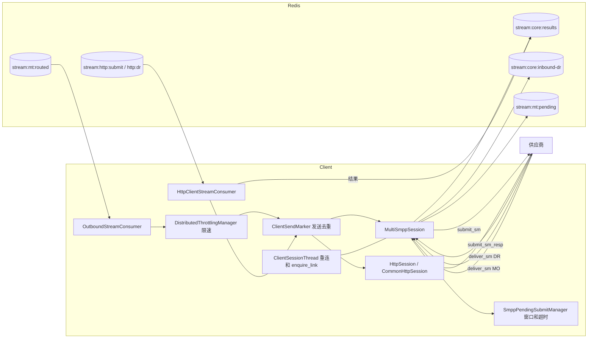

# Client 模块功能与测试用例清单

> 范围：Client（`MultiSmppClient`、`CommonHttpClient`）当前 `main` 的代码。“回归现状”依据 `regression/` 现有用例。第一批（连接生命周期和窗口）、第二批（失败码和 DR 解析）、第三批（真实 HTTP 收发）、第四批（Redis 故障和多进程）、第五批（submit_sm 字段、连接策略）已实现，结果见第 8～12 节；**标“待补”的还没有写，也没有执行**。

## 1. 总览

Client 从 Redis 读取 Core 路由后的 MT，通过 SMPP 或 HTTP 发给供应商，再把 submit_resp、供应商 DR 和 MO 写回 Redis。

- **已支持功能：** 22 组，其中回归已覆盖 19 组，部分覆盖 1 组，没有覆盖 2 组。
- **测试用例：** 103 条，其中已覆盖 82 条，部分覆盖 3 条，待补 18 条。
- **主要缺口：** 可靠性优化（发送去重、限速、慢通道隔离、pending）测得比较全，主要业务路径都有用例，剩下的多是少用的配置。

### 架构

### 一条 SMPP MT 的处理顺序

`OutboundStreamConsumer.handleMessageSending`：

1. 按 rssid 选会话。没有会话或未连接：抢标记后回失败结果（COMMUNICATION_ERROR）并确认。
2. 查发送窗口。窗口满：本批延后（`ClientOutboundWindowFullRetryMs`）。
3. 取限速令牌。取不到：本批延后，不阻塞 worker。
4. 抢发送标记（`ClientSendMarker.claim`）。可能有另一份副本时，再查一次 stream 记录。
5. 登记 pending（这里窗口满也会延后），发出 submit_sm，确认消费。此时还没收到 submit_sm_resp。
6. 收到 resp 或超时后，把结果写入 `stream:core:results`。

## 2. 已支持的功能

现状说明：已覆盖 = 回归有用例验证行为；部分 = 只验证了其中一段；待补 = 回归没有用例，功能在代码和配置中存在，但本文档没有实测。

### 消费与发送

| 功能 | 主要配置 | 回归现状 |
|---|---|---|
| 消费 `stream:mt:routed`，门铃调度，慢通道隔离 | `RedisStreamConsumer.ClientOutboundSubmit.*`、`ClientStreamTaskMax*` | 已覆盖 |
| 按分片消费，跨模块校验分片 | `ClientShard.*`、`RELOAD_CLIENT_SHARDS` | 已覆盖 |
| 发送去重，重投和确认竞争不重复发送 | `ClientSendIdempotency`、`ClientSendLeaseMs` | 已覆盖 |
| 通道限速（非阻塞） | `SMSOptionOutgoingThrottlingNum` | 已覆盖 |
| 发送窗口满时延后 | `WindowSize`、`ClientOutboundWindowFullRetryMs` | 已覆盖 |
| 自动重投 | `RedisStreamAutoClaim*` | 已覆盖 |

### SMPP 连接

| 功能 | 主要配置 | 回归现状 |
|---|---|---|
| bind、断线重连 | `BindMode`、`ReconnectInterval` | 已覆盖 |
| enquire_link 保活、静默断开 | `EnquireLink`、`EnquireLinkTime`、`EnquireLinkFailureNum`、`ConnectionSilentTime` | 已覆盖 |
| 多连接、多会话、连接选择策略 | `ConnectionType`、`OutgoingConnection`、`SessionNumber`、`SubmitPolicy_Conn` | 部分 |
| SMPP 3.3、TLS | `SMSOptionSMPPVersion`、`Protocol=SSLSMPP` | 待补 |

### 收发内容

| 功能 | 主要配置 | 回归现状 |
|---|---|---|
| 组装 submit_sm：编码、拼接方式、有效期、自定义参数 | `SMSOptionSupportOutgoingGSM7bit`、`ChlUdhConcatenated`、`SMSOptionTransferValidityPeriod` | 已覆盖 |
| submit_sm_resp 转结果，失败码映射，outMsgId 转换 | `SMSOptionSubmitNotPaidMapping`、`ChlSMPPMsgIDParse`、`SMSOptionSMPPIsPadZero4SR` | 已覆盖 |
| 等待响应超时，结果写入失败重试 | `BufferTimeout`、`SMPPSubmitPendingMode`、`SMPPSubmitPendingResultMaxRetry` | 已覆盖 |
| 接收供应商 DR：先写 Redis 再回 resp | `stream:core:inbound-dr:*` | 已覆盖 |
| DR 解析和状态映射 | `SMSOptionDRStatusIsOptionPara`、`SMSOptionDRStatusMapping`、`SMSOptionDRNotPaidCode` | 已覆盖 |
| 接收 MO | `stream:mt:pending:*` | 已覆盖 |

### HTTP 通道

| 功能 | 主要配置 | 回归现状 |
|---|---|---|
| HTTP 外发，按通道超时和限速 | `SMSOptionHttpConnectTimeout`、`SMSOptionHttpReadTimeout`、`SMSOptionOutgoingThrottlingNum` | 已覆盖 |
| 按模板拼接请求、解析响应 | `ChlURL`、`protocol/commonhttp/*` | 已覆盖 |
| 推送 DR 给 HTTP 客户 | `stream:http:dr:*` | 已覆盖 |
| 主动查询 DR 和 MO | `SMSQueryDRHttpModule`、`QueryHttpMessageThread` | 待补 |

### 运维

| 功能 | 主要配置 | 回归现状 |
|---|---|---|
| 改通道配置只影响改动的通道 | `RELOAD_CUSTOMER` | 已覆盖 |
| 全链路日志 | — | 已覆盖 |

## 3. 不支持、已决定不做或有限制的功能

### 3.1 已决定不做

| 功能 | 现状 | 依据 |
|---|---|---|
| 会话断开时的宽限期 | 会话不可用就立即回失败（COMMUNICATION_ERROR），连接抖动时会有一批失败，由 Core 重试或改道 | `Client第2批优化设计`，S1 暂不改 |
| HTTP 连接池、异步客户端 | 仍是同步 `HttpURLConnection`，只做了按通道超时和限速 | `Client第2批优化设计` |
| 多节点共享限速额度 | 见 3.2 | 没有实现 |

### 3.2 有限制的行为

| 功能 | 限制 | 依据 |
|---|---|---|
| 通道限速 | 按单个 Client 节点生效，总速率等于配置值乘节点数 | 配置说明 5.3 |
| 不重复发送 | 只保证同一次外发不重复。resp 超时后如果 Core 重试，供应商可能收到两条，这是 SMPP 协议的限制，建议不把超时类错误码配进重试 | `Client第1批优化设计` |
| 发送中进程挂掉 | 不重发，可能少发一条，由 Core outbox 判超时（2700） | `ClientSendMarker` |
| SMPP 连接超时 | 固定 500 毫秒，不能配置，网络延迟高的供应商可能连不上 | `MultiSmppSession.java:260` |
| HTTP 同步阻塞 | 慢供应商占住 worker，用超时和小批量缓解 | `HttpSession` |
| HTTP 推送 DR | 没有发送去重，可能重复 | `HttpClientStreamConsumer` |

### 3.3 Client 不负责的

路由、改道、重试策略和重试次数、CDR、DR 匹配原消息，都由 Core 负责。

## 4. 测试用例

级别：P0 = 影响消息不丢、不重复发送或主链路；P1 = 影响业务功能；P2 = 少用的功能或优化。

### 一、消费与调度

| ID | 级别 | 配置 / 前置 | 场景 | 预期 | 现状 | 现有用例 |
|---|---|---|---|---|---|---|
| CS-01 | P0 | 正常 MT | 从 `stream:mt:routed` 读到 MT | 发给供应商，确认消费，标记删除 | 已覆盖 | ClientBatch1IT |
| CS-02 | P0 | `ClientShard.*`，两个真实 Client 进程 | 各负责一个分片 | 只消费自己的分片，全部到达，没有重复 | 已覆盖 | ClientFailoverIT、ShardGroupIT |
| CS-03 | P1 | `RELOAD_CLIENT_SHARDS` | 运行中把分片交给另一个 Client | 它开始消费积压和新消息 | 已覆盖 | ClientFailoverIT |
| CS-04 | P0 | 多个慢通道积压 | worker 只有 4 个 | 快通道不受影响 | 已覆盖 | ClientBatch1IT |
| CS-05 | P1 | `WorkerMaxPoolSize` | worker 全忙 | 核心数等于最大数，满了拒绝任务并把 stream 交回门铃，不由 dispatcher 执行 | 已覆盖 | ClientBatch1IT |
| CS-06 | P1 | `ClientStreamTaskMaxBatches=1`，2 个 worker | 3000 条积压 | 小通道约 100 毫秒内得到处理；积压最终完成，没有重复 | 已覆盖 | ClientPduIT |
| CS-07 | P0 | worker 读走后挂掉 | 记录还在待确认列表 | 重投后发送并确认 | 已覆盖 | ClientBatch1IT |
| CS-08 | P1 | `RedisStreamMaxDeliveries` | 消息反复投递失败 | 进死信队列，不无限重试。现有用例只验证了推迟不计投递次数 | 部分 | ClientBatch1IT |
| CS-09 | P2 | 门铃丢失 | Client 启动时 stream 有积压 | 启动时重新敲门铃，积压被消费 | 待补 |  |

### 二、发送去重

| ID | 级别 | 配置 / 前置 | 场景 | 预期 | 现状 | 现有用例 |
|---|---|---|---|---|---|---|
| ID-01 | P0 | 已发出但确认丢失 | 重投 | 不再发送，只确认 | 已覆盖 | ClientBatch1IT |
| ID-02 | P0 | 另一线程正在发送 | 重投 | `BUSY`，不发送，留在待确认 | 已覆盖 | ClientBatch1IT |
| ID-03 | P0 | 发送者中途停止，租约过期 | 重投 | 不重发，只确认，由 Core outbox 判超时（2700） | 已覆盖 | ClientBatch1IT |
| ID-04 | P0 | 会话断开 | 新消息 | 回失败结果，确认消费，删除标记 | 已覆盖 | ClientBatch1IT |
| ID-05 | P0 | 会话断开，但这条之前已发出 | 重投 | 不回失败结果，只确认 | 已覆盖 | ClientBatch1IT |
| ID-06 | P1 | `ClientSendIdempotency=false` | 发送 | 不写标记 | 已覆盖 | ClientBatch1IT |
| ID-07 | P0 | 重投和确认竞争（两个方向） | 两份副本 | 供应商只收到一次，没有标记残留，不写多余失败结果 | 已覆盖 | ClientBatch1IT |
| ID-08 | P1 | 长短信各段、Core 重试 | 同一 msgId，不同段号或重试次数 | 标记 key 不同，每一段、每次重试都能发送；标记随后删除 | 已覆盖 | ClientPduIT |
| ID-09 | P0 | Redis 真实断开（TCP 代理） | 发送前抢标记 | 不发送，留在待确认；恢复后重投，只发一次 | 已覆盖 | ClientFaultIT |

### 三、限速与窗口

| ID | 级别 | 配置 / 前置 | 场景 | 预期 | 现状 | 现有用例 |
|---|---|---|---|---|---|---|
| TW-01 | P0 | `SMSOptionOutgoingThrottlingNum=2` | 积压发送 | 速率符合配置，每条只发一次 | 已覆盖 | ClientBatch1IT |
| TW-02 | P0 | 限速通道 | 取不到令牌 | 不阻塞 worker，本批延后 | 已覆盖 | ClientBatch1IT |
| TW-03 | P1 | 消息被推迟 | 多次推迟 | 不计投递次数，不进死信队列，不被重投重复发送 | 已覆盖 | ClientBatch1IT |
| TW-04 | P0 | `WindowSize=2`，供应商不回 resp | 窗口满 | 只发 2 条，其余不回失败、不丢；resp 到达后继续发送；每条只发一次、都有成功结果，stream 清空，没有标记残留 | 已覆盖 | ClientConnectionIT |
| TW-05 | P1 | `ClientOutboundWindowFullRetryMs` | 配置取值 | 限制在 10 到 60000，非法值用 100。只验证了取值，没有测实际重试间隔 | 部分 | ClientPduIT |
| TW-06 | P1 | 限速通道 | 读取批量 | 7 TPS 时每批读 7 条；不限速通道用正常批量 | 已覆盖 | ClientPduIT |
| TW-07 | P1 | 修改 TPS 后 `RELOAD_CUSTOMER` | 运行中 | 新速率生效 | 待补 |  |
| TW-08 | P2 | 两个 Client 节点 | 同一通道 | 按节点限速，总速率等于配置值乘节点数（已知限制） | 待补 |  |

### 四、SMPP 连接

| ID | 级别 | 配置 / 前置 | 场景 | 预期 | 现状 | 现有用例 |
|---|---|---|---|---|---|---|
| CN-01 | P0 | 收发模式（`BindMode` 默认） | 启动 | bind 成功后状态为 CONNECT | 已覆盖 | LogChainClientIT、RenameReloadIT |
| CN-02 | P1 | `BindMode=T`、`R` | 发送和接收 | **T 在加载时拆成一条发送连接和一条接收连接（`_R`），一共两次 bind**；用发送连接外发。R 只有 bind_receiver，不外发，回失败结果 2500 | 已覆盖 | ClientConnectionIT |
| CN-03 | P0 | 供应商拒绝 bind | 启动 | 按 `ReconnectInterval` 持续重试；期间消息回失败结果 2500，不发送；对方恢复后 bind 成功并能外发 | 已覆盖 | ClientConnectionIT |
| CN-04 | P0 | 端口不通 | 启动 | 持续重试；期间消息回 2500；端口恢复后连接并能外发。连接超时固定 500 毫秒（见 3.2） | 已覆盖 | ClientConnectionIT |
| CN-05 | P0 | 供应商主动断开，有等待响应的消息 | 运行中 | 等待中的消息各回一个失败结果（**2700**，可能已发出），Client 不自动重发；按 `ReconnectInterval` 重连后能外发。重连时间不受保活睡眠影响（见第 8.2 节） | 已覆盖 | ClientConnectionIT |
| CN-06 | P1 | `EnquireLink=true`、`EnquireLinkTime` | 空闲 | 按间隔发 enquire_link；有应答时连接保持 | 已覆盖 | ClientConnectionIT |
| CN-07 | P1 | `EnquireLinkFailureNum=3` | 供应商不回 | 第 3 个未回后断开（实测正好 3 个），然后重连 | 已覆盖 | ClientConnectionIT |
| CN-08 | P1 | 供应商发 enquire_link | 运行中 | 回应答 | 已覆盖 | ClientConnectionIT |
| CN-09 | P2 | `ConnectionSilentTime`、`EnquireLink=false` | 长时间无活动 | 断开并重连 | 已覆盖 | ClientConnectionIT |
| CN-10 | P1 | `SessionNumber=2` | 多会话 | 两次 bind，20 条消息平均分到两个会话 | 已覆盖 | ClientConnectionIT |
| CN-11 | P1 | `SubmitPolicy_Conn` | 多连接 | `primary`：全走主连接，主连接断开时切到其他连接，恢复后切回；`loadbalance`：两条都用 | 已覆盖 | ClientPduIT |
| CN-12 | P2 | `ConnectionType=MN` | 多节点 | 按节点建立连接并选择 | 待补 |  |
| CN-13 | P2 | `SMSOptionSMPPVersion=V33` | SMPP 3.3 供应商 | bind、发送、DR 都正常 | 待补 |  |
| CN-14 | P2 | `Protocol=SSLSMPP` | TLS 供应商 | `SslSmppClient` 能连接和发送 | 待补 |  |
| CN-15 | P0 | 修改通道配置后 `RELOAD_CUSTOMER` | 运行中 | 只有改动的通道重连，其他通道不受影响 | 已覆盖 | RenameReloadIT |

### 五、submit_sm 编码

| ID | 级别 | 配置 / 前置 | 场景 | 预期 | 现状 | 现有用例 |
|---|---|---|---|---|---|---|
| PD-01 | P0 | 普通 MT，抓真实 PDU | 发送 | 发送方、接收方、内容一致；默认没有 service_type、protocol 0、esm 0、没有 validity；`ServiceType` 生效 | 已覆盖 | ClientPduIT |
| PD-02 | P1 | `SMSOptionSupportOutgoingGSM7bit`、编码 | ASCII、UCS2、7bit | ASCII→dcs 0；配 1 或 2 时 UCS2→dcs 8，7bit 分别是不打包和打包。**配 0（默认）时 UCS2 的 dcs 是 0，见第 12.1 节（DEF-C6）** | 已覆盖（已知缺陷） | ClientPduIT |
| PD-03 | P1 | `ChlUdhConcatenated` | 长短信分段 | 开启：esm 0x40，UDH 在内容前，没有 SAR 参数；默认：SAR 可选参数，段号正确 | 已覆盖 | ClientPduIT |
| PD-04 | P1 | `SMSOptionTransferValidityPeriod`、`SMSOptionIsRelateValidityPeriod` | 有效期 | 绝对时间或相对时间（`000000hhmmss000R`）；默认不传 | 已覆盖 | ClientPduIT |
| PD-05 | P1 | `ChlIsSupportDeliveryReport` | 发送 | 默认 registered_delivery 1；配 No 时 0 | 已覆盖 | ClientPduIT |
| PD-06 | P2 | `SMSOptionSourceAddrTon` 等 | 发送 | 默认 1/1；按配置；字母发送方固定 TON 5、NPI 0；`SMSOptionProtocolId` 生效 | 已覆盖 | ClientPduIT |
| PD-07 | P2 | `SMSOptionHttpCustomParameter` | 发送 | 写入可选参数（tag 5140） | 已覆盖 | ClientPduIT |
| PD-08 | P2 | `getTransparency` 大于 0 | 发送 | 带上 MNC、MCC | 待补 |  |
| PD-09 | P1 | 消息无法构造 PDU（字符集不存在） | 发送 | 不发送，回失败结果 2500，确认消费，通道继续工作 | 已覆盖 | ClientPduIT |

### 六、submit_sm_resp 和超时

| ID | 级别 | 配置 / 前置 | 场景 | 预期 | 现状 | 现有用例 |
|---|---|---|---|---|---|---|
| RS-01 | P0 | resp 为 ROK | 收到 | 写结果到 `stream:core:results`，带 outMsgId，删除 pending | 已覆盖 | LogChainClientIT |
| RS-02 | P0 | resp 为失败码 | 14 个代表性的 command_status | 按 `SMPPRespStatus` 转成内部状态（如 0x03→2010、0x0A→2110、0x0B→2120、0x14→2600、0xFE→2500、0x08→3000、0x0E→5000），没列出的码→9000，写失败结果 | 已覆盖 | ClientResultIT |
| RS-03 | P1 | `SMSOptionSubmitNotPaidMapping` | 匹配的失败码 | 转成映射后的状态；不在映射里的按普通规则 | 已覆盖 | ClientResultIT |
| RS-04 | P1 | `ChlSMPPMsgIDParse`、`SMSOptionSMPPIsPadZero4SR` | outMsgId | 默认保留原值；开启后十六进制转十进制，并默认补零到 10 位；可单独关补零；供应商 DR 带同样的 id 时一致 | 已覆盖 | ClientResultIT |
| RS-05 | P0 | `BufferTimeout`，供应商不回 | 超时 | WARN `[RESP-TIMEOUT]`，写失败结果（SUBMIT_RESP_ERROR） | 已覆盖 | LogChainClientIT |
| RS-06 | P1 | 超时后 resp 才到 | 迟到 | 超时回 2700；迟到的 resp 不写第二个结果，打一条找不到原消息的日志，连接不受影响 | 已覆盖 | ClientFaultIT |
| RS-07 | P0 | 结果写不进去（Redis 真实断开） | 收到 resp | 恢复后重试写入，只有一个结果；超过 `SMPPSubmitPendingResultMaxRetry` 后放弃并释放窗口，没有结果，由 Core outbox 兜底 | 已覆盖 | ClientFaultIT |
| RS-08 | P1 | `SMPPSubmitPendingMode` | memory、redis、hybrid | memory 不访问 Redis；redis 写入并删除；模式切换和遗留 key 都正确 | 已覆盖 | ClientPendingIT |
| RS-09 | P1 | 响应和超时竞争 | 同时发生 | 只写一个结果（`tryClaimProduce`） | 待补 |  |

### 七、供应商 DR 和 MO

| ID | 级别 | 配置 / 前置 | 场景 | 预期 | 现状 | 现有用例 |
|---|---|---|---|---|---|---|
| VD-01 | P0 | deliver_sm 是 DR | 收到 | 写 `stream:core:inbound-dr`，再回 deliver_sm_resp ROK | 已覆盖 | LogChainClientIT |
| VD-02 | P0 | 写 Redis 失败（背压和 Redis 真实断开） | 收到 DR | 回 ESME_RX_T_APPN（0x64），不写入；供应商重发时接受 | 已覆盖 | ClientResultIT、ClientFaultIT |
| VD-03 | P1 | DR 没有 id 字段 | 收到 | 不抛异常，会话正常。**实际回 ROK 并写入一条没有 outMsgId 的 DR，供应商不会重发**，见第 9.2 节 | 已覆盖 | ClientResultIT |
| VD-04 | P1 | `SMSOptionDRStatusIsOptionPara`，或文本为空 | 状态在可选参数里 | message_state 2、6→10000，3→过期，4→删除，5→10400，8→拒绝，其他→未知；只有 network_error_code→10400；只有 receipted_message_id→DELIVERED。`SMSOptionSMPPNeedReceiptedMessageId` 用于发给客户的 DR，这里没有测 | 已覆盖 | ClientResultIT |
| VD-05 | P1 | 短信文本格式回执 | `id:... sub:... stat:DELIVRD` | 7 种状态都解析正确；没有 `sub:` 时取 `id:` 后 10 个字符 | 已覆盖 | ClientResultIT |
| VD-06 | P1 | `SMSOptionDRStatusMapping`（Core 清单 DR-13） | 匹配状态 | **在发给客户时生效，不影响 Client 收到的状态**：回执里显示映射后的状态，内部状态不变。代码在 `createSmppDeliverSM4dr`，只测了组 PDU | 已覆盖 | ClientResultIT |
| VD-07 | P2 | `SMSOptionIsNotSupportUnknowDRStatus`（Core 清单 DR-14） | UNKNOWN、DELETED | 同样在发给客户时生效：显示为 UNDELIV；没开选项的客户显示原状态 | 已覆盖 | ClientResultIT |
| VD-08 | P1 | `SMSOptionDRNotPaidCode`（Core 清单 DR-17） | 欠费码 | 文本 `err:` 或 network_error_code 匹配时转 REJECTED_BYNC；其他保持原状态 | 已覆盖 | ClientResultIT |
| VD-09 | P2 | `DrSwapAddr`、`SMSOptionSmppMapErrCod4DR` | DR | `DrSwapAddr` 默认交换发送方和接收方，false 时不交换。`SMSOptionSmppMapErrCod4DR` 没有测 | 部分 | ClientResultIT |
| VD-10 | P1 | deliver_sm 是 MO | 收到 | 写 `stream:mt:pending`，供应商作为 ossid，回 ROK；写失败回 0x64 | 已覆盖 | ClientResultIT |
| VD-11 | P2 | `SMSOptionRemoveUdh` | 带 UDH 的 MO | 开启时去掉 UDH；其他通道保留 | 已覆盖 | ClientResultIT |
| VD-12 | P1 | SMPP DR 首发和重发，抓真实 PDU | 客户不回 resp 后重发 | 回执里是标准状态词（`DELIVRD`、`UNDELIV` 等），重发和首发一致。**细分失败状态（10402、10405）重发时变成 UNKNOWN（DEF-C5）** | 已覆盖（已知缺陷） | ServerDrPduIT |

### 八、HTTP 通道

| ID | 级别 | 配置 / 前置 | 场景 | 预期 | 现状 | 现有用例 |
|---|---|---|---|---|---|---|
| HT-01 | P1 | `SMSOptionHttpReadTimeout`、`SMSOptionHttpConnectTimeout` | 供应商响应慢 | 按通道超时；没配用模块默认值 | 已覆盖 | ClientBatch2IT |
| HT-02 | P1 | 修改超时后 `RELOAD_CUSTOMER` | 运行中 | 下一个请求用新超时 | 已覆盖 | ClientBatch2IT |
| HT-03 | P0 | `SMSOptionOutgoingThrottlingNum` | HTTP 积压 | 速率符合配置，每条只处理一次，不阻塞 worker | 已覆盖 | ClientBatch2IT |
| HT-04 | P0 | 慢 HTTP 通道积压 | 多通道 | 不限速的通道不受影响 | 已覆盖 | ClientBatch2IT |
| HT-05 | P0 | 重投和确认竞争（两个方向） | 两份副本 | 供应商只收到 1 个真实请求，只有 1 个结果 | 已覆盖 | ClientHttpIT、ClientBatch2IT |
| HT-06 | P0 | 没有 HTTP 会话 | 消息到达 | 回失败结果 2500，确认消费 | 已覆盖 | ClientHttpIT |
| HT-07 | P0 | 配置了 `HandlerClass` 的 HTTP 通道 | 发送成功 | 真实 POST，参数正确；解析响应得到 outMsgId，写成功结果，stream 清空，没有标记残留。没配 `HandlerClass` 时发不出请求（见第 10.2 节） | 已覆盖 | ClientHttpIT |
| HT-08 | P0 | 供应商回错误内容、HTTP 错误码、连不上、超时 | 发送 | 映射码→对应状态；映射外→9000；格式错或空响应→2130；HTTP 400、500、504→2300，401、403→5000，408→2500，503→2600；连不上和读超时→9000 | 已覆盖 | ClientHttpIT |
| HT-09 | P0 | `stream:http:dr` | DR 推送给 HTTP 客户 | 发出真实请求，带客户的消息 id 和映射后的状态；客户回空响应时结果为 10000，确认消费 | 已覆盖 | ClientHttpIT |
| HT-10 | P1 | DR 推送失败 | HTTP 错误码、连不上、超时 | 临时故障（连不上、超时、408、5xx）→11005，Core 会重试；401、403、511→10500；其他 4xx→10900，不重试；都确认消费 | 已覆盖 | ClientHttpIT |
| HT-11 | P2 | `SMSQueryDRHttpModule`、`QueryHttpMessageThread` | 主动查询 DR | 查询结果写回 Core | 待补 |  |
| HT-12 | P2 | 供应商专用处理类（`protocol/commonhttp`，共 95 个文件） | 按供应商抽样 | 发送和回执解析正确。建议只测线上在用的几家 | 待补 |  |
| HT-13 | P1 | 标记所在 Redis 出错 | 发送前 | 不发送，留在待确认 | 待补 |  |
| HT-14 | P0 | DR 重发，走真实链路 | 失败结果 11005（文本保留真实状态）→ `getResendDR` 还原状态码 → 重发 | 客户收到真实状态 | 已覆盖 | ClientHttpIT |
| HT-15 | P1 | Core 处理 DR 推送结果 | 11005、401 | 11005 写 RDQ 等重试，重发成功后删除；401 不保留 | 已覆盖 | ClientHttpIT |

### 九、配置热加载

| ID | 级别 | 配置 / 前置 | 场景 | 预期 | 现状 | 现有用例 |
|---|---|---|---|---|---|---|
| CF-01 | P0 | 改通道 shortName、ssid | `RELOAD_CUSTOMER` | 旧连接关闭，新连接只 bind 一次，MT 能到；其他通道不受影响 | 已覆盖 | RenameReloadIT |
| CF-02 | P1 | 连续 reload | 流量中 | 不丢消息，连接稳定 | 已覆盖 | RapidReloadIT |
| CF-03 | P1 | 新增通道 | `RELOAD_CUSTOMER` | 自动建立连接并能发送 | 待补 |  |
| CF-04 | P1 | 删除通道 | `RELOAD_CUSTOMER`，有等待中的消息 | 连接关闭，等待中的消息回失败结果，不丢 | 待补 |  |

### 十、故障与恢复

| ID | 级别 | 配置 / 前置 | 场景 | 预期 | 现状 | 现有用例 |
|---|---|---|---|---|---|---|
| FT-01 | P0 | 真实 `kill -9` 一个 Client 进程 | 空闲、等待 resp、压力下 | 不接管，它的分片积压等待，另一分片不受影响；重启后继续，等 resp 的消息不重发，没有重复；被 kill 打断的发送不重发（第 11.2 节） | 已覆盖 | ClientFailoverIT |
| FT-02 | P0 | 发送中进程挂掉 | 真实进程 | 标记是发送中，不重发，只确认，由 Core outbox 判超时 | 已覆盖 | ClientFailoverIT、ClientBatch1IT |
| FT-03 | P0 | Redis 断开 3 秒（TCP 代理） | 发送中 | 恢复后全部到达，每条一次，一个结果，没有遗留 | 已覆盖 | ClientFaultIT |
| FT-04 | P1 | Socket 写失败 | 发送时 IOException | 删除 pending，停止会话，这条回失败结果，重连后恢复 | 待补 |  |
| FT-05 | P1 | 两个 Client 分片重叠或缺失 | 校验 | 打 `[SHARD-CHECK]` 告警 | 已覆盖 | ShardGroupIT |
| FT-06 | P1 | Client 挂掉后手动改分片 | `RELOAD_CLIENT_SHARDS` | 另一个 Client 接手积压，每条只发一次 | 已覆盖 | ClientFailoverIT |
| FT-07 | P1 | Core 停止读取结果 | 结果 stream 积压 | Client 不受影响；触发背压时按 RS-07 处理 | 待补 |  |

### 十一、日志

| ID | 级别 | 配置 / 前置 | 场景 | 预期 | 现状 | 现有用例 |
|---|---|---|---|---|---|---|
| LG-01 | P1 | MT 外发 | 正常 | `[MT-OUT]` → `[SUBMIT-RESP]` → `[STREAM-PUT]`，没有 WARN、ERROR | 已覆盖 | LogChainClientIT |
| LG-02 | P1 | 供应商 DR | 正常 | `[VDR-IN]` → `[VDR-TO-CORE]` | 已覆盖 | LogChainClientIT |
| LG-03 | P1 | resp 超时 | 超时 | `[RESP-TIMEOUT]` 带会话和序号 | 已覆盖 | LogChainClientIT |

### 十二、性能基线

| ID | 级别 | 配置 / 前置 | 场景 | 预期 | 现状 | 现有用例 |
|---|---|---|---|---|---|---|
| PF-01 | P1 | 单 SMPP 通道 | 逐步加压 | 记录 TPS 上限、p50、p99、CPU | 待补 |  |
| PF-02 | P1 | 多通道 | 逐步加压 | 记录上限和瓶颈 | 待补 |  |
| PF-03 | P2 | HTTP 通道 | 慢供应商 | 记录 worker 占用和吞吐 | 待补 |  |

## 5. 覆盖汇总

| 分组 | 用例数 | 已覆盖 | 部分 | 待补 |
|---|---|---|---|---|
| 消费与调度 | 9 | 7 | 1 | 1 |
| 发送去重 | 9 | 9 | 0 | 0 |
| 限速与窗口 | 8 | 5 | 1 | 2 |
| SMPP 连接 | 15 | 12 | 0 | 3 |
| submit_sm 编码 | 9 | 8 | 0 | 1 |
| submit_sm_resp 和超时 | 9 | 8 | 0 | 1 |
| 供应商 DR 和 MO | 12 | 11 | 1 | 0 |
| HTTP 通道 | 15 | 12 | 0 | 3 |
| 配置热加载 | 4 | 2 | 0 | 2 |
| 故障与恢复 | 7 | 5 | 0 | 2 |
| 日志 | 3 | 3 | 0 | 0 |
| 性能基线 | 3 | 0 | 0 | 3 |
| **合计** | **103** | **82** | **3** | **18** |

| 级别 | 已覆盖 | 部分 | 待补 |
|---|---|---|---|
| P0 | 38 | 0 | 0 |
| P1 | 39 | 2 | 9 |
| P2 | 5 | 1 | 9 |

## 6. 建议补用例的顺序

前五批已完成，P0 已经全部覆盖。接下来建议：

1. **剩余 P1：** TPS 热加载（TW-07）、响应和超时竞争（RS-09）、配置热加载（CF-03、CF-04）、Core 停止读取结果（FT-07）。
2. **P2：** SMPP 3.3、TLS、多节点、主动查询 DR、供应商处理类抽样。
3. **性能基线（PF-01～PF-03）：** 需要更多环境资源。

## 7. 未核实的部分

- 第 2 节“待补”的功能只确认了代码和配置存在，没有实测。第 4 节的“预期”来自读代码，补用例时可能需要按实际行为调整。
- 读代码有疑问、需要用例确认的地方：顺序是查窗口 → 取令牌 → 抢标记 → 发送。令牌取到后，如果抢标记得到 `BUSY`，或发送时窗口已满，这个令牌就白白消耗了，实际速率可能低于配置。
- `AcceletSession`、`ClickatellSession`、`SpringSession`、`WebServiceSession`、`PeeringTcp2Session` 等其他通道类型没有列入，是否还在使用没有排查。

## 8. 第一批结果

新增 `ClientConnectionIT`（48 项）和可复用的假供应商 `FakeSmsc`，已加入 `regression/suites.txt`，真实的 `MultiSmppClient`、会话线程和 `OutboundStreamConsumer` 都没有被模拟。这批修了一处产品代码（第 8.2 节），跑了 Client 相关套件，没有跑全量回归。

### 8.1 确认没有问题的

- 发送窗口有效：`WindowSize=2` 时只发 2 条，其余等 resp，不丢、不重复（`TW-04`）。
- bind 被拒或端口不通时持续重试，恢复后自动连上（`CN-03`、`CN-04`）。之前读代码有疑问，现在确认会持续重试。
- `EnquireLinkFailureNum=3` 时，正好第 3 个未回后断开（`CN-07`）。

### 8.2 修复：断线后重连比配置的慢

**问题：** 重连线程在保活循环里 `Thread.sleep`，供应商断线时不会被唤醒，要睡完才发现断线，再等 `ReconnectInterval` 才重连。这段时间内，如果这条连接是通道唯一可用的连接，发过去的消息都回失败结果 2500。

**修复：** 保活等待改成可唤醒（`SessionWake`），`stopThread` 改完状态后唤醒，线程立刻进入 `ReconnectInterval` 等待。

- **改动范围：** `ClientSessionThread`（SMPP 和 SSL 的单节点通道、Peering）和 `NodeClientSessionThread`（多节点通道）。
- **为什么不用现成的 `interrupt()`：** `stop()` 可能是线程自己调用的，自我中断会让后面的 `sleep(ReconnectInterval)` 立刻返回，变成没有间隔的重连。
- **配置：** 没有新增配置，配置值的含义和文档一致了。

| 配置（`ReconnectInterval=1`） | 修复前（最坏情况） | 修复后 |
|---|---|---|
| `EnquireLink=true`，`EnquireLinkTime=8` | 约 9.05 秒 | 约 1.0 秒 |
| `EnquireLink=false`，`ConnectionSilentTime=12` | 约 12.6 秒 | 约 1.0 秒 |

按默认配置（`EnquireLinkTime=30`，或 `ConnectionSilentTime=300`），修复前最坏多等 30 秒或 300 秒。

**副作用检查：**

- 线程自己发现断线（enquire_link 不回）时，仍然等够 `ReconnectInterval`（`CN-07d`）。
- 供应商持续拒绝 bind 时，仍按间隔重试，3 秒内 3 次，不会变成密集重试（`CN-03e`）。

**没有实测：** 多节点（`MN`）和 Peering 通道没有用例，`NodeClientSessionThread` 的修改只经过编译，没有运行。

### 8.3 用例确认的其他行为

- **断线时等待中的消息回 2700（CN-05）：** 表示可能已发出，Client 不重发。是否重试由通道的 `SMSOptionSubmitRetryCode` 决定，配了 2700 就可能重复。
- **`BindMode=T` 是两条连接（CN-02）：** 发送连接和接收连接（`_R`）各 bind 一次。
- **cm.cfg 同一块里重复写同一个键（读代码确认）：** 值会用逗号拼起来，比如 `WindowSize: 20` 和 `WindowSize: 2` 变成 `20,2`，解析失败后退回默认值（这次实测 `WindowSize` 变成 100）。

### 8.4 这批用例的限制

- 假供应商不校验 submit_sm 的其他字段，只解析内容来检测重复。
- 单进程运行，消息由测试写入 `stream:mt:routed`，没有经过 Core，也没有 Core 消费结果。
- 没有覆盖多节点（`MN`）、`SubmitPolicy_Conn` 策略和 TLS。

## 9. 第二批结果

新增 `ClientResultIT`（86 项），`FakeSmsc` 增加了发 deliver_sm 和指定 message_id 的能力，已加入 `regression/suites.txt`，连跑 2 轮结果一致。这批只加测试，没有改产品代码，没有跑全量回归。

### 9.1 更正

清单原来把 `SMSOptionDRStatusMapping`、`SMSOptionIsNotSupportUnknowDRStatus` 归到 Client 收 DR。实际它们**只在发给客户时生效**（`Smpp.createSmppDeliverSM4dr`），改变的是客户看到的回执文本，不改变 Client 收到和 Core 记录的状态。`SMSOptionDRNotPaidCode` 才是在 Client 收 DR 时生效。

### 9.2 待确认：DR 没有 id 时会丢失

供应商的回执里没有 `id:` 字段时：Client 记一条错误日志，**仍回 deliver_sm_resp ROK，并写入一条没有 outMsgId、状态为 -1 的 DR**。供应商认为已送达，不会重发，这条 DR 也匹配不到原消息。Core 收到后如何处理没有实测。产品代码没有改，用例按当前行为断言。

### 9.3 用例确认的其他行为

- **`ChlSMPPMsgIDParse` 默认也会补零（RS-04）：** `SMSOptionSMPPIsPadZero4SR` 的默认值跟随它。开启后 `1A2B` 变成 `0000006699`。供应商 DR 里的 id 也要是这个格式，否则匹配不上。
- **没有列出的 command_status（RS-02）：** 一律转成 9000（UNKNOWN_ERROR）。
- **没有 `sub:` 字段的回执（VD-05）：** 固定取 `id:` 后 10 个字符，id 长度不是 10 时会截错或带上其他内容。
- **只有 receipted_message_id、没有状态的 TLV 回执（VD-04）：** 判为 DELIVERED。

### 9.4 这批用例的限制

- **VD-02、VD-10 的写入失败用背压模拟：** Redis 真实断开时的行为没有测。
- **发给客户的回执（VD-06、VD-07）：** 直接调用组 PDU 的方法，没有走真实的 Server 会话。
- **RS-02：** 只测了 14 个代表性的码，没有穷举。
- **SMPP 3.3 的回执（`CN-13`）：** 没有测，它的 id 转换逻辑不同。

## 10. 第三批结果

新增 `ClientHttpIT`、`ServerDrPduIT`（抓真实 PDU）和测试用的 `ItHttpHandler`，已加入 `regression/suites.txt`。这批修了一处产品代码（第 10.1 节），跑了 HTTP 相关套件，没有跑全量回归。请求是真实的：真实的 `CommonHttpSession` 和消费者，对接本地 HTTP 服务。

### 10.1 发现并修复的缺陷

**DEF-C4（中，已修复）：DR 推送给 HTTP 客户时，临时故障不重试，DR 丢失。** Core 只重试状态 11005（`handleInDeliveryReportRes`），而原来只有 504、598、599 才回它。客户的服务器宕机、超时、返回 500 时回 10900，DR 直接丢失。

**修复：** `HttpUtils.drStatusOfHttpFailure` 统一失败状态，`CommonHttpSession`、`CommonRESTHttpSession` 都用它。REST 会话原来失败时用 `setStatus` 覆盖了状态文本，重发时真实状态就丢了，改成只改状态码。

| 客户服务器的情况 | 修复前 | 修复后 | Core |
|---|---|---|---|
| 连不上、读超时 | 10900 | 11005 | 重试 |
| HTTP 408 | 10400 | 11005 | 重试 |
| HTTP 500、503 等 5xx | 10900 | 11005 | 重试 |
| HTTP 504 | 11005 | 11005 | 重试 |
| HTTP 401、403、511 | 10500 | 10500 | 不重试 |
| 其他 4xx（400、404） | 10900 | 10900 | 不重试 |

**影响：** 客户服务器长时间不可用时，DR 会按 DR 重试策略堆在 RDQ 里。默认策略是 `10M*144`（约 24 小时），之后放弃。可能出现少量重复 DR，这是已接受的取舍。

**验证：** `HT-10c`～`g` 转正；`HT-14` 走真实重发链路，状态正确；`HT-15` 验证 Core 写 RDQ、重发成功后删除。RDQ 的写入和删除通过记录 SQL 验证，从 RDQ 取数这一步用同一个还原方法（`getCodeFromState`）模拟，没有真实数据库。`CommonRESTHttpSession` 的修改只经过编译，没有用例。

### 10.1.1 更正：之前的两个错误结论

- **“重发时状态发错”不成立。** 我曾说 HTTP DR 重发时客户会收到错误状态，并为此加过还原代码；**“SMPP 重发回执是 `stat:Delivered`（旧 DEF-C5）”也不成立**。两者都是用例的输入不真实：手工构造了“状态 11005 + 文本”直接调用组包方法。真实链路里，`MessageStoreManager.getResendDR` 取出 RDQ 记录时会先用 `getCodeFromState` 把状态码还原，到不了那个分支。还原代码已撤掉。
- 现在用 `ServerDrPduIT` 抓真实 Server 发出的 deliver_sm：DELIVERED 首发和重发都是 `stat:DELIVRD`。

### 10.1.2 新发现、未修复：细分失败状态重发时变成 UNKNOWN（DEF-C5）

`getCodeFromState` 只认 8 种状态文本（Delivered、Expired、Deleted、Undeliverable、Rejected、Unknown、Enroute、Accept）。细分失败状态（如 10405 网络错误、10402 接收号错误）的文本不在其中，重发时被还原成 10900。

| 状态 | 首发回执 | 重发回执 |
|---|---|---|
| 10000、10400、10200、10500、10900 | 正确 | 和首发一致 |
| 10402、10405 | `UNDELIV` | **`UNKNOWN`** |

只影响“第一次发 DR 失败、重发”的情况。SMPP 实测（`SD-03a`、`SD-03b`）；HTTP 用同一个还原方法，读代码判断有同样的问题，没有实测。已登记为已知缺陷，没有改。

**已确认符合预期：** 发送方黑名单拒绝（10801）的回执是 `stat:UNKNOWN`（`getStateTextFromCode` 没有列这个码）。上面的 DEF-C5 也按决定保持现状，不修改。

### 10.2 用例确认的其他行为

- **没配 `HandlerClass` 的通道发不出请求（HT-07g）：** 默认的 `CommonMessageHttpHandler.createXml` 里，生成 XML 的代码被注释掉了，总是返回空串。每条消息都报 `Can't send empty message!` 并回 2500。
- **接口定义文件（HT-07）：** `Protocol` 决定读取 `conf/{Protocol}.xml`，文件不存在时同样发不出请求。这个文件不在仓库里，部署时要带上。
- **HTTP 通道连不上回 9000（HT-08c）：** SMPP 通道连不上回 2500。所以只把 2500 配进 `SMSOptionSubmitRetryCode` 时，HTTP 通道连不上不会重试，要把 9000 也配上。读超时同样回 9000，这时供应商可能已收到，重试可能重复。
- **HTTP 500 回 2300（HT-08b）：** 不是 2500，同样要按需要配重试码。

### 10.3 这批用例的限制

- **`ItHttpHandler` 是测试用的：** 线上供应商的处理类（`protocol/commonhttp`，共 95 个文件）各有各的格式，这里没有测（HT-12）。
- **DR 响应：** 只测了空响应。客户回非空内容时走 `dealDRResp`，没有测。

## 11. 第四批结果

新增 `ClientFaultIT`（24 项）和 `ClientFailoverIT`（19 项），以及测试工具 `RedisGate`、`ClientNode`，已加入 `regression/suites.txt`。这批只加测试，没有改产品代码，没有跑全量回归。

### 11.1 测试方式

- **Redis 故障：** Client 通过可切断的 TCP 代理连 Redis。切断后得到真实的连接错误，Redis 里的数据不丢；用例自己直连 Redis 读结果。
- **进程故障：** 两个真实 Client 进程，`kill -9`，由假供应商统计实际收到的消息。

### 11.2 用例确认的行为

这批**没有发现缺陷**，确认了几个结论：

- **Client 不会自动接管（FT-01）：** 和 Core 一样。分片积压等待重启，或手动 `RELOAD_CLIENT_SHARDS`，消息不丢。
- **被 `kill -9` 打断的发送不重发（FT-01i）：** 压力下 `kill -9` 时，读走未确认的有 4 条，供应商没有收到的也正好是 4 条（两轮一致）。重启后它们没有再发出去；按代码逻辑，这是发送标记已过期、只确认不重发，由 Core outbox 回 2700。“两边是同样的 4 条”是从数量推断的，没有逐条比对。这是“宁可不发不重发”的设计，这几条是否重试取决于 `SMSOptionSubmitRetryCode`。
- **结果写不进去时会重试（RS-07）：** Redis 恢复后写入，只有一个结果。超过 `SMPPSubmitPendingResultMaxRetry`（默认 50 次）后放弃并释放窗口，这时结果由 Core outbox 兜底。
- **Redis 断开时不回 ROK（VD-02）：** 供应商 DR 回 0x64，让供应商重发，不丢。

### 11.3 这批用例的限制

- **Redis 故障时序：** 这几轮都没有碰到“已发给供应商，但确认消费时 Redis 断开”这个窗口，它要在发送和确认之间正好断开，没有专门构造。
- **Core outbox：** 用例里没有运行 Core，所以“由 outbox 回 2700”是配置说明和读代码的结论，没有端到端跑到。
- **多进程：** 只覆盖 SMPP，HTTP Client 没有做 `kill -9`。
- **阈值：** 用例把 `ClientSendLeaseMs`、`RedisStreamAutoClaimIdleMs` 调低了，不是默认的 60 秒。

## 12. 第五批结果

新增 `ClientPduIT`（抓真实 submit_sm，逐字段校验），`FakeSmsc` 增加完整的 submit_sm 解析。已加入 `regression/suites.txt`。这批只加测试，没有改产品代码，没有跑全量回归。

### 12.1 待确认：默认配置下 UCS2 的 data_coding 是 0（DEF-C6）

通道的 `SMSOptionSupportOutgoingGSM7bit` 是 0（默认）时，`Smpp.createSmppSubmitSM` 把字符集强制设成默认字符集，所以：

| 通道配置 | 消息 | data_coding | short_message |
|---|---|---|---|
| 0（默认） | UCS2 中文 | **0** | `4F60597D`（UTF-16） |
| 1 | UCS2 中文 | 8 | `4F60597D` |

字节是 UTF-16，却标成默认字符集，按规范解析会是乱码。已确认链路：真实 Core 发到 Client 的消息确实是 UCS2（`CoreContentIT` 的 `OUT-05c`），Client 发给假供应商的 PDU 里就是上表的值。

**没有确认的：** 这段代码来自最早的提交。线上通道如果都配了 1 或 2，就不会触发；供应商是否按其他方式处理 dcs 0 也不清楚。所以这里只登记（`PD-02a`），没有改代码。

### 12.2 用例确认的其他行为

- **主连接恢复后会切回（CN-11）：** `Policy=primary` 时全走主连接，主连接断开时切到其他连接，恢复后切回。
- **字母发送方（PD-06）：** 固定 TON 5、NPI 0，不受 `SMSOptionSourceAddrTon` 影响。
- **任务预算有效（CS-06）：** 2 个 worker、3000 条积压时，小通道约 100 毫秒就得到处理。

### 12.3 这批用例的限制

- **`PD-08`（MNC、MCC）没有测：** 需要运营商数据。
- **`TW-05`：** 只验证了配置取值，没有测实际重试间隔。
- **消息来源：** 除了 `OUT-05c`，这批的消息由测试直接写入 `stream:mt:routed`，字段是测试设置的。
