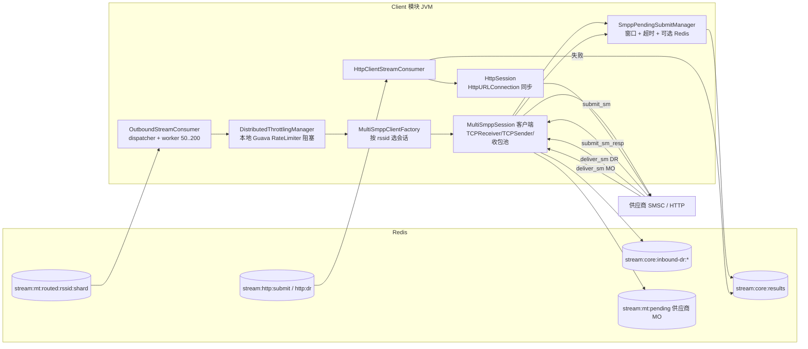

# Client 模块架构分析与改进

> 范围：Client 模块，负责从 Redis 消费 Core 路由后的 MT，通过 SMPP/HTTP 发给供应商（vendor）；接收供应商的 submit_resp 和 DR，回写给 Core。
> 结论均来自当前 `main` 代码；行号以本文写作时为准。

## 1. 总体架构



## 2. 消息流程

### 2.1 SMPP 外发

```
OutboundStreamConsumer.dispatcherLoop（单线程）
  popResponsibleDoorbell(zset:mt:routed:active)  （按 MyShards 过滤）
  → FetchAndProcessTask(stream)：循环 XREADGROUP batch=100
    每条 handleMessageSending：
      session = MultiSmppClientFactory.getSession(rssid)
      ├ 没有会话或会话未连接 → handleFailure：produceResult(COMMUNICATION_ERROR) + XACK
      ├ 发送窗口满 → logNack，退出本批次，100ms 后 windowRetry（XAUTOCLAIM minIdle=100ms）
      ├ DistributedThrottlingManager.acquire(rssid)   ← 阻塞等待令牌
      ├ submitClientOutbound → pendingSubmitManager.tryPut → connection.send（放入 sendQueue）
      └ SENT → XACK（此时还没收到 submit_sm_resp）
供应商 submit_sm_resp → handleSubmit_SM_Resp
  → 从 pending 中取回原消息 → produceResult(stream:core:results) → 删除 pending
超时 / 会话停止 → pending 按 SUBMIT_RESP_ERROR / COMMUNICATION_ERROR 回结果
```

### 2.2 供应商 DR / MO

```
deliver_sm → handleDeliver_SM4Client
  DR → produceInboundDeliveryReport(stream:core:inbound-dr) 成功 → deliver_sm_resp(OK)，失败 → ESME_RX_T_APPN
  MO → produceSubmitMessage(stream:mt:pending)        成功 → resp(OK)，失败 → ESME_RX_T_APPN
```

这条路径先写入 Redis 再回 resp，可靠性语义是对的。

### 2.3 HTTP 外发（HTTP 供应商 / 推送给 HTTP 客户的 DR）

```
HttpClientStreamConsumer：stream:http:submit:{rssid}:{shard}、stream:http:dr:{ssid}:{shard}
  每条 → session.submit(msg)（HttpURLConnection 同步，ConnectTimeout 30 秒 / ReadTimeout 60 秒）
  成功 → XACK；失败 → produceResult(失败) + XACK
```

## 3. 问题清单

### 3.1 重复下发（P0）

客户端是唯一直接把短信发给供应商的地方，这里一旦重复处理，就是供应商侧的重复下发和重复计费。

| # | 问题 | 原因 |
|---|---|---|
| D1 | **窗口满后的重试会把别的任务正在处理的消息也领走**：`scheduleWindowRetry` 用 `XAUTOCLAIM minIdle=100ms` 领取这个 stream 里所有空闲超过 100ms 的待确认消息，并不区分是谁读的。窗口满时，当前任务退出；随后门铃又会为同一个 stream 启动一个新任务，新任务读出 100 条，因为限流 `acquire` 阻塞，每条都要等，很快就超过 100ms。retry 线程把这些消息领走自己发，而新任务手里还拿着同样的消息，也会发一遍 | `OutboundStreamConsumer.scheduleWindowRetry`、`ClientOutboundWindowFullRetryMs` 默认 100ms |
| D2 | **低速通道会被 auto-claim 重复领取**：一次读 100 条，再逐条 `acquire` 限流。通道 TPS 低于 100/60≈1.7 时，批次后面的消息排队会超过 60 秒，被全局 auto-claim（`RedisStreamAutoClaimIdleMs` 默认 60 秒）领走再发一次。HTTP 通道同理：单条最长要 90 秒（连接 30 秒 + 读 60 秒），只要碰到一条慢请求，同批后面的消息就会超时被领走 | `FetchAndProcessTask` + `RedisStreamAutoClaimRunner` |
| D3 | **确认失败后会重发**：放入发送队列后才 XACK。如果 XACK 失败，或者在发送和确认之间进程退出，auto-claim 会再发一次 | `handleMessageSending` |

上线后可以在 Client 日志里搜 `ack_returned_zero`。第二个处理者确认消费时，消息已被第一个处理者确认并删除，会返回 0，出现这条日志就说明发生过重复处理。

### 3.2 限流

| # | 级别 | 问题 | 位置 |
|---|---|---|---|
| T1 | P0 | **限流只在单个节点内生效**：`DistributedThrottlingManager` 名字叫"分布式"，实际是每个节点一个 Guava `RateLimiter`。同一个 rssid 的路由 stream 按分片分布在多个 Client 节点上，每个节点都按配置的 TPS 发，实际发给供应商的速率是"节点数 × TPS"，会触发供应商限流或拒绝 | `DistributedThrottlingManager` |
| T2 | P1 | **限流会让 worker 线程睡眠等待**：`acquire()` 阻塞调用它的 worker。低速通道越多，睡眠的 worker 就越多；worker 池满了以后按 CallerRuns 由 dispatcher 自己执行，dispatcher 也睡在限流器上，所有通道一起停 | `OutboundStreamConsumer.handleMessageSending` |
| T3 | P1 | **HTTP 外发没有限流**：stream 路径只有 SMPP 调用了 `acquire`；旧的 `CustomerMessageSender` 系列有 `isAllowedToSend`，但 stream 路径没用上 | `HttpClientStreamConsumer` |

### 3.3 稳定性与吞吐

| # | 级别 | 问题 | 位置 |
|---|---|---|---|
| S1 | P1 | **会话不可用就立即判失败**：供应商连接短暂中断（重连几秒）期间，所有消息立即回 COMMUNICATION_ERROR，交给 Core 的重试策略或改道。连接抖动会造成大量失败和改道 | `handleFailure("Session disconnected")` |
| S2 | P1 | **HTTP 同步阻塞，超时过长**：默认连接 30 秒、读 60 秒，用的是 `HttpURLConnection`，没有连接池。一个慢供应商会占住它所有分片的 worker | `HttpSession` |
| S3 | P1 | **每个 stream 一个 worker，单通道吞吐受限**：单个 rssid 的吞吐上限 ≈ 分片数 / 每条耗时。SMPP 每条耗时含 `tryPut`（Redis 模式下 1 次往返）、发送、XACK（1 次往返） | `FetchAndProcessTask` |
| S4 | P2 | **公共问题**：auto-claim 用 `KEYS` 列 stream；重投没有次数上限、没有 DLQ；dispatcher 在 CallerRuns 时被卡住。这些和 Core、Server 相同 | `RedisStreamAutoClaimRunner`、`StreamQueueManager` |
| S5 | P2 | **submit_resp 超时的语义**：resp 超时后按 SUBMIT_RESP_ERROR 回 Core。如果供应商其实已经收下（只是 resp 丢了），Core 按重试策略再发一次，就会重复。这是 SMPP 协议本身的限制，可以通过让超时类失败默认不改道、不重试（或者可按通道配置）来降低影响 | `SmppPendingSubmitManager.markSubmitTimeout` |

## 4. 改进方案

### 阶段 A（与 Core 阶段 A 同批，约 1 到 2 周）

| 项 | 改动 | 对应问题 |
|---|---|---|
| A1 | **windowRetry 只重投本任务退出时还没处理的那几条**：任务退出前把剩余消息的 ID 交给 retry（用 `XCLAIM` 指定 ID），不再用 `XAUTOCLAIM` 扫整个 stream；同一个 stream 在 retry 期间不再启动新任务 | D1 |
| A2 | **按速率调整批量大小**：`batch = min(batchSize, TPS × 10 秒)`，并且始终保证"批量 / TPS" 远小于 auto-claim 的空闲阈值；HTTP 每次只读 1 到 10 条 | D2 |
| A3 | **外发幂等**：`SET client:sent:{msgId}:{rssid} NX EX 24h` 成功才真正发送；失败说明已经发过，直接 XACK | D2、D3 |
| A4 | **限流改为非阻塞**：用 `tryAcquire`，拿不到令牌就记下这个 stream 下一次可以发送的时间，挂回门铃让出 worker | T2 |
| A5 | **多节点共享限流额度**：每个节点按 `TPS / 负责该 rssid 的节点数` 设本地速率（简单）；或者用 Redis Lua 令牌桶按秒发放额度，各节点本地缓存一小批令牌（精确） | T1 |

### 阶段 B

| 项 | 改动 | 对应问题 |
|---|---|---|
| B1 | **会话不可用先等一会**：nack 并延迟重试（比如 5 秒），累计超过宽限期（比如 30 秒）仍不可用再回失败 | S1 |
| B2 | **HTTP 改用连接池 + 异步客户端**（Apache HttpClient 5 / OkHttp），超时可按通道配置（默认连接 3 秒、读 10 秒），并补上 HTTP 限流 | S2、T3 |
| B3 | **区分 resp 超时和明确拒绝**：超时类失败默认不改道、不重试，或者可按通道配置 | S5 |
| B4 | **统一消费框架**：使用 Core 文档里提出的 `StreamConsumerTemplate`，`SCAN`、DLQ、投递次数上限一起解决 | S4 |
