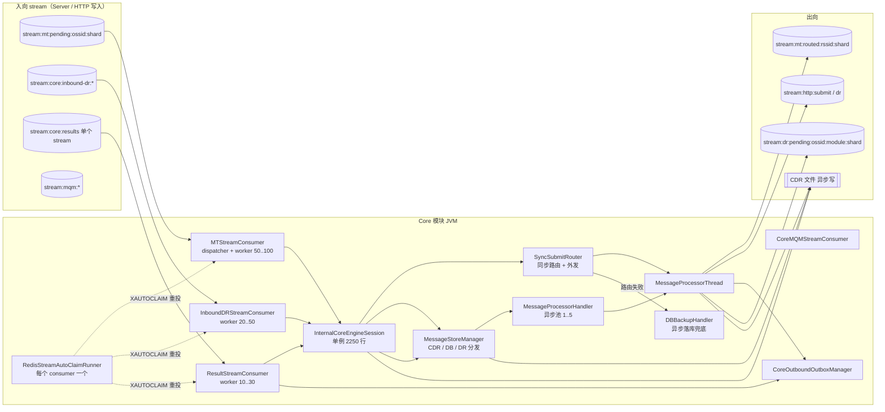

# Core 模块架构分析与改进

> 范围：Core（CoreEngine）模块，负责从 Redis Stream 消费上行 MT、做检查与路由、外发到出向 stream；消费供应商 DR 并转发给客户；消费出向结果（submit_resp / DR_resp）。
> 结论均来自当前 `main` 代码；行号以本文写作时为准。

## 1. 总体架构



关键类：

| 层 | 类 | 职责 |
|---|---|---|
| 启动 | `routing/DeliveryRouter` | 初始化 Redis、分片、DB、CDR；启动 4 个 stream consumer 和延迟 DR 分发器；把路由和黑白名单加载到 Redis |
| 消费 | `messagequeue/MTStreamConsumer`、`InboundDRStreamConsumer`、`ResultStreamConsumer`、`CoreMQMStreamConsumer` | 门铃 zset → 每个 stream 一个 worker 任务 → `XREADGROUP` 批量读 → 处理 → `XACK` |
| 重投 | `RedisStreamAutoClaimRunner` | 每隔 `RedisStreamAutoClaimIntervalMs`（默认 300 秒）用 `XAUTOCLAIM` 把空闲超过 60 秒的 PEL 消息领回来重新处理 |
| 业务入口 | `connectionpool/session/InternalCoreEngineSession`（单例，2250 行） | `processSubmitFromStream`、`handleInboundDRInternal`、`handleOutboundResultInternal`；同时保留旧的 TCP 内部 PDU 路径 |
| 路由 | `routing/SyncSubmitRouter` → `IOSMSDispatcher` → `MessageProcessorThread` | 同步完成路由、选通道、外发到出向 stream |
| 存储 | `message/gmms/MessageStoreManager`、`CDRManager`、`processor/DBBackupHandler` | CDR、DB 队列（WDQ/RDQ/SDQ…）、DR 分发 |
| 出向兜底 | `messagequeue/CoreOutboundOutboxManager` | 外发后登记 outbox，收到结果后清除；扫描超时 |

## 2. 消息流程

### 2.1 上行 MT（submit）

```
MTStreamConsumer.dispatcherLoop（单线程）
  popResponsibleDoorbell(zset:mt:pending:active)：ZRANGE 100 → 逐个 XLEN → ZREM
  → FetchAndProcessTask(stream)：循环 XREADGROUP batch=100 直到读空
    每条 → InternalCoreEngineSession.processSubmitFromStream
      ├ 发件人黑白名单、内容黑名单（内存正则）→ 拒绝：IN_SUBMIT CDR + 拒绝 DR
      ├ 高级发件人替换、过期时间
      ├ csm.processGMMS / prepareInSubmit
      └ processInnerAck
          ├ store 模式 / 定时发送 → handleInSubmit 落 SMQ
          ├ 号码长度规则 → 黑洞
          ├ handleInSubmit（写 IN_SUBMIT CDR）
          ├ 长短信：CsmReassembleMode=redis → 同步重组；默认 legacy → csmHandler 异步池
          └ 普通短信：24 小时收件人上限（Redis INCR）→ SyncSubmitRouter.routeSubmitSync
              ├ dispatch 路由；失败 → dbBackup.putMsg（异步）
              ├ spawnFakeDrIfNeeded（内联生成假 DR）
              └ MessageProcessorThread.processSync
                  → 选通道 → produceSubmitRouted（XADD + 门铃，Lua）
                  → CoreOutboundOutboxManager.register（SET + ZADD，再 SET meta）
    处理返回 true → XACK；返回 false → 留在 PEL，等 auto-claim
```

对照你给的日志：`10:57:30,112` 开始做黑名单检查，`,114` 选出 rssid 8，`,121` 登记 outbox 并写入 `stream:mt:routed:8:0`。单条处理约 9ms。

### 2.2 出向结果（submit_resp / DR_resp）

```
Client 模块 / Server 模块 → XADD stream:core:results（全系统只有一个 stream）
ResultStreamConsumer → handleOutboundResultInternal
  submit_resp：OUT_SUBMIT CDR；写 DR 反查缓存（outMsgID → 原消息，Redis SET + hash）；重试策略
  DR_resp：IN_DELI_REP CDR
  → CoreOutboundOutboxManager.complete → XACK
```

### 2.3 供应商 DR → 客户

```
Client 模块 → XADD stream:core:inbound-dr:* 
InboundDRStreamConsumer → handleInboundDRInternal
  ├ Redis GET outMsgID 取原消息；命中后立即 DEL（状态不是 ACCEPT 时）
  ├ 未命中 → 查 DB；DB 也没有 → processStoredDeliveryReport（存入 SDQ 以后再匹配）
  └ processDeliveryReport → processInnerAck → handleOutDeliveryReportResForInnerAck
       → OUT_DELI_REP CDR → sendDRMessage → processorHandler.putMsg（异步内存池）
  → 返回 true → XACK
MessageProcessorHandler 池（MessageProcessorThread#N）→ transactDR
  → produceDeliveryReportToQueue(stream:dr:pending:ossid:module:shard) 或 HTTP DR stream
```

对照日志：`10:57:45,201` 写 OUT_DELI_REP，`,204` 由 `MessageProcessorThread#1` 写入 `stream:dr:pending:8888:MultiSmppServer1:1`。

## 3. 问题清单

分级：**P0** 会丢消息、重复下发或错账；**P1** 是容量或稳定性问题；**P2** 是可维护性和效率问题。

### 3.1 可靠性：先确认后处理、重投不幂等

| # | 级别 | 问题 | 位置 |
|---|---|---|---|
| R1 | P0 | **DR 转发是先 ack 后处理**：Core 把 DR 交给 `MessageProcessorHandler` 的内存线程池后就返回 true，入向 DR stream 随即 XACK。真正写出 `stream:dr:pending` 的动作在异步线程里，进程崩溃或重启时，池中排队的 DR 会丢失：没发给客户，也不会再被重投 | `MessageStoreManager.doSendDRMessage` → `processorHandler.putMsg`；`InboundDRStreamConsumer.processMessage` |
| R2 | P0 | **DR 反查缓存在处理前就删了**：`handleInboundDRInternal` 拿到原消息后立即 `DEL outMsgID`，之后才处理。如果后续处理返回 false 或抛异常，消息留在 PEL 等 auto-claim 重投，但重投时 Redis 已经查不到，只能退到 DB，查不到就进 SDQ。重试的语义被破坏了 | `InternalCoreEngineSession.java:1617-1631` |
| R3 | P0 | **MT 重投没有幂等保护**：消息只有处理完才 ack；中途失败，或处理成功但 XACK 失败，auto-claim 会把整条消息重新处理一遍。已经发生的副作用会再来一次：IN_SUBMIT CDR 重复、24 小时收件人计数重复加、假 DR 再发一次（`retriedNumber` 不会因重投而增加）、`produceSubmitRouted` 再外发一次，导致供应商侧重复下发 | `MTStreamConsumer.processMessage`、`SyncSubmitRouter.routeSubmitSync`、`spawnFakeDrIfNeeded` |
| R4 | P1 | **兜底路径是异步的**：路由失败、rssid 为空、RA2P 无效等情况交给 `dbBackup.putMsg`（内存池）后就 ack。默认的长短信模式（`CsmReassembleMode=legacy`）同样是交给 `csmHandler` 异步池后就 ack。崩溃时这些消息会丢；代码注释里也承认了这一点 | `SyncSubmitRouter.java:78-106`、`InternalCoreEngineSession.java:1940-1948` |
| R5 | P1 | **CDR 异步写文件**：`cdrAsynWriter` 先写内存缓冲，崩溃会丢最后一批 CDR，而对应的消息已经 ack，造成对账差异 | `CDRManager.add` |
| R6 | P1 | **重投没有次数上限**：反序列化失败才进 DLQ。一直处理失败的"毒消息"每 5 分钟被 auto-claim 领回来一次，永远不进 DLQ，PEL 也会一直增长 | `RedisStreamAutoClaimRunner.recoverOnce` |
| R7 | P1 | **收件人计数可能永不过期**：先 `INCR`，等于 1 时再单独 `EXPIRE`。如果两步之间出错，key 永不过期，这个号码会被永久拦截。同样的代码有两处 | `processInnerAck`、`SyncSubmitRouter.applyDuplicateCheck` |

### 3.2 吞吐与扩展性

| # | 级别 | 问题 | 位置 |
|---|---|---|---|
| S1 | P0 | **结果全系统只有一个 stream**：`stream:core:results` 是单个 stream，而同一个 stream 在一个节点上同一时刻只有一个 worker 处理（`processingMap`），所以每个 Core 节点实际只有 1 个线程处理全部 submit_resp 和 DR_resp，配置的 10 到 30 个 worker 用不上。它同时也是 Redis 单 key 热点。结果一旦积压，DR 反查缓存写得晚，供应商的 DR 先到时就会查不到（R2 的路径），DR 被打进 SDQ，延迟下发 | `StreamQueueManager.produceResult`、`ResultStreamConsumer` |
| S2 | P1 | **DR 转发线程太少**：DR 发往客户统一经过 `MessageProcessorHandler` 池，默认只有 1 到 5 个线程（`Min/MaxMessageProcessorNumber`），而 MT 有 50 到 100 个 worker。DR 高峰时排队，超过 `CacheMsgTimeout` 就按 FAIL_SENDOUT_DELIVERYREPORT 处理 | `MessageProcessorHandler` |
| S3 | P1 | **auto-claim 用 `KEYS` 列 stream**：`listResponsibleStreams` 调的是 `jedis.keys(pattern)`，每个 consumer、每个节点每 5 分钟执行一次。stream 数是"客户数 × 分片数"量级，`KEYS` 会阻塞 Redis | `RedisConnection.keys`、`RedisStreamAutoClaimRunner` |
| S4 | P1 | **每条 MT 的 Redis 往返多**：门铃 XADD（1 次）+ outbox `setPendingMessage`（1 次）+ meta `SET`（1 次）+ XACK（1 次），可选再加收件人计数 2 次。outbox 可以并进外发的那段 Lua 一次执行 | `MessageProcessorThread`、`CoreOutboundOutboxManager.register` |
| S5 | P1 | **单个大 stream 长期占着 worker**：每个 worker 一直读到 stream 空为止；worker 池满时按 CallerRuns 由 dispatcher 自己执行，所有 stream 的分发一起停（和 Server 侧 D1、D2 相同） | 各 `FetchAndProcessTask`、`dispatcherLoop` |
| S6 | P1 | **生产环境开着 TRACE 日志**：线上日志里有大量 TRACE（`match cc`、`do login …`、`recipientRule is null`），每条消息还有好几条 INFO/DEBUG（CDR 全文、outbox、dispatch）。高 TPS 下，同步写日志会成为主要开销 | 日志配置 |

### 3.3 代码结构

| # | 级别 | 问题 | 位置 |
|---|---|---|---|
| C1 | P2 | **同步、异步两套路径并存**：MT 已经改成同步（`SyncSubmitRouter`），DR 仍走异步池；启动时仍初始化 `DeliveryRouterHandler`、`MessageProcessorHandler`、`CsmProcessorHandler` 这些旧的异步组件。同一类消息走哪条路，取决于从哪个入口进来 | `DeliveryRouter.startService` |
| C2 | P2 | **重复代码**：<br>- `processSuccessSubmitFromStream` 和 `processSuccessSubmit` 的黑白名单逻辑几乎一样（约 100 行）<br>- "黑名单命中 → 写 CDR + 拒绝 DR"这段重复了 6 次<br>- 假 DR 判断有 4 份拷贝（`MessageProcessorHandler.putMsg` 里 3 份，`SyncSubmitRouter` 里 1 份） | `InternalCoreEngineSession`、`MessageProcessorHandler`、`SyncSubmitRouter` |
| C3 | P2 | **核心类过大**：`InternalCoreEngineSession` 单例 2250 行，同时承担旧 TCP 会话、stream 入口、业务检查和 DR 处理；`MessageProcessorThread` 1123 行 | — |
| C4 | P2 | **4 个 consumer 写法完全一样**：dispatcher、worker、门铃、auto-claim 各复制了一遍（MT、InboundDR、Result、MQM，再加上 Server 的 DR、Client 的 Outbound） | `messagequeue/*StreamConsumer` |
| C5 | P2 | **小 bug**：`MessageProcessorHandler.putMsg` 先调用 `oInfo.getPriority()`，再判断 null；ossid 不存在时直接抛 NPE，被外层吞掉后返回 false | `MessageProcessorHandler.java` |

## 4. 改进方案

### 4.1 原则

1. **每个 stream 消费都遵守"先持久化下一跳，再 ack"**：凡是 ack 之后才执行的动作，要么已经写进下一个 stream，要么写进有持久化的 outbox，不能只放在内存池里。
2. **处理要幂等**：以 `msgId + 阶段` 作为幂等键（`SET NX`，TTL 覆盖重投窗口），重投时跳过已经完成的副作用（CDR、外发、假 DR、计数）。
3. **热点 stream 要分片**：结果流和 MT 一样按 `rssid/ossid` 加分片号拆开。
4. **重投要有上限**：用 `XPENDING` 的投递次数，超过上限就写入 DLQ 并告警。

### 4.2 分阶段实施

#### 阶段 A：可靠性止血（约 1 到 2 周）

| 项 | 改动 | 对应问题 |
|---|---|---|
| A1 | DR 转发改为同步：`InboundDR` 的 worker 直接调用 `MessageProcessorThread.processSync()`（和 MT 的 `SyncSubmitRouter` 一样），写出 `stream:dr:pending` 成功后才 XACK | R1、S2 |
| A2 | DR 反查缓存改成处理成功后再删除，或者重投时允许重新读取；`DEL` 放到 XACK 之前的最后一步 | R2 |
| A3 | MT 幂等：进入 `processSubmitFromStream` 前先 `SET core:done:{msgId}:submit NX EX <ttl>`，值为"处理中"，完成后标为"已完成"。重投时如果已完成就直接 ack；如果处于处理中，就跳过 CDR、假 DR、计数，只重试外发 | R3 |
| A4 | auto-claim 读取投递次数（`XPENDING` 或 `XAUTOCLAIM` 返回值），超过 `RedisStreamMaxDeliveries`（比如 10 次）就写入 DLQ、ack 并告警 | R6 |
| A5 | `INCR` + `EXPIRE` 合并成一段 Lua（或 `SET NX EX` 加 `INCR`），抽成一个公共方法，两处共用 | R7 |
| A6 | 生产日志级别改为 INFO，每条消息的明细日志降到 DEBUG；CDR 不再额外打一份 DEBUG 全文 | S6 |
| A7 | 默认使用 `CsmReassembleMode=redis` | R4 |

#### 阶段 B：吞吐（约 2 到 3 周）

| 项 | 改动 | 对应问题 |
|---|---|---|
| B1 | 结果流分片：`stream:core:results:{rssid}:{shard}`，归 `ZSET_CORE_RESULTS_ACTIVE` 门铃管理，按 `MyShards` 分配到各节点。迁移期间新旧 stream 同时消费 | S1 |
| B2 | outbox 登记并进外发 Lua（XADD + ZADD 门铃 + outbox SET/ZADD 一次完成）；结果侧的 `complete` 和 XACK 用 pipeline 一起发 | S4 |
| B3 | auto-claim 改用 `SCAN`，或者直接复用门铃 zset 里登记的 stream 集合，不再用 `KEYS` | S3 |
| B4 | worker 每轮最多处理 N 批，然后重新挂门铃让出线程；worker 池拒绝时不再由 dispatcher 自己执行；门铃弹出改成一段 Lua | S5 |
| B5 | dbBackup 兜底改为先写 `stream:dlq:submit`（持久化）再 ack，由单独的消费者写 DB | R4 |

#### 阶段 C：结构重构（视需要）

- **抽出 `StreamConsumerTemplate`**：门铃、worker、批量读、ack、auto-claim、DLQ、指标都放在这里，各个 consumer 只实现 `process(msg) → Outcome{ACK, RETRY, DLQ}`。
- **把 `InternalCoreEngineSession` 的 stream 入口拆成三个处理器**：
  - `SubmitPipeline`：按"检查 → 预处理 → 路由 → 外发"串成一条管线，每一步都是可以单独测试的小类；拒绝统一由 `RejectHandler`（CDR + 拒绝 DR）处理。
  - `InboundDrPipeline`
  - `ResultPipeline`
- **删掉旧的异步路径**：`DeliveryRouterHandler`/`DeliveryRouterThread`，以及 `MessageProcessorHandler` 只为 DR 存在的那部分。假 DR 判断收拢成一个方法。

## 5. 验证建议

| 场景 | 方法 | 期望 |
|---|---|---|
| DR 不丢 | DR 高峰中 kill -9 Core | 重启后 `stream:dr:pending` 收到全部 DR，`IN_DELI_REP` 和 `OUT_DELI_REP` 数量一致 |
| MT 不重复 | 让 `produceSubmitRouted` 之后的 XACK 失败（断开 Redis 连接） | auto-claim 重投后，供应商只收到一次，CDR 只有一条 |
| DR 先于结果到达 | 让结果流积压（暂停 ResultStreamConsumer）后发 DR | 阶段 B1 之后积压消失；A2 之后能够重试，不再直接进 SDQ |
| 毒消息 | 构造一条处理时必定抛异常的消息 | 投递 N 次后进入 DLQ 并告警，PEL 不再增长 |
| Redis 阻塞 | 造 1 万个 stream key，观察 auto-claim 周期 | 不再出现 `KEYS` 慢日志 |
| 吞吐 | 1 万 TPS MT + 对应 DR | 结果流时延 P99、DR 下发时延 P99 |

## 6. 补充说明

### 6.1 DR 转发改成同步，对性能的影响

总工作量不变，只是把"写出 `stream:dr:pending`"这一步从 `MessageProcessorHandler` 池（默认 1 到 5 个线程，所有 DR 都要排队）挪到 InboundDR 的 worker（20 到 50 个线程）上直接执行，所以吞吐会提高，排队时延也没有了。代价有两点：
- 每条 DR 确认消费的时间点推后约 1 次 Redis 往返。
- 单个 stream 串行处理，上限约为"1 / 单条耗时"，大约每秒 500 条；超过时靠分片或 pipeline 扩展。MT 现在已经是这个模型。

### 6.2 为什么会重复处理

Redis Stream 只知道一条消息有没有被确认消费，不知道它是不是处理失败了。auto-claim 领取的是"空闲超过 60 秒还没确认"的消息。下面这些情况都会让已经处理过的消息再被处理一次：

1. **处理成功但确认失败**：比如网络抖动，或者 Redis 已经执行了确认、只是响应没回来。代码里有专门的日志 `ack failed after process success`。
2. **外发之后、确认之前进程退出**：外发和确认是两次独立的 Redis 调用。
3. **处理到一半失败，前面的步骤不回滚**：CDR、收件人计数、假 DR 都已经执行，最后外发失败，返回 false 等重投；重投时这些步骤再执行一遍。`retriedNumber` 不会因重投增加，挡不住假 DR 重复。
4. **批量读出后排队超过 60 秒**：一次读 100 条后逐条处理，遇到 Redis 变慢、GC 或者限流等待时，后面的消息会被 auto-claim 领走并同时处理（Client 侧更容易发生，见 Client 文档 D1、D2）。

确认消费时用 Lua 同时执行 `XACK` 和 `XDEL`，第二个处理者再确认时，消息已被第一个处理者确认并删除，会返回 0，日志里就出现 `ack_returned_zero`，可以用它来统计线上发生重复的次数。

### 6.3 幂等标记的做法

用 msgId（Server 生成，存在 stream 的消息体里，重投时不会变）记录处理到了哪一步：

```
st = GET core:mt:{msgId}
ROUTED → 直接 XACK
null   → 写 CDR、计数、假 DR → SET core:mt:{msgId} PRE EX 86400
PRE    → 跳过 CDR、计数、假 DR，只重试外发
外发：同一段 Lua 执行 XADD 出向 stream + ZADD 门铃 + 登记 outbox + SET core:mt:{msgId} ROUTED
→ XACK
```

外发和写"已完成"标记在同一段 Lua 里，所以任何时刻崩溃或确认失败，重投时都能正确判断处理到了哪一步。
