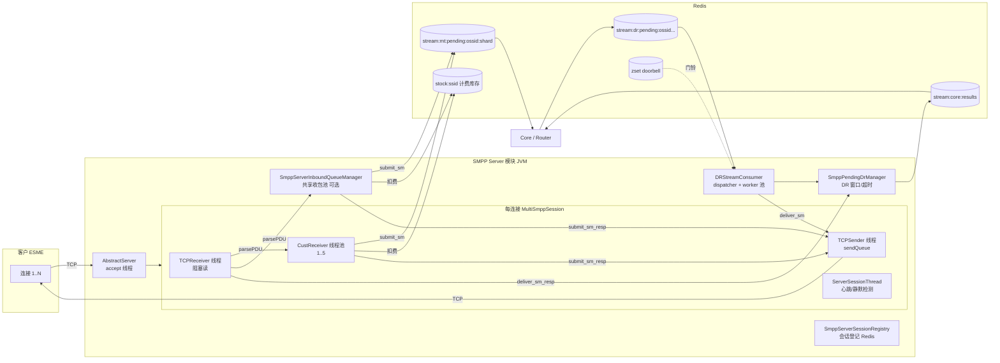
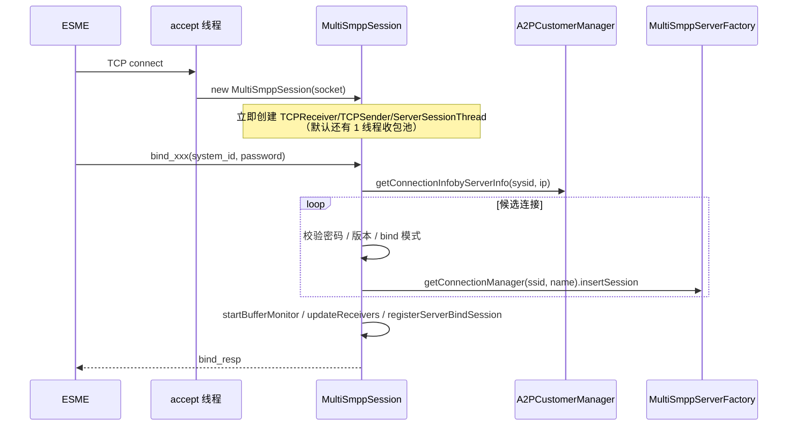
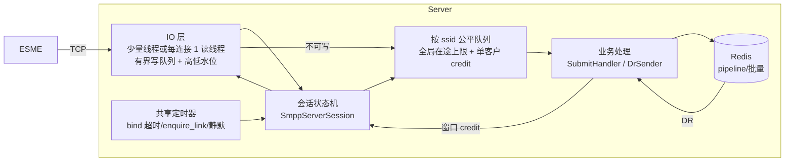

# SMPP Server 架构分析与改进

> 范围：`MultiSmppServer` 所在的 SMPP 服务端模块，即客户（ESME）通过 SMPP 连接进来提交 MT（submit_sm）、接收 DR（deliver_sm）的这一侧。
> 不含 Core 路由、出向 Client 和 HTTP 接入。
> 结论均来自当前 `main` 代码；行号以本文写作时为准。

## 1. 总体架构



关键类：

| 层 | 类 | 职责 |
|---|---|---|
| 监听 | `listener/AbstractServer`、`listener/smppserver/MultiSmppServer` | 阻塞 `ServerSocket.accept()`，每个 socket `new MultiSmppSession(socket)` |
| IO | `connectionpool/TCPIPConnection` | 每连接 1 个读线程 + 1 个写线程，写走无界 `ConcurrentLinkedQueue` |
| 会话 | `connectionpool/session/MultiSmppSession`（2468 行） | bind 鉴权、PDU 分发、submit/deliver 业务、DR 发送、窗口管理，客户端和服务端两种角色共用一个类 |
| 会话保活 | `sessionthread/ServerSessionThread` | 每连接 1 个线程：未 bind 等待、enquire_link、静默超时 |
| 收包调度 | `AbstractCommonSession.parse` + `SmppServerInboundQueueManager` | 每会话线程池（默认）或按 ssid 公平调度的共享池（`SmppServerInboundSharedPoolEnable`） |
| 连接管理 | `customerconnectionfactory/MultiSmppServerFactory`、`ConnectionManager` | ssid+连接名 → 会话集合；DR 按 ssid 选会话 |
| 下行 DR | `messagequeue/DRStreamConsumer` | Redis 门铃 zset → 每个 stream 一个任务 → 选会话发 deliver_sm |
| DR 窗口 | `smpp/pending/SmppPendingDrManager` | 按会话的在途窗口、超时、可选 Redis 持久化 |
| 多实例 | `ha/SmppServerAssignmentResolver`、`SmppServerSessionRegistry`、`SmppServerDrRouteResolver` | 客户分配到模块、会话登记、DR 路由到持有连接的模块 |

## 2. 消息流程

### 2.1 连接与 bind



- 一个 TCP 连接在 bind 之前就已经占了 3 到 4 个线程。
- 未 bind 的连接要等 `MaxSilentTime`（默认 600 秒）才会被 `ServerSessionThread` 关闭。

### 2.2 上行 submit_sm（MT）

```
TCPReceiver.read → ByteBuffer.allocate(len) → parsePDU（拷贝到 Unprocessed）
  → [共享池: 按 ssid 入队 → Dispatcher 轮转 → Worker]
    或 [每会话线程池 ReceiverThread]
  → MultiSmppSession.receive → processServerRequest
     1. refreshServerBindRegistry（按间隔刷新 Redis 登记）
     2. checkThrottlingControl：thcon 开关（静态缓存 50 秒）+ ThrottlingControl.isAllowedToReceive
        → 不允许时回 ESME_RTHROTTLED
     3. processor.handleSubmitSM 解码成 GmmsMessage
     4. 计费：stock:ssid 扣 1；stock:ssid:cc 扣 1（Lua，余额不足返回 -2）
     5. StreamQueueManager.produceSubmitMessage
        → Lua 一次执行 XADD stream:mt:pending:{ossid}:{shard} + ZADD 门铃
     6. 成功 → submit_sm_resp(ROK, message_id)；失败 → ESME_RSYSERR
```

- 写入 Redis 成功后才回 resp，"先落盘再确认"的语义是对的。
- 每条消息同步访问 Redis 1 到 3 次（扣费 0 到 2 次，XADD 1 次）。吞吐受这几次往返时间和收包线程数的限制。

### 2.3 下行 DR / MO（deliver_sm）

```
Core → XADD stream:dr:pending:{ossid}[:module:shard] + ZADD zset:dr:pending:active
DRStreamConsumer.dispatcherLoop（单线程）
  popResponsibleDoorbell：ZRANGE 100 → 逐个 XLEN → ZREM
  → workerPool.submit(FetchAndProcessTask(stream))  （同一个 stream 同一时间只有 1 个任务）
FetchAndProcessTask：循环 XREADGROUP batch=100，直到 stream 读空或窗口满
  每条：resolveServerSession(按 ssid 策略选会话)
       → hasServerDrWindow → submitServerDr
            → SmppPendingDrManager.tryPut（可选 Redis 持久化）
            → connection.send(放入 sendQueue)
       → SENT 后立即 XACK
       → 窗口满：logNack，延迟 windowRetry
       → 找不到会话或发送失败：produceResult(11005) + XACK
ESME deliver_sm_resp → handleDeliver_SM_Resp
  → pending 中取回原消息 → produceResult(stream:core:results) → 删除 pending
```

## 3. 问题清单

分级：**P0** 会导致服务不可用或丢数据、错账；**P1** 会导致容量或稳定性问题；**P2** 是可维护性和效率问题。

### 3.1 线程与连接模型

| # | 级别 | 问题 | 位置 |
|---|---|---|---|
| T1 | P0 | **每个连接 4 到 8 个线程**：TCPReceiver、TCPSender、ServerSessionThread、收包池 1 到 5 个，RECOVER 状态再加 1 个 Timer。2 万个连接就是 8 万到 16 万个线程，会先打满系统线程上限，报 `unable to create native thread` | `TCPIPConnection.open`、`MultiSmppSession(Socket)`、`AbstractCommonSession.initReceivers`、`ServerSessionThread` |
| T2 | P0 | **accept 循环只捕获 `IOException`**。`createSession` 抛出 `OutOfMemoryError` 时 accept 线程直接退出，整个端口不再接受连接；已经创建了一半的会话（线程、socket）也没人回收 | `AbstractServer.run` |
| T3 | P1 | **没有连接数上限**：没有全局、单 IP 或单客户的上限，也没有单独的 bind 超时（复用 600 秒的 `MaxSilentTime`）。重连风暴或扫描端口时，空连接会把线程占满 | `AbstractServer.run`、`ServerSessionThread.run` |
| T4 | P1 | **发送队列无界**：`TCPIPConnection.sendQueue` 没有长度限制。客户读得慢时，DR、resp 会一直堆在堆里，也没有反压通知上游 | `TCPIPConnection.send` |
| T5 | P1 | **空闲线程轮询**：每个 `TCPSender` 空闲时每 200ms 唤醒一次，2 万个连接是每秒约 10 万次；共享收包池的 dispatcher 空闲时每 1ms 唤醒一次 | `TCPSender.run`、`SmppServerInboundQueueManager.Dispatcher` |
| T6 | P2 | **每次读都复制两次**：先 `ByteBuffer.allocate(len)` 新建一份，`parsePDU` 再拷一份到 `Unprocessed`，产生不少 GC 垃圾 | `TCPReceiver.run`、`MultiSmppSession.parsePDU` |
| T7 | P2 | **bind 之前就分配资源**：默认模式下，构造会话时就建了收包线程池 | `MultiSmppSession(Socket)` |

### 3.2 收包调度（共享池）

| # | 级别 | 问题 | 位置 |
|---|---|---|---|
| Q1 | P0 | **调度线程会被任务卡住**。worker 池队列只有 1000，满了以后按 CallerRuns 由 dispatcher 线程自己执行任务。默认只有 2 个 dispatcher，它一去执行任务，所有客户的分发都停了 | `SmppServerInboundQueueManager.executeTask` + `A2PCallerRunsPolicy` |
| Q2 | P1 | **单客户可占用的线程太多**：单客户最多同时处理 100 条，线程池最多 300，3 个客户就能占满 | `SmppServerInboundMaxInFlightPerSsid` |
| Q3 | P1 | **全局队列 200 万条**，内存风险大，而且 40 个客户同时堆满就会让所有客户都被限流 | `SmppServerInboundGlobalQueueLimit` |
| Q4 | P2 | **每条消息都重新读配置**：`getInt` 和 `isEnabled` 每次都调 `getCommonProperty` 再解析 | `submit`、`dispatchSsid` |

### 3.3 业务处理（submit_sm / deliver_sm）

| # | 级别 | 问题 | 位置 |
|---|---|---|---|
| B1 | P0 | **计费只扣不退**。先扣 `stock:ssid`，再扣 `stock:ssid:cc`。① 国家余额不足被拒时，总余额已经扣了；② `produceSubmitMessage` 失败回 RSYSERR 时，两份余额都已经扣了。这两种情况都不退款，客户被多扣钱 | `processServerRequest` SUBMIT_SM / DELIVER_SM 分支 |
| B2 | P1 | **Redis 出错时两项计费行为相反**。`stock()` 出异常返回 null：总余额判断 `stock==null` 就拒绝，国家余额判断 `stock!=null && stock<0` 就放行 | 同上 |
| B3 | P1 | **每条消息打多条完整 info 日志**：消息全文、`accepted asynchronously`、DR 的 `resolved session`、`send dr` 等，再加上 pduLogger 每个 PDU 一条。高 TPS 下日志 IO 会成为瓶颈 | `processServerRequest`、`DRStreamConsumer.sendDeliveryReport` |
| B4 | P2 | **SUBMIT_SM 和 DELIVER_SM 两个分支约 150 行几乎一样**：限流、计费、入流、回 resp 都复制了一遍，而且限流顺序不一致（submit 在解码前，deliver 在解码后） | `processServerRequest` |
| B5 | P2 | **`MultiSmppSession` 职责过多**：2468 行，同时管 IO 回调、bind 鉴权、服务端业务、客户端业务、窗口、DR、注册表 | — |

### 3.4 下行 DR

| # | 级别 | 问题 | 位置 |
|---|---|---|---|
| D1 | P1 | **大客户长期占着 worker**。`FetchAndProcessTask` 会一直读到 stream 空为止。worker 池 core=20、队列 5000，队列不满就不会扩到 max 50，所以实际只有 20 个 worker。20 个大客户在消化积压时，其他客户的 DR 只能排队，时延变大 | `DRStreamConsumer.FetchAndProcessTask` |
| D2 | P1 | **dispatcher 单线程，门铃弹出代价高**：每弹出一个 stream 要 `ZRANGE 100` + 逐个 `XLEN` + `ZREM`，3 次以上 Redis 往返，空闲时 sleep 100ms。worker 池满时按 CallerRuns 由 dispatcher 自己执行，同样会卡住分发 | `dispatcherLoop`、`popResponsibleDoorbell` |
| D3 | P1 | **每条 DR 约 4 次同步 Redis 访问**：持久化 pending（Redis 模式）、XACK、写结果流、删 pending。没有做批量 ack 或 pipeline | `sendDeliveryReport`、`handleDeliver_SM_Resp` |
| D4 | P1 | **放进发送队列就 ack 了**。之后的可靠性完全靠 `SmppPendingDrManager`。如果客户的 `SMPPDRPendingMode` 是内存模式，进程崩溃时这些 DR 就丢了，既没回 Core，也不在 stream 里 | `sendDeliveryReport` 中 SENT 后 `ackById` |
| D5 | P2 | **会话不在就直接判失败**：客户临时断线（几秒内重连）期间的 DR 会立即回 11005 并 ack，没有给重连留一个短暂的宽限期 | `failToCoreAndAck` |

## 4. 改进方案

### 4.1 目标架构



原则：

1. **线程数和连接数脱钩**：IO 线程不超过每连接 1 个，其余工作都放到共享池或共享定时器上。
2. **每一级都有界、都能反压**：发送队列 → 会话窗口 → 单客户队列 → 全局队列，满了就回 `ESME_RTHROTTLED` 或暂停读取，不在内存里无限堆积。
3. **调度线程只做分发，不执行任务**：拒绝时把客户放回轮转队列，不用 CallerRuns。
4. **扣费和入流要么都成功，要么都不发生**。

### 4.2 分阶段实施

#### 阶段 A：止血（配置 + 小改动，约 1 周，风险低）

| 项 | 改动 | 对应问题 |
|---|---|---|
| A1 | accept 循环改为捕获 `Throwable`；会话创建失败时清理已经起来的线程和 socket；加全局、单 IP 最大连接数，超过直接关闭 | T2、T3 |
| A2 | 独立的 bind 超时 `SmppServerBindTimeoutMs`（默认 30 秒），未 bind 的连接到时关闭 | T3 |
| A3 | 计费改为一段 Lua 同时扣总余额和国家余额；入流失败调用补偿 `INCRBY` 退款；Redis 异常时两项统一按"拒绝"处理（或按配置选择） | B1、B2 |
| A4 | 共享池：dispatcher 先检查全局同时处理数，到上限就停止分发；worker 池拒绝时不再由调用方执行，而是把客户放回轮转队列 | Q1 |
| A5 | 开启 `SmppServerInboundSharedPoolEnable=true`；`MaxInFlightPerSsid` 设 20 到 30，`PerSsidQueueSize` 设 5000 到 10000，`GlobalQueueLimit` 设 20 万左右 | T1、Q2、Q3 |
| A6 | DR worker 池：`WorkerQueueSize` 调小，或 core=max，让 worker 真正能扩上去；`FetchAndProcessTask` 每轮最多处理 N 批，然后重新挂回门铃让出 worker | D1 |
| A7 | 每条消息的 info 日志改成 debug，或抽样输出；消息全文只在 debug 级别打印 | B3 |
| A8 | JVM 加 `-Xss256k`；系统调大 `ulimit -u/-n`、`pid_max`、`threads-max`、`max_map_count`；用 `SmppServerAssignmentResolver` 把客户分散到多个模块 | T1 |

#### 阶段 B：线程模型收敛（约 2 到 3 周，风险中等）

| 项 | 改动 | 对应问题 |
|---|---|---|
| B1 | 去掉每连接的 `TCPSender`：由调用方在锁内直接写；或用一个共享的小写线程池，按连接串行写。写队列改成有界，并加高低水位，超过高水位时通知 DR 侧暂停对这个会话发送 | T1、T4、T5 |
| B2 | 去掉 `ServerSessionThread`：用 1 个 `ScheduledExecutorService`（或 HashedWheelTimer）统一负责所有会话的 bind 超时、enquire_link、静默检查和 RECOVER 计时 | T1、T5 |
| B3 | 收包统一走共享公平队列，删掉每会话的收包线程池代码路径 | T1、T7 |
| B4 | DR：持久化 pending、XACK、写结果改成 pipeline 或批量（XACK 一次带多个 ID）；门铃弹出改成一段 Lua 原子执行 | D2、D3 |
| B5 | DR 找不到会话时，先进入短暂的延迟重试（比如 30 秒，重连宽限期），超时再回 11005 | D5 |
| B6 | 内存模式的 DR pending：只有收到 deliver_sm_resp 后才 XACK；或者把 Redis 模式设为默认 | D4 |

完成后，每个连接只剩 1 个读线程，2 万个连接对应 2 万个线程（栈 256k 时约几 GB），单机可以承受。

#### 阶段 C：IO 重构（视容量需求，约 1 到 2 个月，风险高）

- 引入 Netty（目前 `jar/` 下没有，需要新增依赖）：
  - 用 `LengthFieldBasedFrameDecoder` 按 SMPP 头部长度拆包。
  - 用 `IdleStateHandler` 替代心跳线程。
  - 用 `Channel.isWritable()` 和 `WriteBufferWaterMark` 实现反压。
- 拆分 `MultiSmppSession`：
  - `SmppServerSession`（状态机）
  - `BindAuthenticator`
  - `SubmitHandler`（限流、计费、入流、回 resp）
  - `DrSender`（窗口、发送、超时）
  - 客户端会话单独成类。
- Redis 改用异步客户端（Lettuce）：按 ssid 小批量 XADD，在回调里发 submit_sm_resp，用较少线程撑起更高的 TPS。
- 线程数变成固定的"CPU 核数 × 2"个 IO 线程加上共享业务池，与连接数无关。

**取舍**：阶段 A、B 已经能撑住 2000 个客户、2 万个连接（多节点部署）。只有单节点需要承载远超 2 万个连接，或单节点 TPS 要上 10 万级时，才值得做阶段 C。

## 5. 验证建议

| 场景 | 方法 | 关注指标 |
|---|---|---|
| 连接容量 | 压测工具建立 2 万个连接，只 bind 不发消息 | 线程数（`/proc/<pid>/status` 的 Threads）、RSS、GC 停顿、bind 耗时 |
| 空连接攻击 | 1 万个连接只建立 TCP 不 bind | bind 超时是否生效、accept 线程是否存活 |
| 线程耗尽 | 用 `ulimit -u` 人为压低上限 | 端口是否仍可连接、错误日志 |
| 公平性 | 1 个客户 1 万 TPS + 100 个客户各 10 TPS | 小客户的 submit_sm_resp P99 时延 |
| 慢客户 | 一个客户不回 deliver_sm_resp、不读 socket | 堆内存、其他客户 DR 时延、发送队列水位 |
| 计费一致性 | 制造 Redis 写流失败、国家余额不足 | 扣费 − 成功入流条数 = 0 |
| DR 可靠性 | 发送 DR 过程中 kill -9 | 重启后 DR 是重发还是回 11005，不能静默丢失 |
