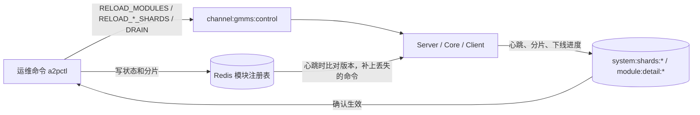
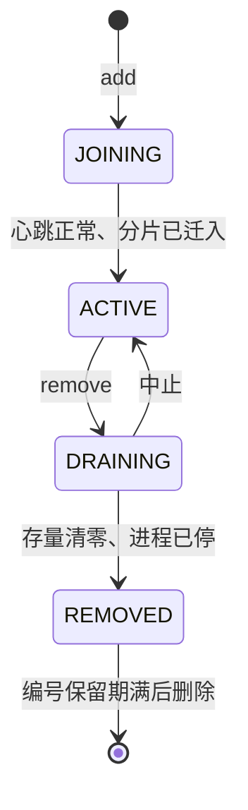

# 模块动态扩缩容设计

> 日期：2026-11-04。状态：**设计稿，还没有实现，也没有实测**。第 2 节的现状来自读当前 `main` 的代码，标“已有用例”的项有回归覆盖。范围是 SMPP Server、Core、Client；HTTP Server 和 MQM 不在本期，见第 11 节。

## 1. 目标

在商用环境运行中增加或删除 Server、Core、Client 模块，业务不中断。

| 要求 | 说明 |
|---|---|
| 不丢消息 | MT、DR、结果都不丢，包括操作中途进程崩溃 |
| 尽量不重复 | 外发不重复；DR 允许现有的“最多重发一次”语义 |
| 可中止、可回退 | 每一步失败都停下，并能回到上一个状态 |
| 默认不改变行为 | 不开新开关时，现有部署和现在完全一样 |

**不做：**

- 进程内热插拔。一个模块就是一个 JVM，加减模块就是起停进程。
- 自动接管。节点挂掉后积压等待，由人决定，不会丢消息（`FT-06`、`FT-01`）。自动接管要先解决误判和两个节点抢同一分片的问题。
- 运行中改 `TotalShards`。配置说明要求修改前先清空积压，所以扩缩容只调整分片归属。

## 2. 现状和差距

| 能力 | 现状 | 差距 |
|---|---|---|
| 分片迁移 | `RELOAD_CORE_SHARDS@模块`、`RELOAD_CLIENT_SHARDS@模块`，已有用例（`FT-06`、`CS-03`） | 手工操作；不支持迁空，见 2.2 |
| 分片校验 | `ShardAssignmentChecker` 每分钟比对，问题打 `[SHARD-CHECK]` 日志 | 只告警，不参与操作流程 |
| 存活检测 | 模块心跳、`STATUS_OFFLINE`；Core 发 DR 时避开已下线的 Server，已有用例（`DrLivenessIT`） | 只区分在线和离线，没有“正在下线” |
| 模块列表 | `ModuleManagement.xml` 或 `a2p_modules.conf`，只在启动时读 | 不能热加载 |
| 优雅下线 | 各模块有 `stopService()`，但 `HALauncher.stopService()` 是空实现，关闭钩子只打印一行 | 停进程等于直接杀，内存队列不会清空 |
| 崩溃恢复 | `kill -9` 后不丢、不重复外发，已有用例 | 可以作为下线失败时的兜底 |

### 2.1 依赖模块列表的地方

| 用途 | 位置 | 模块数变化的影响 |
|---|---|---|
| Client 连接数 | `getSessionNumberOfModule`：`SessionNumber / 同类模块数`，向上取整 | 见第 6 节 |
| 消息 ID 的模块号 | `getModuleIndex`：模块在列表里的位置，Client 再加 3 | 见第 5 节 |
| DR 的兜底目标 | `selectConfiguredServerModule` | 老节点不知道新 Server。主路径走会话登记，只有登记查不到时才用这份列表 |
| Core 判断、选路由 | `getRouterModules`、`selectRouter` | 主要影响旧的 TCP 路径和“本模块是不是 Core”的判断 |

### 2.2 分片不能迁空

`initCoreShardAssignment` 和 `initClientShardAssignment` 读到空值时会依次回退到 `CoreShard.*`（或 `ClientShard.*`），最后是 `MyShards`，默认 `0`。

所以**把 Redis 里的分片清空，节点不会变成零分片，而是可能退回去消费 0 号分片**，和接手的节点重叠。GmmsConfig 热加载也会拒绝空分片。下线流程必须先解决这一点，见 4.1。

### 2.3 Core 后台线程的迁移安全性

| 组件 | 运行方式 | 迁移影响 |
|---|---|---|
| MT、入向 DR、结果、MQM 消费者 | 按分片（`isResponsibleForStream`） | 随分片走，已有用例 |
| `DelayedInDRDispatcher` | 按 `getMyShards` 领取，有租约，超时放回 | 随分片走。分片没有归属时，这个分片的延迟 DR 也会停 |
| `CsmExpirySweeper` | 带租约领取，代码注释写明多处可同时运行 | 安全 |
| `ChannelReleaseDispatcher` | 不分片，每个 Core 都放行，有自动领回 | 限速按单个 Core 计算，**加 Core 会提高放行速率**，见第 6 节 |
| SDQ 队列、异步 SQL 写库 | 进程内存队列 | **直接停进程，队列里的内容会丢**，见第 7 节 |
| `RetrieveRedisDRThread`、`SendDelayRedisDRThread` | 属于 MQM，由 `MqmActiveCoordinator` 选主 | 不受 Core 增减影响 |

## 3. 总体方案



分四部分：

1. **模块注册表：** 模块列表放到 Redis，可以热加载，每个模块有固定编号和状态。
2. **零分片：** 节点可以合法地不负责任何分片。
3. **优雅下线：** 新增 `DRAIN` 命令，关闭钩子真正调用 `stopService()`。
4. **运维命令：** 一条命令按固定步骤完成，每一步都确认结果后才继续。

### 3.1 模块注册表

| Key | 内容 |
|---|---|
| `system:modules:version` | 整数，每次变更加 1 |
| `system:module:{模块名}` | Hash：`type`、`role`、`moduleNo`（固定编号，1 到 9）、`state`、`updatedAt` |
| `system:modules` | Set：所有模块名 |

**状态：**



**规则：**

- **来源：** 开启后以 Redis 为准；Redis 里没有时，用 `a2p_modules.conf` 初始化，编号按现在的列表位置加 1 写入，保证切换前后 ID 不变（5.3）。
- **文件同步：** 运维命令同时更新 `a2p_modules.conf`，这样 Redis 数据丢失后，还能从文件恢复。
- **命令丢失：** Redis 发布订阅不保证送达。节点每次心跳比对 `system:modules:version`，发现落后就重新加载。
- **并发读：** `ModuleManager` 的 `moduleTypeMap`、`routerList` 等现在是启动后只读的，改为不可变快照加 `volatile` 引用，整体替换。这和 `A2PCustomerManager` 路由表的做法一致。
- **Redis 不可用：** 继续用内存里的最后一份快照，运维命令直接失败。

**列表里不再计入 `DRAINING`、`REMOVED` 的模块**，所以 `selectConfiguredServerModule` 不会选到它们。`SmppServerDrRouteResolver` 的其他分支也要排除 `DRAINING`，因为这时节点还有心跳。

### 3.2 命令

| 命令 | 作用 |
|---|---|
| `RELOAD_MODULES` | 重新读注册表 |
| `DRAIN@模块` | 进入下线流程，按第 4 节执行 |
| `DRAIN_CANCEL@模块` | 中止，回到正常服务 |
| 现有 `RELOAD_CORE_SHARDS`、`RELOAD_CLIENT_SHARDS` | 不变，增加对 `none` 的支持 |

## 4. 各模块流程

### 4.1 分片迁移

新增合法值 `none`，表示零分片。`parseShardSet`、严格校验和 `ShardAssignmentChecker` 都要支持；零分片的节点不算缺失，也不算重叠。

每次只迁一个分片，顺序固定：

1. 把分片从旧节点移除，执行 `RELOAD_*_SHARDS@旧节点`。
2. 通过 `system:shards:*` 确认旧节点已不再负责这个分片。
3. 等旧节点处理中的消息结束，最长等 `CoreMtLeaseMs`（Client 是 `ClientSendLeaseMs`）。
4. 把分片分给新节点，执行 `RELOAD_*_SHARDS@新节点`，并确认。
5. 观察积压是否下降，再迁下一个。

步骤 1 到 4 之间，这个分片没有人消费，积压会短暂上升，`[SHARD-CHECK]` 也可能报缺失。这是预期的，运维命令要在操作期间说明。已读走但没确认的消息，由新节点通过自动重投接手（`RedisStreamAutoClaimIdleMs`，默认 60 秒），再由发送标记和处理标记防止重复。

### 4.2 Core

| 操作 | 步骤 |
|---|---|
| **增加** | 注册为 `JOINING`，分片 `none` → 起进程 → 确认心跳 → 按 4.1 迁入 → `ACTIVE` |
| **删除** | `DRAINING` → 按 4.1 迁出全部分片 → 停止放行 hold 流 → 清空内存队列（第 7 节）→ 停进程 → `REMOVED` |

**下线完成的条件：** 没有分片；本节点消费者在 Core 各流的待确认消息为 0；SDQ 和异步 SQL 队列为空。

### 4.3 Client

| 操作 | 步骤 |
|---|---|
| **增加** | 先过第 6 节的连接数和 TPS 检查 → 注册为 `JOINING`，分片 `none` → 起进程 → 确认供应商连接 → 按 4.1 迁入 → `ACTIVE` |
| **删除** | `DRAINING` → 按 4.1 迁出全部分片 → 等发送窗口清空（有响应或 `BufferTimeout` 超时）→ 继续保持连接一段时间接收 DR（`ModuleDrainDrWaitSeconds`）→ unbind → 停进程 → `REMOVED` |

**风险：** 供应商的 DR 可能只从提交时的连接回。断开后，这部分 DR 是否会从其他连接回来，取决于供应商，所以默认要保持连接一段时间，并逐家确认。分片为空后，Client 仍要能接收 DR 和 MO。

### 4.4 Server

| 操作 | 步骤 |
|---|---|
| **增加** | 注册为 `JOINING` → 起进程 → 确认心跳 → `RELOAD_MODULES` → **人工**加入负载均衡并确认 → `ACTIVE` |
| **删除** | 见下面 |

**删除步骤：**

1. **预检查：** 有客户的 `SmppServerModules` 只写了这个模块时拒绝操作，要先改配置。
2. 标记 `DRAINING`，并执行 `RELOAD_MODULES`。Core 不再把新 DR 发往这个模块。
3. `a2pctl` 暂停，提示**人工**从负载均衡删除节点，确认后才继续；然后拒绝新的 bind。负载均衡目前只能手动操作，所以这一步不做自动化。
4. 逐步断开客户连接，等客户重连到其他节点，避免同时重连。
5. 等 `stream:dr:pending:*:{模块}:*` 清空，内存里等待响应的 DR 也结束。
6. 超时还有剩余时，把这个模块的流里剩下的 DR 转移到其他在线模块，见下面。
7. `STATUS_OFFLINE`，停进程，`REMOVED`。

**DR 转移工具是新增的：** `isResponsibleForStream` 只让本模块读 `stream:dr:pending:{ossid}:{模块}:{分片}`，模块删掉后，里面剩下的 DR 不会有其他节点读取。工具要把未读和待确认的记录都写到目标模块的流，再从原流删除。如果 DR 已发给客户但没等到响应，转移后会再发一次，这符合现有“最多重发一次”的语义。

## 5. 消息 ID

### 5.1 查证结果

`generateDecID` 生成发给客户的 10 位 message_id，格式如下：

```text
(月内小时数 × 10000 + 小时内秒数 + 1000 × (模块号 + 4)) 取后 6 位 + 4 位序号
模块号 = 模块在列表里的位置 % 6（Client 的位置先加 3）
```

线上日志的 `2977515121` 能对上：11-01 05:45:51，序号 5121，模块号 1，正好是 `MultiSmppServer2`。

### 5.2 现有问题：不同模块本来就可能生成相同的 ID

这个问题和扩缩容无关，**现在的代码就有**。模块号和秒数是直接相加的，会互相覆盖。下面用 Python 按公式算过，没有在 Java 里实际跑：

| 模块号 | 时间 | 序号 | ID |
|---|---|---|---|
| 0 | 05:33:20 | 123 | `2960000123` |
| 1 | 05:16:40 | 123 | `2960000123` |

也就是两个 Server 在同一小时内相差 1000 秒，序号又恰好相同，ID 就完全相同。其他情况：

- **序号：** 每个进程独立计数，到 9999 归零，流量越大越容易撞。
- **100 小时重复：** 小时数只保留后两位。比如 1 日 05 点和 5 日 09 点，时间部分相同。
- **超过 6 个模块：** 位置对 6 取模，第 7 个模块和第 1 个模块号相同，同一秒、同一序号就会撞。
- **Client：** 位置加 3 后再取模，第 4 个 Client 的模块号是 0。

### 5.3 重复的频率

线上目前没有发现重复。但下面的模拟说明，**不只是 TPS 大时才会出现**，也可能是还没有被发现，要用 5.5 的命令核实。

模拟条件：2 个 Server，模块号 0 和 1，流量相同，公式和 `generateDecID` 一致，每种情况跑 24 小时、12 个随机起始相位。这是模型，不是线上数据。

| 每个 Server 的 TPS | 流量平稳：每小时重复数（最小 / 中位 / 最大） | 流量波动：每小时重复数（最小 / 中位 / 最大） |
|---|---|---|
| 1 | 0 / 0 / 6.5 | 0 / 0 / 1.7 |
| 5 | 0 / 0 / 0 | 0.3 / 3.2 / 15.5 |
| 10 | 0 / 0 / 0 | 4.8 / 21.9 / 46.4 |
| 50 | 0 / 0 / 1879 | 510 / 677 / 896 |
| 100 | 0 / 0 / 7397 | 2146 / 2533 / 3171 |
| 500 | 4177 / 60153 / 151546 | 59915 / 64441 / 70597 |

- **流量波动时：** 接近 `2600 × TPS₁ × TPS₂ / 9999` 条每小时。2600 是一小时里能和另一模块相差 1000 秒的秒数。
- **流量完全平稳时：** 取决于两个计数器的相位，要么几乎没有，要么很多。线上流量一般会波动，更接近右列。
- **模块越多越容易重复：** 模块号相差 2 时，相差 2000 秒的秒数同样会撞，模拟没有计入这种情况。
- **只有一个 Server 时：** 单进程每秒不超过 9999 条就不会撞。

### 5.4 本期做法

**编号用 1 到 9，直接作为新格式 ID 的第一位。** 新格式（`消息ID防重复设计.md`）默认开启，第一位不用 0，避免客户解析出错，所以同类模块最多 9 个。

配置 `MessageIdFormat=v1` 的模块仍用旧公式，这时才有 `编号 - 1`（Client 是位置加 3 后取模）的换算，而且超过 6 个就会重复。

**其他规则：**

- **编号固定：** 用注册表的 `moduleNo`，不再用列表位置。删除中间的模块，其他模块的编号不变。
- **初始化：** 按现在的列表位置加 1，所以编号和模块名可能不一致。比如列表只有 `Server1`、`Server3`，`Server3` 的编号是 2。这样 ID 才和现在一样。新模块才按未占用的最小编号分配，建议命名时保持一致。
- **复用：** 删除的模块编号保留 `ModuleIndexRetainHours`（默认 120 小时），超过 100 小时的重复周期后才能复用。
- **上限：** 同类模块最多 9 个，超过时运维命令拒绝，直接启动第 10 个也会失败。

### 5.5 重复 ID 的核实和修复方向

**核实：** 统计一天内 Core 日志里重复的 inMsgId。出现结果后要抽样看 `ossid` 和 msgId 是否不同，因为消息重投也可能让同一条记两次。

```bash
zgrep -h "type=IN_SUBMIT" CoreEngine1.log.2026-11-01-*.gz | grep -o "inMsgId=[^ ]*" | sort | uniq -d | wc -l
```

多个 Core 时要把所有 Core 的日志合起来统计。

**修复：** 已实现，默认开启，见 `消息ID防重复设计.md`。新格式第一位直接用这里的编号 1 到 9，不再减 1。

**重复的影响还没有评估：** 至少客户会看到相同的 message_id，延迟 DR 的 Redis key 也用了 inMsgID。

## 6. 容量：连接数和速率

加减模块会同时改变三个数字，运维命令执行前要算好并显示，超过限制时拒绝，除非加 `--force`。

| 数字 | 现在的计算 | 变化 |
|---|---|---|
| 供应商连接数 | 每个 Client `⌈SessionNumber / 启动时的同类模块数⌉` | 老节点不会自动调整。比如 `SessionNumber=4`，2 个 Client 各 2 条；加第 3 个，新节点算出 2 条，总共 6 条，超过 4 条 |
| 通道外发 TPS | `SMSOptionOutgoingThrottlingNum` 按单个 Client 生效 | 总速率随节点数增加（`TW-08`：20 TPS 两个节点约 40） |
| Core 放行速率 | `SMSOptionCoreProcessorThrottlingNum` 按单个 Core 生效 | 同上 |

**本期做法：**

- **不做自动调整：** 只做检查和提示。需要调整时，先改配置，再滚动重启 Client。
- **第一步先查清：** `RELOAD_CUSTOMER` 重建通道时是否会重新计算连接数，还没有验证。如果会，就可以少重启。
- **不做全局限速：** 按节点限速是已知限制。如果以后要严格限速，单独做分布式限流。

## 7. 优雅下线

**进程停止：** `HALauncher` 的关闭钩子调用 `service.stopService()`，最长等 `ModuleStopMaxWaitSeconds`。超时就退出，由崩溃恢复兜底。

**各模块 `stopService()` 要补的内容：**

| 模块 | 要补的 |
|---|---|
| Core | 停止消费者和放行线程，等处理中的任务结束，清空 SDQ 和异步 SQL 队列，再刷新 CDR 缓冲 |
| Client | 停止消费者，等窗口，发 unbind |
| Server | 停止接受 bind，发 unbind，停止 DR 消费，刷新会话登记 |

**下线进度：** 节点把状态写到 `module:detail:*`：`drainState`、`shards`、`inflight`、`queueDepth`。运维命令据此判断是否可以进入下一步。

**管理端：** `CommandProcessor` 有 `DirectStopModules` 和直接杀进程的路径。商用环境里，走直接杀进程的模块不会执行上面的清理，要从这个配置里去掉。

## 8. 运维命令

新增 `a2pctl`，放在现有的管理入口或独立脚本里，第 11 节待定。

```bash
a2pctl status
a2pctl add    --type MultiSmppClient --name MultiSmppClient3 --shards 8-11 [--dry-run]
a2pctl remove --name MultiSmppClient2 --shards-to MultiSmppClient3 [--dry-run]
a2pctl cancel --name MultiSmppClient2
```

- **进程和负载均衡不由它负责：** `a2pctl` 只管集群状态。起停进程、增删负载均衡节点都由人操作，到这一步时会暂停并提示，确认后才继续。
- **`--dry-run`：** 只显示步骤、分片变化、连接数和 TPS 的变化，不改任何内容。
- **中断和互斥：** 操作进度写入 Redis，中断后可以继续；同一时间只允许一个操作，用 Redis 锁保证。
- **失败处理：** 任一步超时就停下，显示当前状态和可选的继续、回退操作，不自动回退。

| 失败点 | 结果 | 处理 |
|---|---|---|
| 迁分片时节点没响应 | 分片可能仍在旧节点 | 读 `system:shards:*` 判断，重发命令 |
| `DRAINING` 时进程崩溃 | 存量留在流里 | Core、Client 按崩溃恢复继续迁分片；Server 用 DR 转移工具 |
| 新节点起不来 | 还是 `JOINING`，没有分片 | 取消，业务不受影响 |
| 操作中 Redis 切换 | 运维命令失败 | 切换完成后 `status` 核对，再继续 |

## 9. 配置项

都是新增，实现时要同步更新 `docs/配置项说明.md`，需要热加载的项还要加入 `GmmsUtility` 的热加载白名单。

| 配置项 | 建议默认值 | 生效方式 | 作用 |
|---|---|---|---|
| `ModuleRegistryEnable` | `false` | 重启 | 是否用 Redis 模块注册表。关闭时和现在一样读文件 |
| `ModuleStopMaxWaitSeconds` | `60` | 热加载 | 进程停止时最长等多久 |
| `ModuleDrainDrWaitSeconds` | `300` | 热加载 | Client 下线时，窗口清空后继续保持连接接收 DR 的时间 |
| `ModuleDrainSessionIntervalMs` | `1000` | 热加载 | Server 下线时，断开相邻两条客户连接的间隔 |
| `ModuleIndexRetainHours` | `120` | 热加载 | 删除的模块编号保留多久后才能复用 |

默认值都是建议值，要在压测后调整。

## 10. 实施和测试

### 10.1 分步实施

每一步都可以单独上线，并且默认不改变现有行为。

| 步骤 | 内容 | 主要改动 |
|---|---|---|
| **0. 定分片数** | 把 `TotalShards` 定到够用（建议 32 或 64），清空积压后切换一次 | 只改配置，需要停流量窗口 |
| **1. 零分片** | 支持 `none` | `GmmsUtility`、`ShardAssignmentChecker` |
| **2. 优雅下线** | 关闭钩子、各模块 `stopService()`、`DRAIN` | `HALauncher`、各模块、`RedisControlSubscriber` |
| **3. 注册表** | Redis 注册表、快照、固定编号、`RELOAD_MODULES` | `ModuleManager`、`SmppServerDrRouteResolver` |
| **4. DR 转移** | 工具和 Server 下线流程 | `StreamQueueManager`、新工具 |
| **5. 运维命令** | `a2pctl` | 新增 |

建议按 Core → Client → Server 的顺序放开，因为 Core 的状态最少依赖外部连接，Server 直接影响客户。

### 10.2 回归用例

都用真实进程、假供应商、真实客户连接，并抓真实 PDU。

| 编号 | 场景 | 预期 |
|---|---|---|
| MS-01 | `none` 分片 | 节点不消费任何分片，不退回 0 号分片，`[SHARD-CHECK]` 不告警 |
| MS-02 | 压力下增加 Core | 不丢，不重复外发，新 Core 开始消费 |
| MS-03 | 压力下删除 Core | 同上，SDQ 和写库队列清空 |
| MS-04 | 删除 Core 时 `kill -9` | 继续迁分片后不丢不重 |
| MS-05 | 压力下增加 Client | 不丢不重，连接数符合预期；超限时命令拒绝 |
| MS-06 | 压力下删除 Client | 窗口清空，DR 在等待期内仍能处理 |
| MS-07 | 增加 Server | 客户能连接，新客户的 DR 能发到新 Server |
| MS-08 | 删除 Server，DR 正常发完 | 客户重连后 DR 不丢，新 DR 不再发往旧模块 |
| MS-09 | 删除 Server，客户不回 resp | 超时后转移，DR 最多重发一次 |
| MS-10 | `SmppServerModules` 只写了要删的模块 | 命令拒绝 |
| MS-11 | 删除中间的模块 | 其他模块编号不变，ID 模块号不变；开启注册表前后，同一模块的 ID 模块号一致 |
| MS-12 | 编号保留期内新增模块 | 不复用旧编号；超过 9 个时拒绝 |
| MS-13 | 控制命令丢失 | 下次心跳补上 |
| MS-14 | `a2pctl` 中途退出 | 能继续，也能取消回到 `ACTIVE` |
| MS-15 | `ModuleRegistryEnable=false` | 现有全量回归全部通过 |

上线前还要在预发环境用接近线上的流量和通道数各跑一遍。

## 11. 待确认

**需要决定：**

1. **`TotalShards`：** 线上现在是多少？同类模块最多 9 个已确认。
2. **重复 ID：** 先按 5.5 的命令统计线上数据，再决定是否单独立项修复。
3. **供应商 DR：** 主要供应商断开一条连接后，DR 会不会从其他连接回来？决定 `ModuleDrainDrWaitSeconds` 的取值。
4. **`a2pctl` 的形式：** 集成到现有管理入口（`mgt`），还是独立脚本？

**已确认：**

- 同类模块最多 9 个，编号 1 到 9（5.4）。
- Server 前的负载均衡手动增删节点，`a2pctl` 只暂停和提示（4.4、第 8 节）。

**还没有查清：**

- `RELOAD_CUSTOMER` 重建通道时是否重新计算连接数（第 6 节）。
- 零分片的 Core 是否还有其他依赖分片的路径。`isResponsibleForStream` 以外的只查了 2.3 列出的组件。
- Server 收到 MT 后是否写完 Redis 才回 submit_sm_resp。这决定断开客户连接时能否丢消息，要在 MS-08 验证。
- CDR 缓冲在进程停止时的行为（第 7 节）。
- HTTP Client 用同样的分片机制，但通道和 DR 路径不同，流程要单独确认。HTTP Server 和 MQM 增减没有分析。
