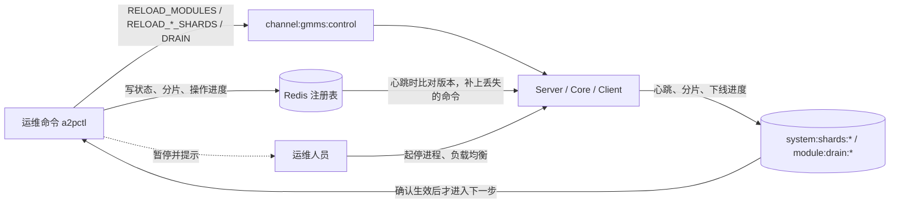
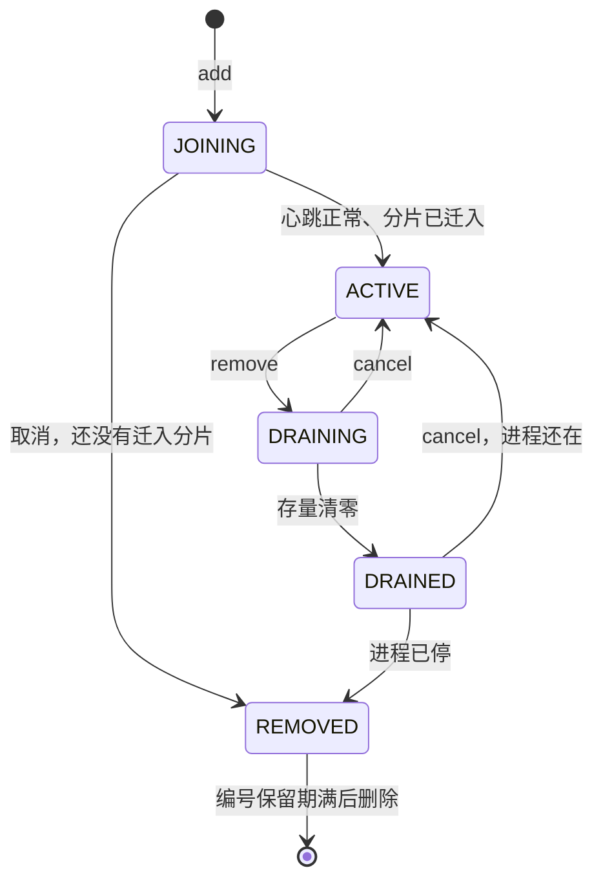

# 模块动态扩缩容设计

> 日期：2026-11-04。状态：**设计稿，没有实现，也没有实测**。第 2 节来自读当前 `main` 的代码，标“已有用例”的项有回归覆盖；默认值都是建议值，要在压测后调整。范围是 SMPP Server、Core、SMPP Client，HTTP Client、HTTP Server、MQM 的差异和缺口见第 18 节。

## 1. 目标和范围

在商用环境运行中增加或删除 Server、Core、Client 模块，业务不中断。

### 1.1 验收标准

| 编号 | 要求 | 怎么判断 |
|---|---|---|
| G1 | 不丢消息 | 压力下增删模块，每条 MT 都有外发或失败结果，每条 DR 都到达客户或进入重试，包括操作中 `kill -9` |
| G2 | 外发不重复 | 假供应商统计每条 MT 只收到一次 |
| G3 | DR 最多重发一次 | 只在“已发给客户但没等到响应”时允许重发，和现有语义一致 |
| G4 | 客户影响可控 | 下线 Server 时，相关客户只经历一次断开重连，不是所有客户同时断开 |
| G5 | 可中止 | 下线完成前的任何一步都能取消，模块回到正常服务 |
| G6 | 默认不变 | `ModuleRegistryEnable=false` 时，行为和现在一样，全量回归通过 |

### 1.2 不做

- **进程内热插拔：** 一个模块就是一个 JVM，加减模块就是起停进程。
- **自动接管：** 节点挂掉后积压等待，由人决定，不会丢消息（`FT-06`、`FT-01`）。自动接管要先解决误判和两个节点抢同一分片的问题。
- **运行中改 `TotalShards`：** 配置说明要求修改前先清空积压，所以扩缩容只调整分片归属。
- **操作负载均衡和进程：** 负载均衡是手动增删节点，进程由启动、停止脚本起停。运维命令到这些步骤时暂停，人工确认后才继续。

## 2. 现状

### 2.1 现有能力

| 能力 | 现状 | 差距 |
|---|---|---|
| 分片迁移 | `RELOAD_CORE_SHARDS@模块`、`RELOAD_CLIENT_SHARDS@模块`，已有用例（`FT-06`、`CS-03`） | 手工操作；不支持迁空（2.3） |
| 分片校验 | `ShardAssignmentChecker` 每分钟比对，问题打 `[SHARD-CHECK]` 日志 | 只告警，操作期间会误报 |
| 存活检测 | 模块心跳、`STATUS_OFFLINE`；Core 发 DR 时避开已下线的 Server，已有用例（`DrLivenessIT`） | 只有在线和离线，没有“正在下线” |
| 模块列表 | `ModuleManagement.xml` 或 `a2p_modules.conf`，只在启动时读 | 不能热加载 |
| 停机 | 有 `SHUTDOWN@模块`，但只做了一部分（2.5） | 不停消费者，不清空写库队列，没有用例 |
| 崩溃恢复 | `kill -9` 后不丢、不重复外发，已有用例 | 可以作为下线失败时的兜底 |

### 2.2 谁消费哪个流

这张表决定了“迁走分片”能解决什么。判断逻辑在 `StreamQueueManager.isResponsibleForStream`，它最后的默认值是 `true`。

| 流 | 消费者 | 归属依据 | 迁走全部分片后 |
|---|---|---|---|
| `stream:mt:pending:{ssid}:{分片}` | Core | 分片 | 不再消费 |
| `stream:mqm:submit`、`stream:mqm:report` | Core | 分片 | 不再消费 |
| `stream:core:results[:{ssid}:{分片}]` | Core | **所有 Core 都消费** | **继续消费** |
| `stream:core:inbound-dr:{ssid}...` | Core | **所有 Core 都消费** | **继续消费** |
| `stream:core:hold:{rssid}` | Core | **所有 Core 都放行** | **继续放行** |
| `zset:delay:outdr:{分片}` | Core | 分片 | 不再发送，延迟 DR 由接手节点发 |
| `stream:mt:routed:{rssid}:{分片}` | SMPP Client | 分片 | 不再消费 |
| `stream:http:submit`、`stream:http:dr` | HTTP Client | 分片 | 不再消费 |
| `stream:dr:pending:{ossid}:{模块}:{分片}` | Server | **模块名** | 分片无关，模块删除后**没有人读** |

**这是对上一版设计的更正：** 上一版写的是 Core 的入向 DR 和结果都随分片走，实际不是。所以零分片的 Core 还在工作，下线时必须另外停掉这三类消费者。这也有好处：它们读走但没确认的消息，其他 Core 的自动重投本来就能接手。

### 2.3 分片不能迁空

`initCoreShardAssignment`、`initClientShardAssignment` 读到空值时，依次回退到 `CoreShard.*`（或 `ClientShard.*`）、NodeID 的配置，最后是 `MyShards`，默认 `0`。

所以**把 Redis 里的分片清空，节点不会变成零分片，而是可能退回去消费 0 号分片**，和接手的节点重叠。严格校验 `validateShardSet` 也会拒绝空值。

### 2.4 依赖模块列表的地方

| 用途 | 位置 | 模块数变化的影响 |
|---|---|---|
| Client 连接数 | `getSessionNumberOfModule`：`⌈SessionNumber / 同类模块数⌉` | 第 10 节 |
| 消息 ID 编号 | `getModuleNo`：模块名末尾的数字，和列表无关 | 第 11 节 |
| SMPP msgId（v1）、消息 ID（v1） | `getModuleIndex`：位置，Client 再加 3 | 第 11 节 |
| DR 的兜底目标 | `selectConfiguredServerModule` | 老节点不知道新 Server。主路径走会话登记，只有登记查不到才用 |
| “本模块是不是 Core” | `getRouterModules().contains` | 新 Core 自己的列表里要有自己 |
| 旧 TCP 路径 | `selectRouter`、`selectChannel` | 流模式下主路径不用，但调用点要保持可用 |

`ModuleManager` 启动后这些集合基本只读，但 `moduleStatusMap` 由 MGT 的连接管理更新。

### 2.5 现有的停机路径

**这也是对上一版的更正：** 上一版写“停进程等于直接杀”，不完全对。代码里有 `SHUTDOWN@模块`（`RedisControlSubscriber`、`TelnetSession`），按优先级通知监听者。

| 监听者 | 收到 `SHUTDOWN` 后 | 够不够 |
|---|---|---|
| `CDRAsynWriter` | 新 CDR 改走同步写，写完队列里的 CDR | 够 |
| `SdqMessageManager` | 新 DR 改走同步写 | **队列没有主动清空**，依赖写线程继续跑 |
| `BufferMonitorWithSafeExit` | 把缓冲里的消息写到备份 | 够 |
| `ExpiredMessageQueueWithSafeExit` | 类似的安全退出 | 没有逐行核实 |
| `DefaultExecutorServiceManager`（最后一级） | 关闭线程池 | 够 |

**缺的：**

- **不调用 `stopService()`：** 流消费者、放行线程都不会停。
- **异步写库：** `MessageStoreManager` 的 `asyncSqlQueue` 没有监听 `SHUTDOWN`。写线程循环条件允许写完队列，但进程退出时不会等它。
- **关闭钩子：** 线上用 `GmmsLauncher`（`AbstractLauncher`），关闭钩子只打印一行。`HALauncher` 也一样。另外只有 `RedisClient` 有一个钩子，最多等 5 秒。
- **进程退出：** `SHUTDOWN` 本身不退出进程。
- **信号：** `SolarisSignal` 和 `handle(Signal)` 存在，但没找到注册信号处理的地方，`SIGTERM` 走不到这些逻辑（2.9 的实测和这一点一致）。
- **没有用例：** 回归里没有测 `SHUTDOWN`。

### 2.6 Core 后台组件

| 组件 | 运行方式 | 增减 Core 的影响 |
|---|---|---|
| `DelayedInDRDispatcher` | 按分片领取，有租约，超时放回 | 随分片走。分片暂时没有归属时，这个分片的延迟 DR 也暂停 |
| `CsmExpirySweeper` | 带租约领取，代码注释写明多处可同时运行 | 安全 |
| `ChannelReleaseDispatcher` | 不分片，有接手逻辑（`CoreHoldRecoverIdleMs`，默认 60 秒） | 限速按单个 Core 计算，**加 Core 会提高放行速率** |
| `RetrieveRedisDRThread`、`SendDelayRedisDRThread` | 属于 MQM，由 `MqmActiveCoordinator` 选主 | 不受影响 |

### 2.7 线上部署方式

来自线上的启动和停止脚本：

- **启动：** `com.king.gmms.GmmsLauncher start {类名}`，`-Dmodule`、`-DNodeID` 来自 `a2p_modules.conf`。
- **模块清单：** `a2p_modules.conf`，格式是 `enabled|module|role|class|nodeId|profile|order|startCmd|stopCmd`，共 9 列，所有模块共用一个 `a2p_home`。
- **停止：** 先跑 `StartupModuleManager stop`，再 `kill`（`SIGTERM`），**固定等 5 秒**，还在的 `kill -9`。
- **线上规模：** 3 个 Core，2 个 SMPP Client，1 个 HTTP Client，2 个 MQM，2 个 SMPP Server，清单里有 1 个 HTTP Server；`TotalShards=16`。
- **注释即停用：** 暂不用的模块以 `#` 注释（如 `#1|CoreEngine4`）。解析代码会跳过。
- **`StartupModuleManager stop`：** 清单没有类路径（只有 XML 才有），所以普通模块只打印“配置无效”，实际只对 `CommonHttpServer` 起作用（调用 `bin/{模块}.sh stop`）。`polaris.sh` 用不到。

用这份清单跑真实解析代码的结果（`sess4` 是 `SessionNumber=4` 时每个节点的连接数）：

| 模块 | 类型 | 编号 | 按 Client 处理 | v1 模块号 | sess4 |
|---|---|---|---|---|---|
| `CoreEngine1`～`3` | `CoreEngine` | 1～3 | 否 | 0～2 | — |
| `MultiSmppClient1`、`2` | `MultiSmppClient` | 1、2 | 是 | 3、4 | 2 |
| `CommonHttpClient1` | `CommonHttpClient` | 1 | 是 | 3 | 4 |
| `MsgQueueMonitor1`、`2` | `MQM` | 1、2 | 否 | 0、1 | — |
| `MultiSmppServer1`、`2` | `MultiSmppServer` | 1、2 | 否 | 0、1 | — |
| `CommonHttpServer1` | `CommonHttpServer` | 1 | 否 | 0 | — |

`smpp-client` 这些角色名没有问题，类型靠模块名前缀判断。

### 2.8 `NodeID` 的启动参数不生效

**实测：** 启动时传 `-DNodeID=77`，配置文件里是 `NodeID=1`，模块实际用的是 `1`。原因是 `GmmsUtility.initUtility` 用 `props.getProperty("NodeID", "0")` 覆盖了系统属性。配置里没有时，就变成 `0`。

线上清单第 5 列也全是 `0`。所以除非配置文件写了别的值，**所有模块的 `NodeID` 都相同**；就算把第 5 列改成不同的值，现在也不起作用。实测：清单之外传 `-DNodeID=9`、配置里没有 `NodeID` 时，结果是 `0`。影响：

| 位置 | 影响 |
|---|---|
| 消费者名（`core-*-{NodeID}`） | 多个 Core、Client 同名，`XPENDING` 分不清是谁的，6.2 的判断做不到 |
| 发送标记、处理标记 | owner 还带 JVM 和线程号，**不会因此重复发送** |
| 心跳 key | 带模块名，不受影响 |
| `MessageIdIncludeNodeId` | 开启后不同模块节点号相同，起不到作用 |

**处理：** 本期第 1 步改成 `-DNodeID` 优先，没有时才读配置；清单第 5 列改成各不相同的值。这会改变消费者名，旧名字下待确认的条目由自动重投接手。

**线上配置（已确认）：** `NodeID=0`（写了两行，效果相同），分片都按模块名配置，没有重叠，不受节点号相同的影响：

| 组 | 分片 |
|---|---|
| Core | `CoreEngine1=0-5`、`CoreEngine2=6-10`、`CoreEngine3=11-15` |
| SMPP Client | `MultiSmppClient1=0-7`、`MultiSmppClient2=8-15` |
| HTTP Client | `CommonHttpClient1=0-15`；`CommonHttpClient2=0-15` 已配置，但模块在清单里是注释状态 |

**注意：** 如果启用 `CommonHttpClient2`，它和 `CommonHttpClient1` 的分片完全重叠，违反不变式 I1，`[SHARD-CHECK]` 会告警。启用前要先拆分，比如 `0-7`、`8-15`。

### 2.8.1 编号来自列表位置的陷阱

编号现在是清单里的位置 + 1，只在模块启动时算一次。所以**注释掉中间的模块，再加新模块，编号就可能相撞**：

```text
运行中：MultiSmppServer1（编号 1）、MultiSmppServer2（编号 2）
注释掉 Server1 并停掉，新增 MultiSmppServer3：
  清单变成 Server2、Server3
  Server2 还没重启，仍是编号 2
  Server3 启动，位置 2，也是编号 2   <- 相撞
```

新格式的计数器都跟着时钟走，两个编号相同的模块几乎一定生成相同的 ID。

**已修复：** 编号直接取模块名末尾的数字（`MultiSmppServer3` 就是 3），没有数字时才用位置，已有用例（`ID-16`）。线上清单里两者完全一样，所以 ID 不变。数字大于 9 时拒绝启动。

### 2.8.2 多台机器部署

现在测试环境在一台机器上，以后模块可能分到不同的机器，HTTP Server 商用时是 2 台。各机器的清单可以不同，影响如下：

| 依赖清单的地方 | 影响 |
|---|---|
| 消息 ID 编号 | 不受影响，来自模块名。**同类模块的名字末尾数字不能相同**，代码查不出，部署时要保证 |
| SMPP Client 连接数 | **受影响。** 分母是本机清单里的同类模块数。如果每台只列自己，分母是 1，每个 Client 都用满 `SessionNumber`，总连接数会翻倍 |
| DR 的兜底目标 | 只能选本机清单里的 Server。主路径走会话登记，不受影响 |
| 配置文件 | 每台一份，`TotalShards`、`CoreShard.*`、`ClientShard.*` 要保持一致，`[SHARD-CHECK]` 能查出不一致 |

所以**多台部署时，建议每台都放完整的清单，用第 1 列或启动参数决定本机启动哪些**：启动脚本已经支持按模块名选择。注册表上线后，这个问题自然解决（第 4 节）。

### 2.9 收到 `kill` 后实际有多快

用真实进程实测（Server、Client 走 `GmmsLauncher`；Core 没有数据库，走测试入口，只启动了 MT 消费者）：

| 场景 | 从 `SIGTERM` 到退出 |
|---|---|
| Client，空闲 | 380 毫秒 |
| Server，空闲 | 约 350 毫秒 |
| Server，4 条连接持续发送（约 300 TPS） | 368 毫秒 |
| Server，Redis 已断开 | 344 毫秒 |
| Core，有积压 | 343 毫秒 |

- **现在几乎是立刻退出，不存在停不掉的问题。** JVM 收到 `SIGTERM` 不等业务线程，只跑钩子。
- **已确认的 submit 没有丢：** Server 那组确认了 1835 条，流里全部都有。
- **会丢的是内存队列：** CDR、SDQ、异步 SQL 只在 `SHUTDOWN` 事件时才处理，`kill` 走不到。这是读代码的结论，测试环境没有数据库，**没有实测丢多少**。
- **没测的：** 4000 TPS 下的停止时间、Core 的全部消费者。

### 2.10 已查清的其他行为

- **Server 收到 submit_sm：** 先写 Redis，成功后才回 submit_sm_resp（`MultiSmppSession`）。所以已确认的消息不会因为断开连接而丢。写成功但回复前断开时，客户可能重发，这和现在重启一样。
- **`RELOAD_CUSTOMER` 和连接数：** 只重建配置变化的通道（`TW-07`），重建时用当时的模块数重新计算连接数。配置没变的通道不会调整。
- **门铃：** `popResponsibleDoorbell` 每次只看前 `RedisStreamDoorbellScanLimit`（默认 100）个 stream，跳过不归自己的，也不删除。**已删除模块的流如果留着门铃，会一直占用扫描名额**，所以下线时必须清掉。
- **消费者名：** Core 和 Client 的消费者名带 `NodeID`，所以每个节点的 `NodeID` 必须不同。节点下线后，消费者还留在消费组里，不影响功能。

## 3. 总体方案



### 3.1 五个部分

| 部分 | 解决什么 | 章节 |
|---|---|---|
| 模块注册表 | 模块列表可以热加载，编号固定，有状态 | 第 4 节 |
| 零分片和迁移协议 | 节点可以合法地不负责任何分片，安全移交 | 第 5、6 节 |
| 下线协议 | 按模块类型清空存量，可取消 | 第 7、8 节 |
| 优雅停机 | 进程退出前写完内存队列 | 第 9 节 |
| 运维命令 | 按固定步骤执行，每步确认 | 第 12 节 |

### 3.2 不变式

实现和测试都按这几条检查：

| 编号 | 不变式 |
|---|---|
| I1 | 同一个分片同一时间最多一个节点负责。可以短暂没有人负责，不能有两个 |
| I2 | 已确认收到的消息都在 Redis 或数据库里，内存里的只有“可以由自动重投恢复”或“退出前写完”的数据 |
| I3 | 一个模块的 `moduleNo` 从分配到回收都不变 |
| I4 | 状态只能按第 4.2 节的表迁移，由 `a2pctl` 写，节点只读 |
| I5 | 任何一步都要先确认上一步生效，不靠等待固定时间 |

I1 不靠它防重复：万一短暂重叠，发送标记和处理标记仍能防止重复外发，但这是最后一道防线。

## 4. 模块注册表

### 4.1 数据结构

都放在 state Redis。

| Key | 类型 | 内容 |
|---|---|---|
| `system:modules:version` | String | 整数，每次变更加 1 |
| `system:modules` | Set | 所有模块名，包括 `REMOVED` 的 |
| `system:module:{模块名}` | Hash | 见下 |
| `system:modules:op` | String（JSON） | 当前操作的进度（12.3） |
| `system:modules:lock` | String | 操作锁，带过期时间 |

```text
system:module:MultiSmppClient3
  type        = MultiSmppClient     # 完整模块类型
  role        = client              # core / server / client / mqm ...
  moduleNo    = 3                   # 模块名末尾的数字，1 到 9，同类唯一
  state       = ACTIVE
  nodeId      = 13                  # 这个模块使用的 NodeID，同一部署内唯一
  updatedAt   = 1793483151000
  removedAt   = 0                   # 进入 REMOVED 的时间
```

### 4.2 状态机



| 状态 | 含义 | 模块在列表里 | 接收新流量 |
|---|---|---|---|
| `JOINING` | 已注册，准备中 | 自己可见，其他节点不计入 | 否 |
| `ACTIVE` | 正常服务 | 是 | 是 |
| `DRAINING` | 下线中，正在清空存量 | 否 | 否 |
| `DRAINED` | 已清空，等待停进程 | 否 | 否 |
| `REMOVED` | 已删除，编号保留中 | 否 | 否 |

**“自己可见”：** 新节点启动时要能找到自己的类型和编号，但其他节点在它 `ACTIVE` 前不计入。否则 Core 可能把 DR 发给还没准备好的 Server。

**强行删除：** 节点已经崩溃时，`a2pctl remove --force` 可以从 `ACTIVE` 或 `DRAINING` 直接进入 `DRAINED`，但存量要按 8.7 和 12.4 处理。

### 4.3 加载和同步

```text
启动：
  initRedisClient -> ModuleRegistry.load()
    if ModuleRegistryEnable == false: 用现有文件逻辑，结束
    if system:modules 为空:           用文件初始化（4.4）
    构造快照，发布给 ModuleManager
    if 自己不在注册表，或者 state 是 REMOVED: 启动失败并报错

运行中：
  收到 RELOAD_MODULES，或者心跳发现 version 变大 -> 重新加载，整体替换快照
  读失败 -> 继续用旧快照，打告警
```

- **命令丢失：** Redis 发布订阅不保证送达。心跳默认 10 秒，所以最多晚一个心跳周期。
- **版本回退：** 只接受更大的版本。Redis 数据丢失后版本变小时打告警，不替换，等人工处理（4.5）。
- **列表外节点：** 快照里没有的模块发来的流量不拒绝，只告警，避免配置问题影响业务。

### 4.4 初始化

第一次开启时，由 `a2pctl init` 明确执行，不让节点自动写，避免并发初始化。

- 按 `a2p_modules.conf` 写入，`moduleNo` 取模块名末尾的数字。线上清单里它和位置 + 1 一样，**消息 ID 不变**。
- 同类超过 9 个时拒绝。
- 校验 `NodeID` 不重复。

### 4.5 文件和 Redis 的关系

| 场景 | 处理 |
|---|---|
| 正常运行 | 以 Redis 为准。`a2pctl` 每次变更后更新 `a2p_modules.conf`，已删除的模块按现有习惯注释掉。编号来自模块名（2.8.1），所以从文件恢复时编号不变，不用新增列 |
| Redis 数据丢失 | 节点继续用内存快照。恢复时执行 `a2pctl init --from-file` |
| 文件和 Redis 不一致 | `a2pctl status` 显示差异，节点不自动处理 |
| `ModuleRegistryEnable` 改回 `false` | 下次重启回到读文件。文件由 `a2pctl` 维护，所以仍然正确 |

**兼容：** 清单格式不变，启动脚本不用改。

### 4.6 `ModuleManager` 改造

把会变化的集合收到一个不可变快照里：

```java
final class ModuleSnapshot {
    final long version;
    final Map<String, ModuleConnectionInfo> routerConnectionMap, serverConnectionMap, clientConnectionMap;
    final Map<String, ArrayList<String>> moduleTypeMap;   // 只含 ACTIVE
    final List<String> routerList, serverList, clientList;
    final Map<String, Integer> moduleNo;                  // 含 JOINING、DRAINING
    final Map<String, String> state;
}
private volatile ModuleSnapshot snapshot;
```

- **读：** 现有公开方法不变，内部改读 `snapshot`。这和 `A2PCustomerManager` 路由表的做法一致。
- **`moduleStatusMap`：** 由 MGT 更新，不放进快照，模块增减时只增删对应条目。
- **`getModuleNo`：** 不变，取模块名末尾的数字。注册表只校验不重复。
- **`getModuleIndex`：** 注册表开启时返回 `moduleNo - 1`（Client 加 3），保持 v1 的 ID 和 msgId 不变。
- **`getSessionNumberOfModule`：** 分母用 `ACTIVE` 模块数，加上自己（如果自己是 `JOINING`）。

**风险：** `ModuleManager` 内部大约有 40 处用到这些集合，要逐个改，并确认没有调用方缓存了旧列表。

### 4.7 配置

新模块还要有自己的配置，`a2pctl add` 的预检查要确认：

- `NodeID` 不重复（`a2p_modules.conf` 第 5 列，要先完成 2.8 的修改才生效）。
- 端口不冲突：`{模块}.Port`、`{模块}.CmdPort` 等。
- 模块名前缀和类型一致，比如 `MultiSmppClient3`。`resolveFullModuleType` 靠前缀判断。
- 客户配置 `SmppServerModules`、`ClientShard.*` 没有写死这个模块。

## 5. 零分片

### 5.1 语法

新增合法值 `none`（不区分大小写），表示零分片：

```bash
SET system:core:shards:CoreEngine2 none
PUBLISH channel:gmms:control RELOAD_CORE_SHARDS@CoreEngine2
```

### 5.2 改动

| 位置 | 改动 |
|---|---|
| `parseShardSet` | `none` 返回空集合 |
| `validateShardSet` | `none` 合法；空字符串仍然拒绝 |
| `initCoreShardAssignment`、`initClientShardAssignment` | `none` 不算空值，**不再回退** |
| `formatShardSet` | 空集合输出 `none` |
| `isResponsibleForStream` | 不用改，`contains` 自然返回 `false` |
| `DelayedInDRDispatcher` | 已有空集合判断，不用改 |
| `ShardAssignmentChecker` | `none` 的节点不算重叠，也不计入缺失 |
| `ClientShard.*`、`CoreShard.*`、`MyShards` | 配置文件也接受 `none` |

### 5.3 没有写 `none` 时

现有回退逻辑不变，保证兼容。`a2pctl` 总是显式写值，不留空。

## 6. 分片迁移协议

### 6.1 单个分片的步骤

```text
迁移分片 S，从节点 A 到节点 B：

1. 写操作进度 step=moving, shard=S
2. A 的分片集合去掉 S（A 只剩 S 时写 none），RELOAD_*_SHARDS@A
3. 等 system:shards:{group}:A:* 不再包含 S
     超时 ModuleShardConfirmSeconds -> 停下，重发或人工处理
4. 等 A 对 S 的处理中消息结束（6.2）
     超时 ModuleShardQuiesceSeconds -> 不算失败，继续，由自动重投接手
5. B 的分片集合加上 S，RELOAD_*_SHARDS@B
6. 等 system:shards:{group}:B:* 包含 S
7. 写操作进度 step=moved，暂停 ModuleShardIntervalSeconds
8. 检查积压没有持续上升，再迁下一个
```

**顺序不能反：** 先移除再添加，满足不变式 I1。代价是这段时间这个分片没人消费，积压短暂上升。

**配置要同步：** 分片优先读 Redis 的 `system:*:shards:{模块}`，读不到才用配置文件。线上现在写在配置文件里。`a2pctl` 写 Redis 后，配置文件里的值就过期了，一旦 Redis 数据丢失，节点重启时会退回旧分片，可能和其他节点重叠。所以 `a2pctl` 每次迁移后要同时更新 `CoreShard.*`、`ClientShard.*`。

**确认要快：** `system:shards:*` 现在只在心跳时刷新，默认 10 秒。这里改为 `RELOAD_*_SHARDS` 处理完立刻发布一次，否则每个分片要多等 10 秒。

### 6.2 “处理中消息结束”的判断

对分片 S 的流，用 `XPENDING` 查 A 的消费者名下是否还有条目：

| 模块 | 流 | 消费组 | A 的消费者 |
|---|---|---|---|
| Core | `stream:mt:pending:*:S` | `CoreMT...` | `core-*-{NodeID}` |
| Core | `stream:mqm:*:S` | MQM 消费组 | 同上 |
| Client | `stream:mt:routed:*:S` | `ClientOutboundSubmitGroup` | `client-*-{NodeID}` |
| HTTP Client | `stream:http:*:S` | HTTP 消费组 | `*-{NodeID}` |

实际的消费组名和消费者名实现时从代码取，这里写的是形式。

**超时后为什么可以继续：** 留在 A 名下的条目，会在空闲超过 `RedisStreamAutoClaimIdleMs`（默认 60 秒）后被 B 的自动重投领走。如果 A 还在处理，`CoreMtLeaseMs`、`ClientSendLeaseMs` 的标记会让 B 等待，不会重复外发。这部分已有用例（`CS-03`、`FT-06`）。

### 6.3 操作期间的告警

迁移中会出现短暂的分片缺失。`a2pctl` 写入 `system:modules:maintenance`（带过期时间，默认 300 秒，每步续期），`ShardAssignmentChecker` 看到它时把缺失从 ERROR 降为 INFO，并在日志注明“操作中”。其他告警不变。

### 6.4 分片数和分配

**建议线上保持 `TotalShards=16`，不用改。**

| 模块数 | 16 个分片的分配 | 是否均匀 |
|---|---|---|
| 3（现在） | 6、5、5 | 差 20%，可以接受 |
| 4 | 4、4、4、4 | 均匀 |
| 6 | 3、3、3、3、2、2 | 差 50% |
| 8 | 每个 2 | 均匀 |
| 9 | 七个 2、两个 1 | 差一倍 |

**不建议加大的原因：**

- **切换代价：** 要清空积压，等于停一次流量。
- **stream 变多：** 活跃 stream 数大约是通道或客户数乘以分片数。门铃每次只看前 100 个（`RedisStreamDoorbellScanLimit`），自动重投用 `KEYS` 列 stream，都会随之变慢。
- **目前够用：** 16 个分片已经能分给 9 个模块。

**什么时候再改：** 如果确实要长期跑 6 或 9 个同类模块，再考虑改成 36（能被 2、3、4、6、9 整除），并先调大扫描上限、做压测。

`a2pctl` 默认平均分配，并且迁移量最少：

```text
16 个分片，3 个 Core 变 4 个：
  前：A=0-5         B=6-10       C=11-15
  后：A=0-3         B=6-9        C=11-14     D=4,5,10,15
  迁移 4 个分片

16 个分片，4 个 Core 变 3 个（删除 D）：
  前：A=0-3         B=6-9        C=11-14     D=4,5,10,15
  后：A=0-3,4,5     B=6-9,10     C=11-14,15
```

运维人员可以用 `--shards` 指定，指定的结果也要校验：不重叠、合起来覆盖全部分片。

### 6.5 迁移速度

每个分片最多等 `确认 + 处理中 + 间隔`，默认约 `30 + 60 + 10` 秒，通常只需要十几秒。分片多时整体要几分钟到几十分钟，这是故意的：一次一个，出问题影响面小。

## 7. 下线协议

### 7.1 命令

| 命令 | 作用 |
|---|---|
| `RELOAD_MODULES` | 重新读注册表 |
| `DRAIN@模块` | 进入下线流程 |
| `DRAIN_CANCEL@模块` | 中止，回到正常服务 |
| `SHUTDOWN@模块` | 现有命令，下线完成后清理并退出（第 9 节） |

**命令丢失：** 状态写在注册表里。节点加载注册表时，发现自己是 `DRAINING` 就进入下线流程，发现回到 `ACTIVE` 就恢复。所以 `DRAIN` 命令只是让它更快生效。

### 7.2 节点上的 `DrainController`

新增类，`RedisControlSubscriber` 和注册表加载都调用它。按模块类型执行第 8 节的阶段，每秒把进度写到 Redis：

```text
module:drain:{模块}  (Hash，有效期 3 个心跳)
  stage      = WAIT_WINDOW
  startedAt  = 1793483151000
  inflight   = 12           # 待响应的 submit 或 DR
  sessions   = 3            # 还没断开的连接
  pending    = 40           # 本节点消费者名下的待确认条目
  queues     = sdq:0,sql:3,cdr:0
  done       = false
```

`a2pctl` 只读这个进度决定下一步，不自己连到节点。

### 7.3 取消

| 取消时所处阶段 | 恢复动作 |
|---|---|
| 还在迁分片 | 把迁走的分片迁回来 |
| Server 拒绝 bind、断开连接中 | 恢复接受 bind。已断开的客户不会自动回来，要等它们重连 |
| Core 已停结果消费者 | 重新启动消费者，放行线程同样恢复 |
| `DRAINED`，进程还在 | 同上 |
| 进程已停 | 不能取消，要重新起进程并按“增加”处理 |

人工从负载均衡删除的节点，取消时要人工加回，`a2pctl` 会提示。

## 8. 各模块流程

### 8.1 增加 Core

| 步 | 执行者 | 动作 | 进入下一步的条件 |
|---|---|---|---|
| 1 | `a2pctl` | 预检查（4.7）、分配编号、注册 `JOINING`，分片写 `none` | 写入成功 |
| 2 | 人工 | 部署配置，用启动脚本起进程 | 确认 |
| 3 | `a2pctl` | 等心跳 | `module:status:core:{模块}:{节点}` 是 `ONLINE` |
| 4 | `a2pctl` | 按第 6 节迁入分片 | 全部迁入 |
| 5 | `a2pctl` | 改为 `ACTIVE`，`RELOAD_MODULES` | 其他节点版本一致 |

**注意：** 新 Core 在第 3 步就开始消费结果、入向 DR 和 hold 流（2.2），因为这三类流不看分片。如果新 Core 配置有错，比如连错数据库，从进程启动那一刻起就会处理真实的结果和 DR，放行速率也会立刻增加（第 10 节）。

**建议：** `JOINING` 的 Core 暂不启动这三类消费者，第 5 步再启动。这样可以先看日志、确认配置，有问题直接停掉，业务不受影响。

### 8.2 删除 Core

| 步 | 执行者 | 动作 | 进入下一步的条件 |
|---|---|---|---|
| 1 | `a2pctl` | 预检查：还有其他 `ACTIVE` 的 Core | 通过 |
| 2 | `a2pctl` | 改为 `DRAINING`，发 `DRAIN@模块` | 进度里 `stage` 出现 |
| 3 | `a2pctl` | 按第 6 节迁出全部分片 | 这个节点是 `none` |
| 4 | 节点 | 停 `ResultStreamConsumer`、`InboundDRStreamConsumer`、`ChannelReleaseDispatcher` 的读取 | 线程已退出读取循环 |
| 5 | 节点 | 等工作线程处理完已读到的消息 | `pending=0`，或超过 `ModuleDrainMaxSeconds` |
| 6 | 节点 | 清空 SDQ、异步 SQL、CDR 队列 | `queues` 全部为 0 |
| 7 | `a2pctl` | 改为 `DRAINED`，提示可以停进程 | — |
| 8 | 人工 | 停止脚本（第 9 节） | 确认 |
| 9 | `a2pctl` | 确认心跳消失，改为 `REMOVED`，`RELOAD_MODULES` | 完成 |

**第 5 步超时：** 留下的条目由其他 Core 自动重投接手，不会丢。`a2pctl` 显示数量，继续。

**第 6 步的顺序：** 必须在消费者都停了之后，否则队列还会增加。

### 8.3 增加 Client

| 步 | 执行者 | 动作 | 进入下一步的条件 |
|---|---|---|---|
| 1 | `a2pctl` | 预检查（4.7），计算连接数和 TPS 变化（第 10 节），超限时拒绝 | 通过或 `--force` |
| 2 | `a2pctl` | 注册 `JOINING`，分片 `none` | 写入成功 |
| 3 | 人工 | 部署并起进程 | 确认 |
| 4 | `a2pctl` | 等心跳，等供应商连接建立 | 所有 `IsInit=true` 的通道都有连接，超时只告警 |
| 5 | `a2pctl` | 按第 6 节迁入分片 | 全部迁入 |
| 6 | `a2pctl` | 改为 `ACTIVE`，`RELOAD_MODULES` | 版本一致 |
| 7 | 人工（可选） | 需要调整老节点的连接数时，改配置并滚动重启（第 10 节） | — |

### 8.4 删除 Client

| 步 | 执行者 | 动作 | 进入下一步的条件 |
|---|---|---|---|
| 1 | `a2pctl` | 预检查：还有其他 `ACTIVE` 的 Client，提示连接数和 TPS 变化 | 通过 |
| 2 | `a2pctl` | 改为 `DRAINING`，发 `DRAIN@模块` | 进度里 `stage` 出现 |
| 3 | `a2pctl` | 按第 6 节迁出全部分片 | 这个节点是 `none` |
| 4 | 节点 | 等发送窗口清空：收到响应，或者 `BufferTimeout` 超时后回失败结果 | `inflight=0` |
| 5 | 节点 | 继续保持连接一小段时间，收完正在路上的 DR 和 MO，等 `ModuleDrainDrWaitSeconds` | 时间到 |
| 6 | 节点 | 对所有连接发 unbind，等 resp 或超时 | `sessions=0` |
| 7 | 节点 | 写完结果和入向 DR | `queues` 为 0 |
| 8 | `a2pctl` | 改为 `DRAINED`，提示停进程 | — |
| 9 | 人工 | 停止脚本 | 确认 |
| 10 | `a2pctl` | 确认心跳消失，改为 `REMOVED`，`RELOAD_MODULES` | 完成 |

**为什么第 4 步不能跳过：** 连接断开时，等待中的消息会回 2700（`CN-05`、`CF-04`），表示可能已发出，Client 不重发。等窗口清空能避免这些消息状态不明。

**DR：** 已确认连接断开后，供应商的 DR 可以从其他连接回来，所以第 5 步只需要很短的时间。

### 8.5 增加 Server

| 步 | 执行者 | 动作 | 进入下一步的条件 |
|---|---|---|---|
| 1 | `a2pctl` | 预检查（4.7）、分配编号、注册 `JOINING` | 通过 |
| 2 | 人工 | 部署并起进程 | 确认 |
| 3 | `a2pctl` | 等心跳 | `ONLINE` |
| 4 | 人工 | 可选：用一个测试账号直接连这个节点验证 | 确认 |
| 5 | `a2pctl` | 改为 `ACTIVE`，`RELOAD_MODULES` | 版本一致 |
| 6 | 人工 | **加入负载均衡** | 确认 |

**DR 到新 Server：** 客户连上后写入会话登记，Core 按登记找到它。所以不用通知 Core，只有兜底路径才需要 `RELOAD_MODULES`。

### 8.6 删除 Server

| 步 | 执行者 | 动作 | 进入下一步的条件 |
|---|---|---|---|
| 1 | `a2pctl` | 预检查：`SmppServerModules` 只写了这个模块的客户要先改配置；还有其他 `ACTIVE` 的 Server | 通过 |
| 2 | `a2pctl` | 改为 `DRAINING`，`RELOAD_MODULES` | 所有 Core 的版本一致 |
| 3 | 人工 | **从负载均衡删除节点** | 确认 |
| 4 | 节点 | 拒绝新的 bind | 进度里 `stage` 变化 |
| 5 | 节点 | 按 `ModuleDrainSessionIntervalMs` 逐个发 unbind，再关闭连接 | `sessions=0`，或超过 `ModuleDrainMaxSeconds` |
| 6 | 节点 | 继续消费本模块的 DR 流，等结果写回 | 流为空，`inflight=0`，或超时 |
| 7 | `a2pctl` | 有剩余时运行 DR 转移（8.7） | 剩余为 0，或全部列出 |
| 8 | 节点 | 写完队列，清除会话登记 | `queues` 为 0 |
| 9 | `a2pctl` | 清除这个模块的门铃，改为 `DRAINED` | — |
| 10 | 人工 | 停止脚本 | 确认 |
| 11 | `a2pctl` | `STATUS_OFFLINE`，确认心跳消失，改为 `REMOVED` | 完成 |

**第 2 步的路由改动：** `SmppServerDrRouteResolver` 现在判断 `hasActiveSessionInModule(ossid, originalModule)`，节点还有会话就继续发给它。改为：

```text
候选模块 = 有这个客户活跃会话的 ACTIVE 模块
if 原模块在候选里:      发原模块
else if 候选不为空:     发候选之一
else if DRAINING 模块还有这个客户的会话:  发 DRAINING 模块（避免 DR 卡住）
else:                   走现有的 assigned、configured 兜底，并排除 DRAINING
```

所以只有“这个客户当前只连在要下线的节点”时，DR 才继续发给它。客户重连后，新 DR 自然转到新节点。

**第 4 步：** `AbstractServer` 的 `accept` 循环看到 `DRAINING` 时，接受连接后立刻关闭。负载均衡摘除后不应该还有新连接，这是兜底。

**第 5 步：** 客户没有重连的话，它的 DR 会留在流里，由第 7 步处理。

**第 6 步的响应：** `ServerDrAckOnResp=true` 时，DR 在客户回 resp 或会话关闭后才确认。第 5 步关闭会话时，等待中的 DR 按现有逻辑处理，需要 MS-09 验证。

### 8.7 DR 转移

`isResponsibleForStream` 只让本模块读 `stream:dr:pending:{ossid}:{模块}:{分片}`，所以模块删除后，剩下的 DR 没有人读，要转移：

```text
a2pctl drain-dr --module MultiSmppServer2

for 流 in SCAN stream:dr:pending:*:MultiSmppServer2:*:
    确认这个模块已经是 DRAINED 或进程已停
    for 条目 in XRANGE 流（包括未读和待确认）:
        解码 DR
        目标 = resolveTargetModule(DR)，排除要删除的模块
        if 目标为空:
            记录到“无目标”列表，保留原条目，继续下一条
        写入 stream:dr:pending:{ossid}:{目标}:{分片}（走 produceDeliveryReportToQueue，会敲门铃）
        XACK + XDEL 原条目
    流为空时：DEL 流，ZREM zset:dr:pending:active 流
```

- **复用 Core 的代码：** 目标选择和写入都用现有方法，放在一个 Java 工具里。
- **重复：** 写入成功、删除前崩溃时，这条会有两份。已发给客户但没等到响应的 DR 也会再发一次。两者都符合“最多重发一次”。
- **无目标：** 客户完全不在线时没有目标。保留原条目，门铃也不清除，`a2pctl` 列出客户和数量。客户上线后可以再跑一次。**这时模块不能进入 `REMOVED`，除非加 `--force`**。
- **顺序：** 同一客户的 DR 可能和新 DR 交错。DR 本来就不保证严格顺序。
- **`kill -9` 的情况：** 进程已崩溃时直接跑这个工具，等待中的 DR 通过 `XRANGE` 也会被转移。

### 8.8 同时增减的限制

- 同一时间只允许一个操作（12.3）。
- 替换模块时，**先加后删**，避免容量下降。
- 不能删除某类的最后一个 `ACTIVE` 模块。

## 9. 优雅停机

### 9.1 两件事要分开

| | 下线（`DRAIN`） | 进程停止（`kill`） |
|---|---|---|
| 什么时候 | 只有 `a2pctl remove` 才走 | 所有重启、发布、下线的最后一步 |
| 目的 | 清空存量 | 写完内存队列 |
| 时间 | 几分钟，可以更久 | **最多 4 秒** |
| 影响重启速度吗 | 不影响 | 几乎不影响 |

所以日常重启不会因为下线协议变慢。

### 9.2 进程停止的顺序

现在的 `kill` 约 0.35 秒退出（2.9），但内存队列不写。目标是补上写队列，并且**不能超过脚本的 5 秒**。

```text
SIGTERM（JVM 关闭钩子），或者 SHUTDOWN@模块
  启动看门狗：到 ModuleStopMaxWaitSeconds 时直接 Runtime.halt
  1. 停止读取新消息                  只设标志，不等待
  2. 写完 CDR、SDQ、异步 SQL 队列    有数据库问题时不能卡住，每个队列有时间上限
  3. 保存消息 ID 位置
  4. 退出；正在处理的消息不等        它们没有确认，由自动重投恢复
```

- **不会一直停不掉：** 有看门狗，脚本还有 `kill -9` 兜底。任何一步卡住都不影响退出。
- **不等工作线程：** 正在处理的消息还没确认，其他节点 60 秒后接手，这和现在 `kill` 一样。下线时才等它们。
- **最坏情况：** 数据库或 Redis 卡住时，到 4 秒退出，没写完的内容丢失，和现在一样，不会更差。
- **要实测：** 队列大时 4 秒够不够。不够的话，要么调大脚本的等待时间，要么接受丢一部分。

### 9.3 要改的内容

| 位置 | 改动 |
|---|---|
| `AbstractLauncher`、`HALauncher` | 关闭钩子走 9.2 的流程，加防重入和看门狗；`SHUTDOWN` 事件和钩子走同一段逻辑 |
| `MTStreamConsumer` 等消费者 | `stop()` 不用等待；下线协议单独用 `awaitStop(ms)` 等工作线程 |
| `MessageStoreManager` | 新增监听 `SHUTDOWN`：停止写入新 SQL，写完队列 |
| `SdqMessageManager` | 收到 `SHUTDOWN` 时清空队列，和 `CDRAsynWriter.drain` 一样 |
| `DeliveryRouter`、`AbstractServer`、`MultiSmppClient` | `stopService` 补齐上面的步骤 |
| `MessageIdSetup` | 停机时保存一次位置 |

**接收循环：** `AbstractServer.stopService` 先 `serverThread.join()` 再关闭 socket，`accept` 有 10 秒超时。所以**关闭钩子不能调用它**，否则最多等 10 秒，超过脚本的 5 秒。

### 9.4 停止脚本

现在的脚本：`kill`，固定 `sleep 5`，还在的 `kill -9`。

- **不用改也能工作：** `ModuleStopMaxWaitSeconds` 默认 4 秒，小于 5 秒。
- **建议改进：** 把固定 `sleep 5` 改成每 0.2 秒检查一次，进程退出就结束，最多等 `A2P_STOP_WAIT_SECONDS`（默认 5）。这样重启反而比现在快。
- **`StartupModuleManager stop`：** 不能删。它是停止 `CommonHttpServer` 的路径：后面的 `kill` 只匹配 `GmmsLauncher`，匹配不到 HTTP Server。

### 9.5 管理端

`CommandProcessor` 通知模块，超时会杀进程（`execute time out, killed`）；`DirectStopModules` 里的模块直接杀进程。商用环境里，这些路径不会执行清理，要从 `DirectStopModules` 里去掉需要优雅停机的模块，并把超时调到大于 `ModuleStopMaxWaitSeconds`。如果线上只用脚本，不用管理端停模块，这一节不影响。

## 10. 容量检查

加减模块会改变下面这些数字。`a2pctl` 执行前按通道计算并显示，超过限制时拒绝，除非加 `--force`。

| 数字 | 现在的计算 | 变化 |
|---|---|---|
| 供应商连接数 | 每个 Client `⌈SessionNumber / 启动时的同类模块数⌉` | 老节点不会自动调整 |
| 通道外发 TPS | `SMSOptionOutgoingThrottlingNum` 按单个 Client 生效 | 总速率 = 配置值 × 负责这个通道的 Client 数（`TW-08`） |
| Core 放行速率 | `SMSOptionCoreProcessorThrottlingNum` 按单个 Core 生效 | 总速率 = 配置值 × Core 数 |

### 10.1 连接数例子

| 场景 | 每个节点 | 总连接数 | 问题 |
|---|---|---|---|
| `SessionNumber=4`，2 个 Client | 2、2 | 4 | 无 |
| 加第 3 个，老节点不动 | 2、2、2 | **6** | 超过 4 |
| 滚动重启后 | 2、2、2（`⌈4/3⌉=2`） | **6** | 向上取整，仍然超过 4 |
| 改 `SessionNumber=3` 并滚动重启 | 1、1、1 | 3 | 无 |

### 10.2 删除时的例子

| 场景 | 每个节点 | 总连接数 |
|---|---|---|
| `SessionNumber=6`，3 个 Client | 2、2、2 | 6 |
| 删除 1 个，老节点不动 | 2、2 | **4**，容量下降 |
| 滚动重启后 | 3、3 | 6 |

### 10.3 本期做法

- **不自动调整：** 只检查和提示。需要调整时，先改配置，再滚动重启。
- **`RELOAD_CUSTOMER`：** 只重建配置变化的通道。所以改了通道配置后，这个通道会按新的模块数重建，**不用重启整个 Client**，但这个通道会短暂重连（`TW-07`）。
- **不做全局限速：** 按节点限速是已知限制。严格限速要单独做分布式限流。

## 11. 和消息 ID 的关系

新格式已实现并默认开启，见 `消息ID防重复设计.md`。第一位是模块编号 1 到 9，所以：

| 规则 | 原因 |
|---|---|
| 同类模块最多 9 个 | 第一位不用 0 |
| 编号分配后不变 | 不变式 I3 |
| 编号取模块名末尾的数字（2.8.1） | 新模块用未占用的名字即可，编号和名字始终一致 |
| `REMOVED` 的编号保留 `ModuleIndexRetainHours`（默认 24 小时） | 已确认超过 1 天的 ID 可以复用。保留期内不复用，老消息的 ID 不会和新模块相撞 |
| 重复用编号时，新模块继承 `system:msgid:mark:{旧模块}` | 否则旧模块跑在时钟前面时可能重复。`a2pctl` 把位置复制给新模块 |
| 配了 `MessageIdFormat=v1` 的部署，保留期要改成 120 小时 | 旧格式 100 小时一轮 |

`MessageIdSetup.configure` 在 `initRedisClient` 时读编号，所以注册表要在它之前加载（4.3）。

## 12. 运维命令 `a2pctl`

做成独立的 Java 命令行工具（已确认），用现有 jar 的类，这样目标选择、流写入都复用同一套代码，不用动 `mgt`。

### 12.1 命令

```bash
a2pctl init [--from-file]                            # 第一次初始化注册表，或从文件恢复
a2pctl status [--module 名称]                        # 模块、状态、编号、分片、积压、当前操作
a2pctl add    --type 类型 --name 名称 --node-id N [--shards 8-11] [--dry-run] [--force]
a2pctl remove --name 名称 [--shards-to 名称] [--dry-run] [--force]
a2pctl resume                                        # 从中断的地方继续
a2pctl cancel                                        # 取消当前操作
a2pctl drain-dr --module 名称                        # 单独运行 DR 转移
```

### 12.2 输出例子

```text
$ a2pctl remove --name MultiSmppClient2 --dry-run
将要删除 MultiSmppClient2（编号 2，状态 ACTIVE）

分片：
  MultiSmppClient2 0-3 -> MultiSmppClient1 0-3（新增）
  MultiSmppClient1 4-7 -> 0-7

容量变化（数字只是例子）：
  通道 8：连接 2+2 -> 2（SessionNumber=4，滚动重启后 4）
  通道 8：外发 TPS 总计 400 -> 200
  通道 12：连接 1+1 -> 1
  警告：通道 12 配置了 SessionNumber=2，删除后只剩 1 条连接

步骤：
  1. 标记 DRAINING，发 DRAIN
  2. 迁移 4 个分片（预计 1～6 分钟）
  3. 等发送窗口清空（最长 BufferTimeout）
  4. 保持连接 30 秒，收完路上的 DR
  5. unbind，等队列清空
  6. [人工] 停止脚本 MultiSmppClient2
  7. 标记 REMOVED

没有修改任何内容（--dry-run）。
```

### 12.3 操作进度和互斥

```text
system:modules:lock = {操作 ID}，过期时间 60 秒，每 10 秒续期
system:modules:op   = {"id":"...", "action":"remove", "module":"...", "step":3,
                       "shardsLeft":[2,3], "startedAt":..., "operator":"..."}
```

- **互斥：** `SET NX` 拿锁。拿不到时拒绝，显示谁在操作。
- **中断：** 进程退出后锁过期，`a2pctl resume` 读 `op` 继续。每一步都能重复执行，不会出错。
- **幂等：** 比如迁分片前先读当前归属，已经迁好的跳过。

### 12.4 失败处理

任一步超时就停下，显示当前状态和可选操作，**不自动回退**，因为回退本身也可能出问题。

| 失败点 | 结果 | 处理 |
|---|---|---|
| 迁分片时节点没响应 | 分片可能仍在旧节点 | 读 `system:shards:*` 判断，`resume` 重发 |
| 旧节点确认超时 | 没有进入下一步，所以不会重叠 | 查节点；确认已崩溃时用 `--force`，把它当作无归属，直接分给新节点 |
| 新节点确认超时 | 这个分片没有人消费，积压增加 | 分给另一个节点或迁回旧节点 |
| 下线中进程崩溃 | 存量留在流里 | Core、Client：继续迁分片；Server：`drain-dr`；然后 `remove --force` |
| 新节点起不来 | 还是 `JOINING`，没有分片 | `cancel`，业务不受影响 |
| 窗口清空超时 | 还有 `inflight` | 显示数量；可以继续，这些消息回 2700 |
| 客户一直不重连 | 还有 `sessions` 或无目标的 DR | 列出客户，联系客户后 `resume`，或 `--force` |
| 操作中 Redis 切换 | `a2pctl` 失败，节点用内存快照 | 切换完成后 `status` 核对，再 `resume` |
| `a2pctl` 被杀 | 锁过期，操作停在当前步 | `resume` 或 `cancel` |

## 13. 配置项

都是新增，实现时要同步更新 `docs/配置项说明.md`，需要热加载的项还要加入 `GmmsUtility` 的热加载白名单。

| 配置项 | 建议默认值 | 生效方式 | 作用 |
|---|---|---|---|
| `ModuleRegistryEnable` | `false` | 重启 | 是否用 Redis 模块注册表。关闭时和现在一样读文件 |
| `ModuleStopMaxWaitSeconds` | `4` | 热加载 | 进程停止时最长等多久，到时直接退出。要小于停止脚本的等待时间（现在是 5 秒） |
| `ModuleDrainMaxSeconds` | `600` | 热加载 | 下线时单个阶段最长等多久 |
| `ModuleDrainDrWaitSeconds` | `30` | 热加载 | Client 下线时，窗口清空后继续保持连接的时间，收完正在路上的 DR。供应商的 DR 可以走其他连接，所以不用太长 |
| `ModuleDrainSessionIntervalMs` | `1000` | 热加载 | Server 下线时，断开相邻两条客户连接的间隔 |
| `ModuleShardConfirmSeconds` | `30` | 热加载 | 迁分片时，等节点确认的最长时间 |
| `ModuleShardQuiesceSeconds` | `60` | 热加载 | 迁分片时，等处理中消息结束的最长时间。超时继续，由自动重投接手 |
| `ModuleShardIntervalSeconds` | `10` | 热加载 | 相邻两个分片迁移的间隔 |
| `ModuleIndexRetainHours` | `24` | 热加载 | 删除的模块编号保留多久后才能复用 |

**对现有配置的改动：** `CoreShard.*`、`ClientShard.*`、`MyShards` 新增合法值 `none`。

**Redis key 也要写进配置说明第 8 节：** `system:modules*`、`system:module:*`、`module:drain:*`。

## 14. 日志和监控

| 标签 | 级别 | 内容 |
|---|---|---|
| `[MODULE-REG]` | INFO | 注册表加载：版本、模块数、变化 |
| `[MODULE-REG]` | WARN | 读取失败、版本回退、文件不一致 |
| `[SHARD-MOVE]` | INFO | 节点收到分片变化，新旧集合，耗时 |
| `[DRAIN]` | INFO | 阶段变化、进度、耗时 |
| `[DRAIN]` | WARN | 阶段超时、遗留数量 |
| `[DR-TRANSFER]` | INFO/WARN | 转移数量、无目标的客户 |
| `[STOP]` | INFO/WARN | 停机各步耗时、未写完的队列 |

**操作前后要看的指标：** 每个分片的积压（`XLEN`）、待确认数（`XPENDING`）、`[SHARD-CHECK]`、每个通道的连接数和 TPS、死信队列 `stream:dlq:*`。`a2pctl status` 汇总其中的主要项。

## 15. 实施步骤

每一步都可以单独上线，并且默认不改变现有行为。

| 步骤 | 内容 | 主要改动 | 完成标准 |
|---|---|---|---|
| **1. 零分片** | 支持 `none`；`-DNodeID` 优先（2.8） | `GmmsUtility`、`ShardAssignmentChecker` | MS-01、MS-02、MS-31 |
| **2. 优雅停机** | 第 9 节 | `HALauncher`、各模块、`MessageStoreManager`、`SdqMessageManager` | MS-03～MS-05 |
| **3. 注册表** | 第 4 节 | `ModuleManager`、新增 `ModuleRegistry` | MS-06～MS-10 |
| **4. 下线协议** | `DrainController`，路由改动 | `RedisControlSubscriber`、`SmppServerDrRouteResolver`、`AbstractServer`、各模块 | MS-11～MS-20 |
| **5. DR 转移** | 8.7 | 新工具，`StreamQueueManager` | MS-21～MS-24 |
| **6. 运维命令** | 第 12 节 | 新增 `a2pctl` | MS-25～MS-30 |
| **7. 预发演练** | 第 17 节的手册，接近线上的流量 | 无代码 | 全部场景通过 |

**前 2 步有独立价值：** 零分片让手工腾空节点变得安全，优雅停机让日常重启更可靠，都不依赖后面。

**放开顺序：** Core → Client → Server。Core 的状态最少依赖外部连接，Server 直接影响客户。

## 16. 回归用例

都用真实进程、假供应商、真实客户连接，并抓真实 PDU。压力用例在操作期间持续发送，结束后核对每条消息。

| 编号 | 场景 | 预期 |
|---|---|---|
| MS-01 | `none` 分片 | 不消费任何分片，不退回 0 号，`[SHARD-CHECK]` 不告警 |
| MS-02 | 空字符串分片（对照组） | 仍然回退，行为和现在一样 |
| MS-03 | `SIGTERM`，队列里有 CDR、SDQ、SQL | 都写完，4 秒内退出；**对照组**：现在的代码会丢 |
| MS-04 | `SHUTDOWN@模块` | 和 MS-03 一样，只执行一次 |
| MS-05 | 数据库或 Redis 卡住时 `SIGTERM` | 看门狗 4 秒退出，留下的消息由自动重投恢复，不丢 |
| MS-06 | 从文件初始化注册表 | 编号和现在一致，消息 ID 不变 |
| MS-07 | 增加模块后 `RELOAD_MODULES` | 其他节点的列表更新；未读到命令的节点下次心跳补上 |
| MS-08 | 删除中间的模块 | 其他模块编号和 v1 模块号都不变 |
| MS-09 | 编号保留期内新增模块 | 不复用旧编号；超过 9 个时拒绝 |
| MS-10 | `ModuleRegistryEnable=false` | 现有全量回归全部通过 |
| MS-11 | 压力下增加 Core | 不丢不重，`ACTIVE` 前不接流量 |
| MS-12 | 压力下删除 Core | 不丢不重；结果、入向 DR、hold 都被其他 Core 接手；队列写完 |
| MS-13 | 删除 Core 途中 `kill -9` | 继续操作后不丢不重 |
| MS-14 | 压力下增加 Client | 不丢不重，连接数符合预期；超限时拒绝 |
| MS-15 | 压力下删除 Client | 没有 2700；等待期内的 DR 正常处理 |
| MS-16 | 删除 Client 途中 `kill -9` | 不丢不重 |
| MS-17 | 增加 Server | 客户能连接，DR 到达新 Server |
| MS-18 | 压力下删除 Server | 客户逐个重连，submit 不丢，DR 不丢，新 DR 不发往旧模块 |
| MS-19 | `SmppServerModules` 只写了要删的模块 | 拒绝 |
| MS-20 | 取消：各个阶段 | 回到 `ACTIVE`，业务正常 |
| MS-21 | DR 转移：未读条目 | 全部到新模块，每条一次 |
| MS-22 | DR 转移：待确认条目，客户不回 resp | 重发一次 |
| MS-23 | DR 转移：客户不在线 | 保留，列出，上线后再跑一次能发出 |
| MS-24 | 模块删除后门铃 | 不占用扫描名额，其他模块的 DR 不受影响 |
| MS-25 | `--dry-run` | 不改任何内容，容量计算正确 |
| MS-26 | 两个 `a2pctl` 同时操作 | 第二个被拒绝 |
| MS-27 | `a2pctl` 中途被杀 | `resume` 能继续，`cancel` 能回退 |
| MS-28 | 分片分配 | 平均，迁移量最少，不重叠，覆盖全部 |
| MS-29 | 迁移时旧节点确认超时 | 不分给新节点，停下，不重叠 |
| MS-30 | 操作中 Redis 不可用 | 节点业务继续，`a2pctl` 失败，恢复后能继续 |
| MS-31 | 配置和启动参数的 `NodeID` 不同 | 用启动参数，消费者名不同；旧名字下的待确认条目被接手 |
| MS-32 | 压力下反复重启（4000 TPS） | 每次 5 秒内退出，不丢不重 |

## 17. 操作手册（实现后）

### 17.1 增加一个 Client

```bash
a2pctl status
a2pctl add --type MultiSmppClient --name MultiSmppClient3 --node-id 13 --dry-run
# 看容量变化。超限的话，先改通道 SessionNumber
a2pctl add --type MultiSmppClient --name MultiSmppClient3 --node-id 13
# 暂停提示：请部署配置并启动
启动脚本 MultiSmppClient3
# 确认后自动迁分片
a2pctl status --module MultiSmppClient3
```

**检查：** 积压下降，假供应商或线上日志没有重复，`[SHARD-CHECK]` 无告警。

### 17.2 删除一个 Server

```bash
a2pctl remove --name MultiSmppServer2 --dry-run
a2pctl remove --name MultiSmppServer2
# 暂停提示：请从负载均衡删除这个节点
# 确认后逐个断开客户连接，等 DR 清空
# 如有客户不在线：
a2pctl status --module MultiSmppServer2     # 看无目标的客户
a2pctl drain-dr --module MultiSmppServer2   # 客户上线后再跑
# 暂停提示：可以停进程
停止脚本 MultiSmppServer2
# 确认后标记 REMOVED
```

### 17.3 节点已崩溃，要删除

```bash
a2pctl status
a2pctl remove --name CoreEngine2 --force --shards-to CoreEngine1
# Server 崩溃时还要：
a2pctl drain-dr --module MultiSmppServer2
```

### 17.4 操作前的检查清单

- 没有其他操作在进行，没有 `[SHARD-CHECK]` 错误。
- 选低峰，积压正常。
- `--dry-run` 的容量变化已确认，供应商连接限制和限速已确认。
- 替换模块时先加后删。

## 18. 范围外的差异

| 模块 | 差异 | 本期 |
|---|---|---|
| **HTTP Client** | 分片机制相同，`system:shards:httpclient` 单独分组。没有 unbind，没有发送窗口，DR 由供应商推到 HTTP 入口或主动查询 | 分片迁移可用；下线流程要简化，单独确认 |
| **HTTP Server** | 无状态连接，靠负载均衡摘除；有 2 个模块；消息 ID 带编号 | 没有分析，不纳入 |
| **MQM** | 主备选举，增减不影响分片 | 不纳入 |
| **SystemManager** | `SystemManager.enable` 默认关闭 | 不纳入 |
| **Peering** | 旧 TCP 路径 | 不纳入 |

## 19. 待确认

**需要决定：**

1. **`JOINING` 的 Core：** 建议 `ACTIVE` 前不启动结果、入向 DR 和 hold 消费者（8.1）。

**实现前要查清：**

- **线上 `NodeID`：** `grep '^NodeID' $A2P_HOME/Gmms/GmmsConfig.properties`，确认 2.8 的影响。
- **Redis 里的分片：** 确认 `system:core:shards:*`、`system:client:shards:*` 没有覆盖配置文件（6.1）。
- **`ExpiredMessageQueueWithSafeExit`：** 收到 `SHUTDOWN` 后的实际行为（2.5）。
- **消费组名和消费者名：** 6.2 写的是形式，要从代码逐个取。

**要靠用例验证的推断：**

- 2.2 的消费归属来自读代码，`CoreFailoverIT` 只验证了 MT。结果和入向 DR 被其他 Core 接手要在 MS-12 确认。
- Server 关闭会话时，等待中 DR 的处理（8.6）。
- 第 13 节的默认值。

**已确认：**

- 测试环境在一台机器上，以后可能分到多台（2.8.2）。
- HTTP Server 商用时是 2 台，启动时带 `-Dmodule`。
- 线上 3 个 Core，`TotalShards=16`，保持不变（6.4）。
- 模块清单用 `a2p_modules.conf`，停止方式是 `kill` 加 5 秒后 `kill -9`（2.7）。
- 供应商的 DR 可以从其他连接回来（8.4）。
- `a2pctl` 做成独立的 Java 工具（第 12 节）。
- 同类模块最多 9 个，编号 1 到 9，第一位不用 0（第 11 节）。
- 负载均衡手动增删节点，`a2pctl` 只暂停和提示。
- 有效期超过 1 天的消息，ID 可以复用（第 11 节）。
- 消息 ID 问题的频率和修复，见 `消息ID防重复设计.md`。
